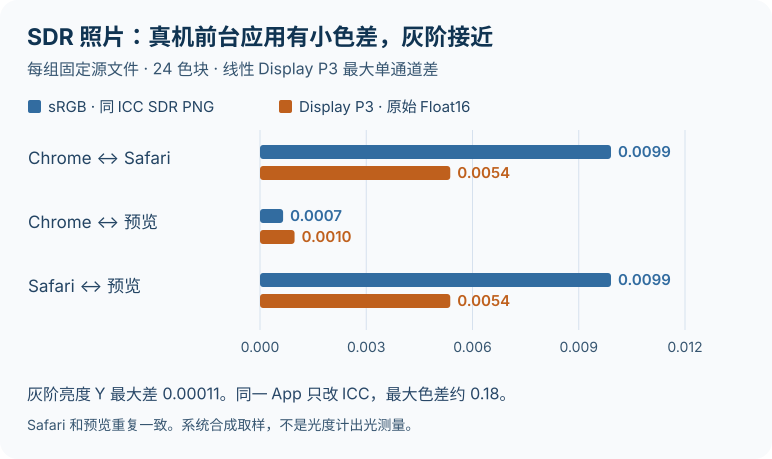
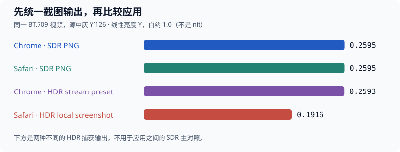
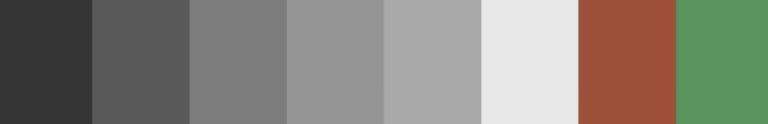

+++
date = '2026-11-24T21:10:00+08:00'
draft = false
title = '同一份素材在 Mac 上会不会显示不一样？四组 SDR／HDR 前台实测'
description = '同一台 Mac 和 HDR 显示器，前台取样 Chrome、Safari、QuickTime 和预览。分 SDR 照片、SDR 视频、HDR 照片、HDR 视频，单列 PQ、HLG 和增益图。'
summary = '播放兼容性不是显示一致性。相同文件送入实际应用并测前台合成像素，再用单变量对照和逆向工程追根因。'
categories = ['影像画质']
tags = ['SDR', 'HDR', 'macOS', '色彩管理', 'PQ', 'HLG', '增益图']
isCJKLanguage = true
contentLanguage = 'zh-CN'
+++

**同一文件换个 App，会看起来不一样吗？本轮实测发现，视频的差别比预想的小，最容易误判的反而是截图。** 同一个 Safari 中灰，SDR 输出读到 0.2595，HDR 截图输出读到 0.1916。不统一取样方式，足以凭空制造一个像模像样的播放器 gamma 差。

<!--more-->


| 素材 | 实际显示有没有差别 | 验证范围 |
| --- | --- | --- |
| SDR 照片 | 灰阶一致，Safari 个别色块存在小幅、稳定的差异 | Chrome / Safari / 预览 |
| SDR 视频 | 同口径取样接近，中灰最大差约 0.00004 | Chrome / Safari / QuickTime |
| HDR 照片 | PQ／HLG 有高光；旧增益图大色差本轮未复现 | 见第 3 节逐格式数据 |
| HDR 视频 | 同格式三端读数一致。PQ／HLG 有不到 1% 的峰值差 | Chrome / Safari / QuickTime |

**「照片」App 待测。** 本轮没有独立图库的前台数据，不用「预览」、QuickTime 或框架结果代测。

**测试条件**为 2026 年 11 月 26 日，同一台 Apple Silicon Mac、同一台 LG ULTRAGEAR+ 外接屏、macOS 27.2（26B123）开启 HDR，配 Chrome for Testing 158.0.8127.88、Safari 27.2、QuickTime Player 10.5 和「预览」11.0。浏览器用本机 HTTP 提供同一份文件，不加滤镜，HDR 元素的 CSS 动态范围设为 no-limit。用 ScreenCaptureKit 取实际前台窗口，不用无头截图代测。HDR 实测的即时 EDR 约 6.30×，潜在 12.61×。表里是系统合成像素，不是光度计测量的屏幕亮度。 [Chrome 桌面稳定公告](https://chromereleases.googleblog.com/2026/11/stable-channel-update-for-desktop_01734282054.html) · [Safari 27.2](https://webkit.org/blog/18515/webkit-features-for-safari-27-2/) · [Apple HDR 截图](https://developer.apple.com/videos/play/wwdc2024/10088/)

## 1. SDR 照片 · 灰阶一致，Safari 个别颜色可重复地偏一点

**有小色差，未见系统性明暗差。** 两份 PNG 只换 ICC，不改 RGB 字节。单份文件在 Chrome、Safari、「预览」各前台打开，抽取 24 格中心。普通灰阶在统一 SDR PNG 读数中完全一致。Safari 与「预览」重复两轮仍有小色差，最大是 sRGB 红块。**QuickTime 不适用。「照片」尚缺独立测试图库数据。**

<figure style="max-width:100%;margin:1.2rem 0;overflow-x:auto" role="region" tabindex="0" aria-label="前台 app 之间的线性 P3 通道最大差。Chrome 对预览接近零，Safari 对另两端的 sRGB 最大差约 0.0099，P3 约 0.0054。"></figure>


| 对照 | 画面证据 | 归因 |
| --- | --- | --- |
| 同一 sRGB PNG，Safari 对「预览」 | 红色 R 最大差 0.0099，暖灰 Y 最大差 0.0027。24 格通道差中位数为 0 | 两边各重复完全一致，Safari 的 EDR 从 1.20× 到 6.30× 仍复现。不是 EDR、随机截图波动或 Float16 单步舍入；未孤立到具体解码、颜色转换或合成步骤 |
| 同一 P3 PNG，Safari 对「预览」 | Float16 读数浅肤色 G 约 0.0054、Y 约 0.0034。中位数为 0 | 与统一 ICC 的 SDR PNG 中浅肤色差同方向；不过饱和绿青在诊断 PNG 中可能被改变，宽色域以 Float16 为准 |
| 不改像素，只把 sRGB ICC 改为 Display P3 | 三个应用各自最大差 0.176–0.182；灰阶完全不变 | **标签造成的差异。** 亮度控制相同，线性 RGB 基色矩阵不同。这是单变量对照，不是 Safari 小残差的起因 |


反汇编和可复现的 ICC 对照

「预览」11.0 的 PVImageElement 在本机 arm64e.x1 上，以 CIImage 读取 ImageIO 源索引、获取源 colorSpace。RGB 的色彩空间能作为输出且兼容 ICC 时被保留。然后图像被转为 CGImage，进入 CALayer。Chromium JPEG 路径会从 APP2 读 ICC、通过 Skia 创建颜色描述，Safari 相关 WebKit 解码器则调用 ImageIO。不同链路与测到的小残差一致，但本轮未动态追踪出第一处分叉。

离屏单变量只用于证明标签机制：Chrome 158 和系统 WKWebView 的固定 sRGB 输出中，去 ICC 与嵌 sRGB 全部一致；相同 RGB 改标 P3，深橙差达到 0.1189；先做正确换算再标为 P3，最大差为 0.0066。该实验并非 Safari.app 前台屏幕结果。规范要求有效嵌入标签按其颜色空间处理，网页无标签静态图默认 sRGB。[W3C CSS Color 4](https://www.w3.org/TR/css-color-4/#tagged-images) · [Chromium JPEG ICC 解析](https://chromium.googlesource.com/chromium/src/+/062a002cca0bbf39d296fa6b2d1e6840eb4611fb/third_party/blink/renderer/platform/image-decoders/jpeg/jpeg_image_decoder.cc) · [WebKit ImageDecoderCG](https://github.com/WebKit/WebKit/blob/main/Source/WebCore/platform/graphics/cg/ImageDecoderCG.cpp) · [Apple ColorSync](https://developer.apple.com/documentation/colorsync/color-profiles)

[SDR 照片色卡、原始读数与装机逆向锚点](sdr-photo-icc-evidence.zip)

## 2. SDR 视频 · 默认路径三端接近，切换 Chrome 解码路径才有明显中灰差

**前台同片结论：本次样片在 Chrome、Safari 和 QuickTime 的 SDR 合成读数非常接近。** Mac 上每个前台播放器打开同一份 BT.709 1-1-1、有限范围 H.264 MP4。ScreenCaptureKit 同时输出 SDR/HDR，我们只用 ICC 和 cICP 相同的 16-bit Display P3 SDR PNG 做这一章的跨 app 主对照。每格取中心 11×11 中位数。

<figure style="max-width:100%;margin:1.2rem 0;overflow-x:auto" role="region" tabindex="0" aria-label="三个前台播放器的 BT.709 灰阶曲线，共用同一 SDR 输出口"></figure>


| 应用 | 近暗灰 Y′64 | 中灰 Y′126 | 亮灰 Y′176 | 白 Y′235 | 32 格 max \|ΔRGB\| vs Chrome |
| --- | ---: | ---: | ---: | ---: | ---: |
| Chrome | .050975 | .259508 | .540182 | 1.000000 | — |
| Safari | .051058 | .259468 | .540897 | .998034 | .002220 |
| QuickTime | .051058 | .259468 | .540897 | .998034 | .002220 |
| 照片 | 未取样 | — | — | — | — |
| 预览.app | 不适用 | — | — | — | — |


Safari 与 QuickTime 的最大线性通道差只有 .000117。模型用黑白归一化灰阶拟合，三者约为 1.961、1.959、1.959。单位是线性 Display P3 Y，以 SDR 白约 1.0，不是显示器实测 nit。这样小的剩余差没有被进一步归因。

**为什么不写 Safari 更暗？** 同一次 Safari 窗口同时取得两份结果，同一中灰的 SDR PNG 为 .259468，HDR 表示为 .191621。QuickTime 重复同样的现象。Apple 区分输出：sdrImage 使用本机捕获显示器色彩空间，hdrImage 使用扩展 sRGB。把 Chrome 的 HDR stream fallback 和 Safari 的 HDR local screenshot 混比，差了 26%，但改用同类型 SDR 输出后只差 .000040。这是一个捕获口径造成的假 gap，不能归咎于播放应用。 [Apple SDR 输出](https://developer.apple.com/documentation/screencapturekit/scscreenshotoutput/sdrimage) · [Apple HDR 输出](https://developer.apple.com/documentation/screencapturekit/scscreenshotoutput/hdrimage)

展开同一窗口的 SDR／HDR 截图输出对照

<figure style="max-width:100%;margin:1.2rem 0;overflow-x:auto" role="region" tabindex="0" aria-label="同一窗口的两种截图输出比较"></figure>

**真正存在的条件差异是换 Chrome 的解码路径。** 独立的离屏 A/B 使用同一个文件，Chrome 默认经 VideoToolbox；禁用加速时媒体记录确认切到 FFmpeg。Y′126 在 sRGB8 截图从 139 变为 128，黑/白仍是 0/255。固定全部 YUV 码值、只把 transfer 改成 sRGB 时，默认路径的 32 个色块逐值复现了软件分支。对应版本 Chromium 将 CoreVideo 709 附件优先映射到 BT709_APPLE（约 1.961），普通 709 transfer 则走 sRGB。Safari WebCore 可创建 AVPlayerLayer，QuickTime 的实际 MGPlayerView 是 AVPlayerView 子类；这些静态锚点和实际曲线吻合，但不等于已追踪每个前台帧。 [Chromium 同版本 CoreVideo 映射](https://chromium.googlesource.com/chromium/src/+/refs/tags/158.0.8127.88/ui/gfx/mac/color_space_util.mm#99) · [Chromium 同版本 transfer 路径](https://chromium.googlesource.com/chromium/src/+/refs/tags/158.0.8127.88/ui/gfx/color_space.cc#990) · [WebKit AVFoundation 视频层](https://chromium.googlesource.com/external/github.com/WebKit/webkit/+/c9fafbca320e01bcba90a1914b2cea04afb92966/Source/WebCore/platform/graphics/avfoundation/objc/MediaPlayerPrivateAVFoundationObjC.mm) · [Apple BT.709 光度与显示模式](https://developer.apple.com/documentation/avfoundation/evaluating-an-app-s-video-color-using-light-measurement-instruments.md)

[SDR 视频前台证据](sdr-video-foreground-evidence.zip) · [Chrome 解码器单变量复验](sdr-video-lab.zip)

## 3. HDR 照片 · PQ、HLG 都保留高光，增益图大色差有复现条件

**测试素材**为同一组 BT.2020 色块分别正确编码成 PQ PNG 和 HLG PNG，另加上一会话的 Display P3 SDR 底图 + ISO RGB 增益图 JPEG。亮度用同图白块归一。QuickTime 不参加静态图比较。


| 应用 | 直接 PQ 峰／白 | 直接 HLG 峰／白 | 增益图峰／白 | 增益图红 G/R · 绿 R/G |
| --- | --- | --- | --- | --- |
| Chrome | 3.997× | 4.000× | 3.999× | 0.177 / 0.166 |
| Safari | 4.002× | 4.000× | 4.002× | 0.175 / 0.162 |
| 预览 | 3.973× | 4.000× | 3.996× | 0.176 / 0.166 |
| 照片 | 未完成取样 | 未完成取样 | 未完成取样 | — |

三款应用各测三份样片，九组峰值都接近片内参考白的 4×，没有一组回退到 SDR 白。直接 PQ 样片的三端差值也不到 0.03×，现有数据不足以把这点差异定位到某个函数。

### 为什么上一轮 Safari 的绿色偏淡？ {#safari-hdr-gain-map-gap}

<figure style="max-width:100%;margin:1.2rem 0;overflow-x:auto" role="region" tabindex="0" aria-label="同一增益图的绿色高光，在两轮前台测量和独立缓冲区重建中的 R/G"></figure>


| 对照 | 预览 绿块 R/G | Safari 绿块 R/G | Safari 红块 G/R | 结果 |
| --- | ---: | ---: | ---: | --- |
| 上一会话，macOS 原生 HDR HEIC 手动取样，原增益图 JPEG | 0.176 | 0.322 | 0.239 | 灰阶仍约 4×，但 Safari 绿块明显向中性偏 |
| 同一会话，Safari 同窗直接 P3 PQ PNG | — | 0.173 | 0.175 | 对照回到接近预览的比例 |
| 本轮，ScreenCaptureKit 单窗，原增益图 JPEG | 0.166 | 0.162 | 0.175 | 高光约 4×，**没有复现旧的大色差** |


看上一轮的真实 HDR 截图裁片

<figure id="safari-preview-captures">
  
  
  <figcaption><strong>图 1 · 同一个增益图 JPEG，两款应用各自在前台。</strong> 上排 Safari 27.2，下排「预览」11.0。重点看最右边两格。</figcaption>
</figure>

<figure id="safari-format-captures">
  
  
  <figcaption><strong>图 2 · 同一扇 Safari 窗口，同一次 HDR 截屏。</strong> 上排是增益图 JPEG，下排是用同一组色值制作的直编码 Display P3 PQ PNG。尺寸、背景和 CSS 一样。</figcaption>
</figure>

**这四条是较早一轮的前台 HDR HEIC 截图裁片。** 为了让普通 SDR 屏也能看见差异，四条图统一做 HDR 解码、在线性 Display P3 中使用相同倍率缩放，再导出为带 P3 色彩描述的 SDR PNG。所有裁片都只有合成色条，没有桌面和其他内容。前面的表格来自原始 HDR 截图，不从这里的 SDR 展示图反推。 [下载 16-bit PQ 裁片和取样说明](safari-hdr-capture-crops.zip)

### 旧色差的根因与补丁验证 {#hdr-root-cause}

对应 Safari 27.2 的 WebKit 源码和装机二进制都显示，加速重建把 P3 底图画进 BGRA，却没把源 CGColorSpace 附给缓冲区。装机 ImageIO 在不能推导颜色空间时回退到 sRGB。只改独立探针这一个附件，绿块 R/G 从正确的 0.167 变成 0.324，接近旧 Safari 截图的 0.322，灰阶峰值不变。**这是一条已验证会产生色差的路径，并不是 Safari 每次都会走的分支。** 两轮实验也用了不同截图方式，尚不能区分本轮没复现是因为实际绘制分支还是取样方式变化。 [WebKit GPU 增益图发布说明](https://webkit.org/blog/18325/webkit-features-for-safari-27-0/) · [底图缓冲区源码](https://github.com/WebKit/WebKit/blob/5e62f67e97ebccc9da92e1ab166cfe640767dea4/Source/WebCore/platform/graphics/cocoa/CVPixelBufferUtilities.cpp#L43-L114) · [原始取样、装机逆向锚点与单变量代码](safari-hdr-lab.zip)

另一次实验在对应发行标签上把这一行补丁编进 WebCore。测试程序分别加载系统版和补丁版 WebCore，调用实际的增益图重建函数，固定其余输入。结果验证的是**引擎重建输出**，不是补丁版 Safari 窗口的实测，也没有替换系统 Safari。 [WebKit 开发构建](https://webkit.org/running-webkit/)


| 引擎 | 最亮灰块 | 红块 G/R | 绿块 R/G |
| --- | ---: | ---: | ---: |
| 本机原版 WebCore | 3.9947 | 0.2378 | 0.3235 |
| 只补底图色彩空间的 WebCore | 3.9947 | 0.1756 | 0.1669 |


## 4. HDR 视频 · 同格式前台一致，PQ 与 HLG 的轻微差别来自格式和映射

**测试素材**为 HEVC Main10／hvc1 MP4，PQ HDR10 带静态元数据，HLG 使用 1000 nit、gamma 1.2 的参考条件编码同一组目标色块。两份的 10-bit 解码码值都和设计值吻合。结果除以片内按 203 nit 设计的参考白块，网页另有独立 CSS SDR 白。「预览」不参加影片比较。

<figure style="max-width:100%;margin:1.2rem 0;overflow-x:auto" role="region" tabindex="0" aria-label="同样片在 AVPlayer 离屏与应用前台的 PQ、HLG 亮度曲线"></figure>


| 格式 | 203 参考白 | 1000 灰块 | 峰／白 | 应用对照 |
| --- | --- | --- | --- | --- |
| PQ HDR10 | 1.017578 | 5.031250 | 4.944× | Chrome、Safari、QuickTime 的 16 格 RGB 取样一致 |
| HLG | 1.012695 | 4.984375 | 4.922× | Chrome、Safari、QuickTime 的 16 格 RGB 取样一致 |
| 照片 | — | — | — | 此轮尚未从独立图库取样 |

同一应用切换这两份分别编码的样片，部分彩色块有小幅变化。原始峰值差约 **0.94%**，各自除以片内白后约 **0.46%**。同格式跨三个应用的 16 色块没有测到差别。这个结论只覆盖本次同一台 Mac 和显示器、同一份本地文件。 [前台 16 色块数值](front-video-measurements.zip)

**为什么离屏 HLG 只有 3.77×，前台却是 4.92×？** AVPlayerItemVideoOutput 取的扩展线性浮点帧已经做了 HLG 逆 OETF，但还在场景线性域。用该帧与前台同一灰阶拟合，HLG 指数是 **1.201**、PQ 是 **1.001**。这符合 Apple 文档的阶段分工：HLG 的最终显示还要应用 OOTF，而 PQ 的显示域关系基本保留。该实验解释了为什么离屏不能代替屏幕合成，不能证明各应用的私有调用栈相同。PQ 对 HLG 的细小剩余差也不能全归给 10-bit 量化或 AMVE。 [ITU-R BT.2100](https://www.itu.int/rec/R-REC-BT.2100-3-202502-I/en) · [Apple HLG OOTF 说明](https://developer.apple.com/documentation/quartzcore/caedrmetadata/hlg) · [HDR 视频实验素材和探针](hdr-video-lab.zip)

---

遇到自己的素材有差异，先查哪一层？

同一条显示路径依次涉及 **交付 → 解码 → 信号解释或增益图重建 → 应用合成 → 屏幕出光**。打不开先查交付和解码。能播但没有高光，查合成余量和屏幕模式。灰阶相近但彩色高光不对，先查输入色彩标记和中间缓冲区。截图方式前后不一致时，先校验取样。

PQ 把码值对应到绝对亮度，HLG 的显示映射还依赖目标屏幕和系统 gamma。带 SDR 基图的增益图文件则是另一路径，能解码 JPEG 并不等于已应用增益图。格式和播放基线的详细结果不计入本篇前台对照。 [ITU-R BT.2100](https://www.itu.int/rec/R-REC-BT.2100-3-202502-I/en) · [Apple Adaptive HDR](https://developer.apple.com/videos/play/wwdc2024/10177/)

如何复验这些结果

- 在同一屏幕和显示模式，逐个应用切到前台。SDR 使用相同类型的 SDR 截图，核对 ICC；HDR 取扩展线性 Display P3，在同一次截图里同时采白与高光。没有光度计的读数不要写成屏幕实测 nit。
- 同一文件以 SHA-256 识别。视频用每一帧色块相同的合成片，实际播放状态另记。色块中心 11×11 取中位数，避免文字、缩放边缘、控件和色块交界污染。
- 这里只覆盖同机同屏、无 DRM 的本地交付。网站转码、HLS 选轨、Dolby Vision、HDR10+、不同 GPU 合成分支都可能改变结果。用「照片」时还要分开单张查看、实际播放与网格缩略图。

[本轮前台量化复验包](display-window-lab.zip) · [早期格式兼容性基线](mac-media-gap-lab.zip)

