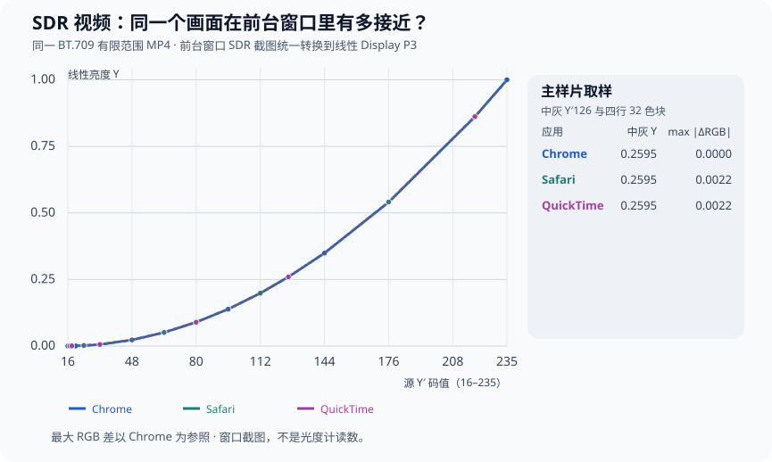
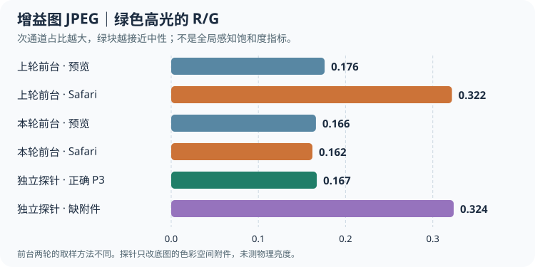
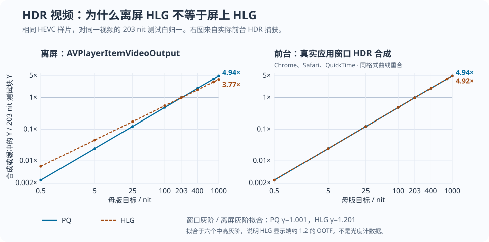

+++
date = '2026-11-24T21:10:00+08:00'
lastmod = '2026-11-26T05:39:00+08:00'
draft = false
title = '同一份素材在 Mac 上会不会显示不一样？四组 SDR／HDR 前台实测'
description = '同一台 Mac 和 HDR 显示器，前台取样 Chrome、Safari、QuickTime 和预览。分 SDR 照片、SDR 视频、HDR 照片、HDR 视频，单列 PQ、HLG 和增益图。'
summary = '换个 App，画面到底会不会变？先看普通照片、普通视频、HDR 照片、HDR 视频和五款 Mac 应用的实测组合矩阵。'
categories = ['影像画质']
tags = ['SDR', 'HDR', 'macOS', '色彩管理', 'PQ', 'HLG', '增益图']
isCJKLanguage = true
contentLanguage = 'zh-CN'
+++

同一台 Mac、同一块屏幕，**同一份照片或视频换个 App 打开，画面会不会变？** 直接查下表。

<!--more-->


| 素材组合 | Chrome | Safari | QuickTime | 「预览」 | 「照片」 |
| --- | --- | --- | --- | --- | --- |
| **普通照片（SDR）** · sRGB | 对照 | 灰阶相同，红等 4 格相差 1 档 | 不适用 | 接近 Chrome | 待测 |
| **普通照片（SDR）** · Display P3 | 对照 | 灰阶相同，浅肤色等 3 格相差 1 档 | 不适用 | 接近 Chrome | 待测 |
| **普通视频（SDR）** · BT.709 | 对照 | 明暗接近 | 明暗接近 | 不适用 | 待测 |
| **HDR 照片** · PQ | 高光约 4× | 高光约 4× | 不适用 | 高光约 4× | 待测 |
| **HDR 照片** · HLG | 高光约 4× | 高光约 4× | 不适用 | 高光约 4× | 待测 |
| **HDR 照片** · 增益图 JPEG | 高光约 4×，颜色接近「预览」 | 高光约 4×。较早一轮亮绿变淡，本轮未复现 | 不适用 | 高光约 4× | 待测 |
| **HDR 视频** · PQ HDR10 | 对照 | 16 色块一致 | 16 色块一致 | 不适用 | 待测 |
| **HDR 视频** · HLG | 对照 | 16 色块一致 | 16 色块一致 | 不适用 | 待测 |


**怎么读。** 横向看同一个文件在不同 App 中的结果，「对照」表示拿 Chrome 的画面作比较。纵向看不同素材，别把换文件造成的差别算到 App 头上。「约 4×」指取样中最亮的灰块是**这张测试图里的白块**的约 4 倍，不是屏幕标称亮度。「待测」不是不支持，「不适用」表示这轮不用 QuickTime 看照片、不用「预览」看视频。

如果只记一句话：**本轮普通视频和 HDR 视频换播放器，没测到明显的画面变化。照片的主要例外不一定是亮度，而可能是颜色。** 较早一轮，同一个 HDR JPEG 在 Safari 里的高光仍然亮，绿色却比「预览」淡。下面会说明为什么这两件事可以同时发生。

查看测试设备、版本和截图方式

2026 年 11 月 26 日，同一台 Apple Silicon Mac、同一台 LG ULTRAGEAR+ 外接屏、macOS 27.2（26B123）开启 HDR。实际测试 Chrome for Testing 158.0.8127.88、Safari 27.2、QuickTime Player 10.5 和「预览」11.0。浏览器用本机 HTTP 提供同一份文件，不加滤镜，HDR 元素的 CSS 动态范围设为 no-limit。用 ScreenCaptureKit 取实际前台窗口，不用无头截图代测。HDR 实测的即时 EDR 约 6.30×，潜在 12.61×。表里是系统合成像素，不是光度计测量的屏幕亮度。「照片」App 本轮没有前台数据。 [Chrome 桌面稳定公告](https://chromereleases.googleblog.com/2026/11/stable-channel-update-for-desktop_01734282054.html) · [Safari 27.2](https://webkit.org/blog/18515/webkit-features-for-safari-27-2/) · [Apple HDR 截图](https://developer.apple.com/videos/play/wwdc2024/10088/)

## 1. SDR 照片｜黑白灰一样，个别颜色略有差别 {#1-sdr-照片--灰阶一致safari-个别颜色可重复地偏一点}

**换 App 会怎样？** 这次同一张普通照片，Chrome 和「预览」的读数几乎一样。Safari 没让照片整体变暗，黑、白和中性灰也一样，差别集中在个别颜色。比如同一张 sRGB 色卡的红块，两轮对比都量到了小差别。

**为什么 Safari 不完全一样？** 不是 PNG 解错了，也不是 Safari 忽略了 ICC。逆向定位到**图片画进浏览器图层时的颜色转换**。浏览器得先把照片的 RGB 换算成这台显示器的 RGB，写进每个通道只有 256 档的图层。几格颜色落在相邻两档，Safari 走到其中一档，Chrome 和「预览」的前台结果对应另一档。用同一台显示器的色彩转换重放，仅改这一档，就能重现大部分原始差异。

两份合成 PNG 只换颜色标签（ICC），不改像素数字。每个 App 分别打开同一份文件，取 24 格中心。表中 1 档是**显示器设备 RGB 的一个码值**，不是说原图像素变了，也不是截屏文件少了一个 16 位码值。

<figure style="max-width:100%;margin:1.2rem 0;overflow-x:auto" role="region" tabindex="0" aria-label="前台 app 之间的线性 P3 通道最大差。Chrome 对预览接近零，Safari 对另两端的 sRGB 最大差约 0.0099，P3 约 0.0054。"></figure>


| 阶段 | 怎么验证 | 结果 |
| --- | --- | --- |
| PNG 解码 | 原尺寸 ImageIO、按 WebKit 参数解码、同尺寸缩略图入口 | 两张色卡各 24 格 RGB 和 ICC 全同 |
| 写到浏览器图层 | 独立 WKWebView 读取自己的 `CAIOSurface` | 图层是 8 位 BGRA，使用本机显示器 ICC。普通网页、单独合成图层、改变显示尺寸三种走法，24 格读数一致 |
| 前台输出 | 把 Safari、Chrome、「预览」的 HDR 浮点截图反算回同一设备 RGB | 两张卡各 24 格，Safari 全部与实取 WebKit 图层一致。sRGB 有 4 格、P3 有 3 格与另两端差 1 档。不饱和的中性灰阶一致 |
| 反事实复验 | 固定显示器 ICC 和转换代码，只改表中的 1 个码值 | 复现偏差位置、方向和主要量级。P3 浅肤色几乎逐值复现，sRGB 纯红仍有少量幅度残差 |



| 样片色块 | WKWebView 实取 = Safari 前台反算 | Chrome =「预览」前台反算 | 哪一档不一样 |
| --- | --- | --- | --- |
| sRGB 中性灰 | 128, 128, 128 | 128, 128, 128 | 无 |
| sRGB 纯红 | 207, 74, 34 | 208, 74, 34 | 红 207 ↔ 208 |
| sRGB 深橙 | 198, 124, 56 | 199, 124, 56 | 红 198 ↔ 199 |
| Display P3 浅肤色 | 209, 170, 138 | 209, 171, 138 | 绿 170 ↔ 171 |


查看反汇编、代码定位和归因边界

WebKit 的 `ImageDecoderCG::createFrameImageAtIndex` 调 ImageIO。装机 WebCore 的 `GraphicsContextCG::drawNativeImage`（arm64e.x1 未滑移地址 `0x1BB56373C`）在 `0x1BB5639F8` 调 `CGContextDrawImage`。远程图层的 backing store 把常规 RGBA8 映射为 BGRA8／BGRX8，把目的 ICC 交给 `CGIOSurfaceContextCreate`。探针通过 `CAIOSurfaceGetIOSurface` 读出颜色空间，再把图层读回为像素值。图层 ICC 和这块 LG 屏当前 ICC 的 SHA-256 完全相同，不能把它当成截图文件附带的标准 Display P3 ICC。 [对应版本 WebKit 绘制代码](https://github.com/WebKit/WebKit/blob/5e62f67e97ebccc9da92e1ab166cfe640767dea4/Source/WebCore/platform/graphics/cg/GraphicsContextCG.cpp#L283) · [图层像素格式](https://github.com/WebKit/WebKit/blob/5e62f67e97ebccc9da92e1ab166cfe640767dea4/Source/WebKit/Shared/RemoteLayerTree/RemoteLayerBackingStore.mm#L271) · [IOSurface 色彩空间与绘制](https://github.com/WebKit/WebKit/blob/5e62f67e97ebccc9da92e1ab166cfe640767dea4/Source/WebCore/platform/graphics/cocoa/IOSurface.mm#L690)

「预览」装机二进制的 `PVImageElement._sourceImage` 将 ImageIO 源交给 CIImage 并读取 ICC，`_createLayerForView` 得到 CGImage 后将它交给 CALayer。用同源 ICC 重放 Core Image 输出，没有得到 Safari 的提前落码模式。固定 8 位位深和 ICC，仅比较普通位图、不压缩 IOSurface、无损压缩 IOSurface，后两者在本对照的色块中心一致。因此不能把观察到的一档差说成图层压缩掉色。这里定位到的是**分叉的位置和一档差足以造成什么**，尚未定位到 Apple 私有色彩转换里的某条取整指令。Chrome 和「预览」一栏是从窗口反算，不是读取它们的私有图层。 [Apple ColorSync](https://developer.apple.com/documentation/colorsync) · [Apple Core Image 工作色彩空间](https://developer.apple.com/documentation/coreimage/cicontextoption/workingcolorspace)

在统一线性 Display P3 下，P3 浅肤色 G 的前台差为 −0.005372，正向重放为 −0.005371。sRGB 纯红 R 的前台 HDR 浮点差为 −0.010254，重放为 −0.008301。sRGB 另用同 ICC 的 SDR PNG 复核，纯红 R 差约 −0.0099，同样反算到 207 对 208。改变 EDR 没改变这些色块的重复结果。宽色域的诊断 PNG 在极饱和色有额外转换，P3 结论用 HDR 浮点数据。

另一个容易混淆的实验是只换 ICC 不换像素数字。那会让三个 App 的彩色格最大差达到 0.176–0.182，而且灰阶不变。它证明**色彩标签本身**能造成更大的颜色变化，但不是 Safari 的小差异。 [W3C CSS Color 4 的图像标签规则](https://www.w3.org/TR/css-color-4/#tagged-images)

[SDR 照片色卡与前台证据](sdr-photo-icc-evidence.zip) · [WebKit 图层读数、反算、单档复验代码](sdr-photo-render-trace.zip)

## 2. SDR 视频｜同一段普通视频，三个播放器的明暗很接近 {#2-sdr-视频--默认路径三端接近切换-chrome-解码路径才有明显中灰差}

**换 App 会怎样？** 这次把同一段普通视频从 Chrome 换到 Safari 或 QuickTime，量出来的黑、白和中间明暗都很接近。就这份文件而言，不用为了让画面更亮而换播放器。

最容易误判的是截屏。**同一个 Safari 窗口没变，截成普通图和 HDR 图，却能读到不同的灰度。** 所以看到两张截图一深一浅，先确认截图方式一样，别先认定播放画面变了。

三端打开同一份 BT.709 1-1-1、有限范围 H.264 MP4。跨应用对照统一使用 ScreenCaptureKit 的 16-bit Display P3 SDR PNG，ICC 和 cICP 相同。每格取中心 11×11 中位数。

<figure style="max-width:100%;margin:1.2rem 0;overflow-x:auto" role="region" tabindex="0" aria-label="三个前台播放器的 BT.709 灰阶曲线，共用同一 SDR 输出口"></figure>


| 应用 | 近暗灰 Y′64 | 中灰 Y′126 | 亮灰 Y′176 | 白 Y′235 | 32 格 max \|ΔRGB\| vs Chrome |
| --- | ---: | ---: | ---: | ---: | ---: |
| Chrome | .050975 | .259508 | .540182 | 1.000000 | — |
| Safari | .051058 | .259468 | .540897 | .998034 | .002220 |
| QuickTime | .051058 | .259468 | .540897 | .998034 | .002220 |
| 照片 | 未取样 | — | — | — | — |
| 预览.app | 不适用 | — | — | — | — |


Safari 与 QuickTime 的最大线性通道差只有 .000117。模型用黑白归一化灰阶拟合，三者约为 1.961、1.959、1.959。单位是线性 Display P3 Y，以 SDR 白约 1.0，不是显示器实测 nit。这样小的剩余差没有被进一步归因。

**为什么不写 Safari 更暗？** 同一次 Safari 窗口同时取得两份结果，同一中灰的 SDR PNG 为 .259468，HDR 表示为 .191621。QuickTime 重复同样的现象。Apple 区分输出：sdrImage 使用本机捕获显示器色彩空间，hdrImage 使用扩展 sRGB。把 Chrome 的 HDR stream fallback 和 Safari 的 HDR local screenshot 混比，差了 26%，但改用同类型 SDR 输出后只差 .000040。这是一个捕获口径造成的假 gap，不能归咎于播放应用。 [Apple SDR 输出](https://developer.apple.com/documentation/screencapturekit/scscreenshotoutput/sdrimage) · [Apple HDR 输出](https://developer.apple.com/documentation/screencapturekit/scscreenshotoutput/hdrimage)

展开同一窗口的 SDR／HDR 截图输出对照

<figure style="max-width:100%;margin:1.2rem 0;overflow-x:auto" role="region" tabindex="0" aria-label="同一窗口的两种截图输出比较"></figure>

**另一个问题是主动关闭 Chrome 的硬件解码。** 那次测到中等灰色变暗，但这和默认设置下换播放器不是一回事。 独立的离屏 A/B 使用同一个文件，Chrome 默认经 VideoToolbox；禁用加速时媒体记录确认切到 FFmpeg。Y′126 在 sRGB8 截图从 139 变为 128，黑/白仍是 0/255。固定全部 YUV 码值、只把 transfer 改成 sRGB 时，默认路径的 32 个色块逐值复现了软件分支。对应版本 Chromium 将 CoreVideo 709 附件优先映射到 BT709_APPLE（约 1.961），普通 709 transfer 则走 sRGB。Safari WebCore 可创建 AVPlayerLayer，QuickTime 的实际 MGPlayerView 是 AVPlayerView 子类；这些静态锚点和实际曲线吻合，但不等于已追踪每个前台帧。 [Chromium 同版本 CoreVideo 映射](https://chromium.googlesource.com/chromium/src/+/refs/tags/158.0.8127.88/ui/gfx/mac/color_space_util.mm#99) · [Chromium 同版本 transfer 路径](https://chromium.googlesource.com/chromium/src/+/refs/tags/158.0.8127.88/ui/gfx/color_space.cc#990) · [WebKit AVFoundation 视频层](https://chromium.googlesource.com/external/github.com/WebKit/webkit/+/c9fafbca320e01bcba90a1914b2cea04afb92966/Source/WebCore/platform/graphics/avfoundation/objc/MediaPlayerPrivateAVFoundationObjC.mm) · [Apple BT.709 光度与显示模式](https://developer.apple.com/documentation/avfoundation/evaluating-an-app-s-video-color-using-light-measurement-instruments.md)

[SDR 视频前台证据](sdr-video-foreground-evidence.zip) · [Chrome 解码器单变量复验](sdr-video-lab.zip)

## 3. HDR 照片｜高光都亮，不代表颜色一定相同 {#3-hdr-照片--pqhlg-都保留高光增益图大色差有复现条件}

**换 App 会怎样？** 这次用 Chrome、Safari 和「预览」打开三种 HDR 照片，最亮处都明显亮过图里的普通白块。没有哪个 App 把这三份照片当普通照片显示。较早一轮的增益图 JPEG 有个例外：Safari 没把高光压暗，却把同一块亮绿色画淡了。**判断 HDR 照片要分开看：亮不亮，颜色对不对。**

PQ 和 HLG 是两种写入 HDR 亮度的方式。增益图 JPEG 则像一张普通照片附了一张「哪里还可以提亮」的小图。只认主图的 App 也能打开文件，但不一定显示了 HDR。

测试用同一组 BT.2020 色块分别生成 PQ PNG 和 HLG PNG，另用一份 Display P3 普通底图加 ISO RGB 增益图的 JPEG。


| 应用 | 直接 PQ 峰／白 | 直接 HLG 峰／白 | 增益图峰／白 | 增益图红 G/R · 绿 R/G |
| --- | --- | --- | --- | --- |
| Chrome | 3.997× | 4.000× | 3.999× | 0.177 / 0.166 |
| Safari | 4.002× | 4.000× | 4.002× | 0.175 / 0.162 |
| 预览 | 3.973× | 4.000× | 3.996× | 0.176 / 0.166 |
| 照片 | 未完成取样 | 未完成取样 | 未完成取样 | — |

三款应用各测三份样片，九组峰值都接近片内参考白的 4×，没有一组回退到 SDR 白。直接 PQ 样片的三端差值也不到 0.03×，现有数据不足以把这点差异定位到某个函数。

### 为什么上一轮 Safari 的绿色偏淡？ {#safari-hdr-gain-map-gap}

先看最右边的红绿两格。上面是 Safari，下面是「预览」。这是较早一轮打开**同一个**增益图 JPEG 的截图裁片。亮度没有整体掉下来，但上面的绿色更淡。本轮没有再测到这样大的色差。

<figure id="safari-preview-captures">
  
  
  <figcaption><strong>图 1 · 同一个增益图 JPEG，两款应用各自在前台。</strong> 上排 Safari 27.2，下排「预览」11.0。重点看最右边两格。</figcaption>
</figure>

两条裁片用了同一种方法转成普通网页能显示的图片，方便比较颜色，不能拿它们测屏幕亮度。

<figure style="max-width:100%;margin:1.2rem 0;overflow-x:auto" role="region" tabindex="0" aria-label="同一增益图的绿色高光，在两轮前台测量和独立缓冲区重建中的 R/G"></figure>


| 对照 | 预览 绿块 R/G | Safari 绿块 R/G | Safari 红块 G/R | 结果 |
| --- | ---: | ---: | ---: | --- |
| 上一会话，macOS 原生 HDR HEIC 手动取样，原增益图 JPEG | 0.176 | 0.322 | 0.239 | 灰阶仍约 4×，但 Safari 绿块明显向中性偏 |
| 同一会话，Safari 同窗直接 P3 PQ PNG | — | 0.173 | 0.175 | 对照回到接近预览的比例 |
| 本轮，ScreenCaptureKit 单窗，原增益图 JPEG | 0.166 | 0.162 | 0.175 | 高光约 4×，**没有复现旧的大色差** |


再看同一个 Safari 窗口换文件时的截图

<figure id="safari-format-captures">
  
  
  <figcaption><strong>图 2 · 同一扇 Safari 窗口，同一次 HDR 截屏。</strong> 上排是增益图 JPEG，下排是用同一组色值制作的直编码 Display P3 PQ PNG。尺寸、背景和 CSS 一样。</figcaption>
</figure>

**本节两组共四条裁片来自较早一轮的前台 HDR 截图。** 为了让普通 SDR 屏也能看见差异，四条图统一做 HDR 解码、在线性 Display P3 中使用相同倍率缩放，再导出为带 P3 色彩描述的 SDR PNG。所有裁片都只有合成色条，没有桌面和其他内容。前面的表格来自原始 HDR 截图，不从这里的 SDR 展示图反推。 [下载 16-bit PQ 裁片和取样说明](safari-hdr-capture-crops.zip)

### 旧色差的根因与补丁验证 {#hdr-root-cause}

那一次，Safari 的一条处理路径在交接照片时丢了颜色标签。**数字没变，但下游用另一张色卡读这些数字。** 于是白色和灰色还对，鲜绿色却被读成了更淡的绿。把标签补回去，颜色恢复，高光亮度没有变。

对应 Safari 27.2 的 WebKit 源码和装机二进制都显示，加速重建把 P3 底图画进 BGRA，却没把源 CGColorSpace 附给缓冲区。装机 ImageIO 在不能推导颜色空间时回退到 sRGB。只改独立探针这一个附件，绿块 R/G 从正确的 0.167 变成 0.324，接近旧 Safari 截图的 0.322，灰阶峰值不变。**这是一条已验证会产生色差的路径，并不是 Safari 每次都会走的分支。** 两轮实验也用了不同截图方式，尚不能区分本轮没复现是因为实际绘制分支还是取样方式变化。 [WebKit GPU 增益图发布说明](https://webkit.org/blog/18325/webkit-features-for-safari-27-0/) · [底图缓冲区源码](https://github.com/WebKit/WebKit/blob/5e62f67e97ebccc9da92e1ab166cfe640767dea4/Source/WebCore/platform/graphics/cocoa/CVPixelBufferUtilities.cpp#L43-L114) · [原始取样、装机逆向锚点与单变量代码](safari-hdr-lab.zip)

另一次实验在对应发行标签上把这一行补丁编进 WebCore。测试程序分别加载系统版和补丁版 WebCore，调用实际的增益图重建函数，固定其余输入。结果验证的是**引擎重建输出**，不是补丁版 Safari 窗口的实测，也没有替换系统 Safari。 [WebKit 开发构建](https://webkit.org/running-webkit/)


| 引擎 | 最亮灰块 | 红块 G/R | 绿块 R/G |
| --- | ---: | ---: | ---: |
| 本机原版 WebCore | 3.9947 | 0.2378 | 0.3235 |
| 只补底图色彩空间的 WebCore | 3.9947 | 0.1756 | 0.1669 |


## 4. HDR 视频｜换播放器没测到差别，换 PQ／HLG 才有一点差 {#4-hdr-视频--同格式前台一致pq-与-hlg-的轻微差别来自格式和映射}

**换 App 会怎样？** 同一段 PQ 视频在 Chrome、Safari、QuickTime 里，测的 16 个色块一样。换成 HLG 再让三个 App 播一次，结果还是一样。**这次少量差别出在换了视频文件，不是换了播放器。** 两份视频各自和自己的白块比，最高光相差约 0.46%，这个数字不代表肉眼能不能看出来。

容易误会的是，应用先读出一帧 HLG 视频，Mac 还要根据屏幕决定这帧里的亮处该亮到什么程度。只量第一步，就会低估窗口里能看到的高光。下图把显示前和实际窗口的两组读数分开画。

测试用 HEVC Main10／hvc1 MP4。PQ HDR10 带静态元数据，HLG 按 1000 nit、gamma 1.2 的参考条件编码同一组目标色块。两份的 10-bit 解码码值都和设计值吻合。结果除以片内按 203 nit 设计的参考白块，网页另有独立 CSS SDR 白。

<figure style="max-width:100%;margin:1.2rem 0;overflow-x:auto" role="region" tabindex="0" aria-label="同样片在 AVPlayer 离屏与应用前台的 PQ、HLG 亮度曲线"></figure>


| 格式 | 203 参考白 | 1000 灰块 | 峰／白 | 应用对照 |
| --- | --- | --- | --- | --- |
| PQ HDR10 | 1.017578 | 5.031250 | 4.944× | Chrome、Safari、QuickTime 的 16 格 RGB 取样一致 |
| HLG | 1.012695 | 4.984375 | 4.922× | Chrome、Safari、QuickTime 的 16 格 RGB 取样一致 |
| 照片 | — | — | — | 此轮尚未从独立图库取样 |

同一应用切换这两份分别编码的样片，部分彩色块有小幅变化。原始峰值差约 **0.94%**，各自除以片内白后约 **0.46%**。同格式跨三个应用的 16 色块没有测到差别。这个结论只覆盖本次同一台 Mac 和显示器、同一份本地文件。 [前台 16 色块数值](front-video-measurements.zip)

**为什么离屏 HLG 只有 3.77×，前台却是 4.92×？** AVPlayerItemVideoOutput 取的扩展线性浮点帧已经做了 HLG 逆 OETF，但还在场景线性域。用该帧与前台同一灰阶拟合，HLG 指数是 **1.201**、PQ 是 **1.001**。这符合 Apple 文档的阶段分工：HLG 的最终显示还要应用 OOTF，而 PQ 的显示域关系基本保留。该实验解释了为什么离屏不能代替屏幕合成，不能证明各应用的私有调用栈相同。PQ 对 HLG 的细小剩余差也不能全归给 10-bit 量化或 AMVE。 [ITU-R BT.2100](https://www.itu.int/rec/R-REC-BT.2100-3-202502-I/en) · [Apple HLG OOTF 说明](https://developer.apple.com/documentation/quartzcore/caedrmetadata/hlg) · [HDR 视频实验素材和探针](hdr-video-lab.zip)

**自己碰到画面不一样，先做两件事。** 先确认网页和播放器打开的是同一个文件，而不是网页换了片源或改过照片。再分清是「亮处不够亮」，还是「亮度够，颜色却发白」。对照截图时也用同一种截屏方式。

---

遇到自己的素材有差异，先查哪一层？

同一条显示路径依次涉及 **交付 → 解码 → 信号解释或增益图重建 → 应用合成 → 屏幕出光**。打不开先查交付和解码。能播但没有高光，查合成余量和屏幕模式。灰阶相近但彩色高光不对，先查输入色彩标记和中间缓冲区。截图方式前后不一致时，先校验取样。

PQ 把码值对应到绝对亮度，HLG 的显示映射还依赖目标屏幕和系统 gamma。带 SDR 基图的增益图文件则是另一路径，能解码 JPEG 并不等于已应用增益图。格式和播放基线的详细结果不计入本篇前台对照。 [ITU-R BT.2100](https://www.itu.int/rec/R-REC-BT.2100-3-202502-I/en) · [Apple Adaptive HDR](https://developer.apple.com/videos/play/wwdc2024/10177/)

如何复验这些结果

- 在同一屏幕和显示模式，逐个应用切到前台。SDR 使用相同类型的 SDR 截图，核对 ICC；HDR 取扩展线性 Display P3，在同一次截图里同时采白与高光。没有光度计的读数不要写成屏幕实测 nit。
- 同一文件以 SHA-256 识别。视频用每一帧色块相同的合成片，实际播放状态另记。色块中心 11×11 取中位数，避免文字、缩放边缘、控件和色块交界污染。
- 这里只覆盖同机同屏、无 DRM 的本地交付。网站转码、HLS 选轨、Dolby Vision、HDR10+、不同 GPU 合成分支都可能改变结果。用「照片」时还要分开单张查看、实际播放与网格缩略图。

[本轮前台量化复验包](display-window-lab.zip) · [早期格式兼容性基线](mac-media-gap-lab.zip)

