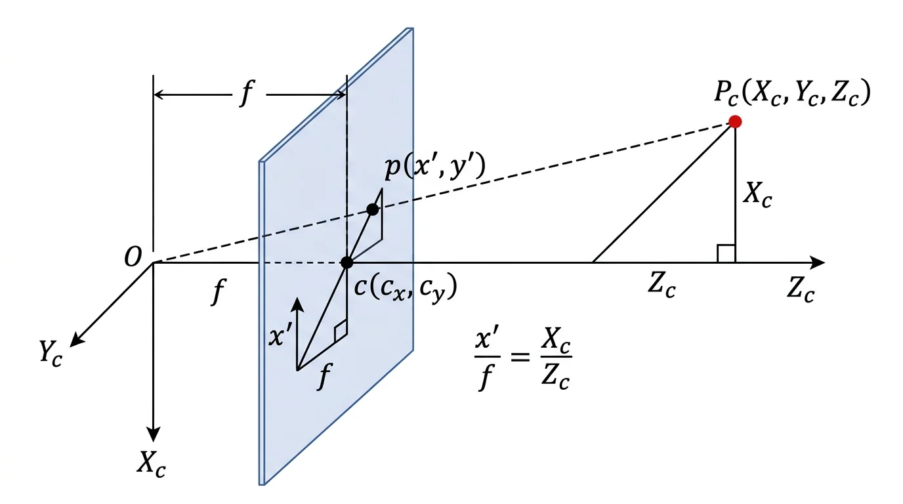

+++
date = '2022-10-01T13:00:00+08:00'
draft = false
title = '相机投影模型：从针孔到像素'
categories = ['Calibration']
tags = ['Calibration', '相机投影模型']
featured = false
math = true
+++

## 概述

相机投影模型回答的是一个最基本的问题：**一个三维空间中的点，如何变成图像上的一个像素？**

整个推导分四步：**针孔几何 → 归一化坐标 → 像素坐标 → 引入外参**。前三步在相机坐标系内完成，第四步把世界坐标系接进来。

## Step 1：针孔模型——相机坐标系下的透视投影

假设相机坐标系的原点在光心 \$O\$，\$Z_c\$ 轴指向相机前方（光轴方向），成像平面位于光心前方距离 \$f\$（焦距）处。

一个点 \$\mathbf{P}_c = (X_c, Y_c, Z_c)^T\$ 在**相机坐标系**下，它和光心的连线会穿过成像平面。根据相似三角形：

$$
\frac{x'}{f} = \frac{X_c}{Z_c}, \quad \frac{y'}{f} = \frac{Y_c}{Z_c}
$$

解出成像平面上的交点坐标：

$$
x' = f \frac{X_c}{Z_c}, \quad y' = f \frac{Y_c}{Z_c}
$$

这就是针孔模型最本质的一步：**除以深度 \$Z_c\$**，把三维变成二维。

注意，到这里为止我们得到的 \$(x^\prime, y^\prime)\$ 是 **成像平面上的物理坐标**（单位和焦距一致，通常是 mm），描述的是相机坐标系中的 3D 点与成像平面上的 2D 点之间的几何关系。它还不是像素坐标 \$(u, v)\$。

## Step 2：归一化坐标

工程上常做一个简化：把焦距剥离出去，定义 **归一化图像坐标**（normalized image coordinates）：

$$
x = \frac{X_c}{Z_c}, \quad y = \frac{Y_c}{Z_c}
$$

和 Step 1 的关系是 \$x^\prime = f \cdot x\$，\$y^\prime = f \cdot y\$。归一化坐标相当于把成像平面"推"到 \$Z_c = 1\$ 处（等价于令 \$f = 1\$），得到的是一个与**焦距无关的纯几何量**。

## Step 3：从成像平面到像素平面

成像平面的物理坐标（mm）和传感器输出的像素坐标 \$(u, v)\$ 之间，还需要处理两件事：

1. **单位转换（mm → pixel）**：设传感器在水平和垂直方向的像素密度分别是 \$m_x, m_y\$（pixel/mm），那么像素单位的焦距是：

$$
f_x = f \cdot m_x, \quad f_y = f \cdot m_y
$$

\$f_x \neq f_y\$ 意味着像素不是正方形（现代传感器几乎都是正方形，但模型保留了这个自由度）。

2. **主点偏移**：像素坐标的原点在图像左上角，而光轴穿过成像平面的点（主点）通常不在角上。设主点的像素坐标为 \$(c_x, c_y)\$。

综合这两步，归一化坐标 \$(x, y)\$ 到像素坐标 \$(u, v)\$ 的关系是：

$$
u = f_x \cdot x + c_x = f_x \frac{X_c}{Z_c} + c_x
$$

$$
v = f_y \cdot y + c_y = f_y \frac{Y_c}{Z_c} + c_y
$$

写成矩阵形式（齐次坐标）：

$$
Z_c \begin{pmatrix} u \\\\ v \\\\ 1 \end{pmatrix}
= \overbrace{\begin{pmatrix} f_x & 0 & c_x \\\\ 0 & f_y & c_y \\\\ 0 & 0 & 1 \end{pmatrix}}^{K}
\begin{pmatrix} X_c \\\\ Y_c \\\\ Z_c \end{pmatrix}
$$

这就是 **内参矩阵 \$K\$** 的来源——它完整编码了"相机坐标系 3D 点 → 像素"的映射，本质上是把 Step 1 的针孔投影和 Step 3 的单位转换、主点偏移打包在一起。左边的 \$Z_c\$ 就是齐次因子 \$s\$（也就是深度）。

## Step 4：引入外参——从世界坐标系到相机坐标系

到目前为止，推导都在**相机坐标系**内完成。但我们拿到的 3D 点通常在世界坐标系下，需要先做一次刚体变换：

$$
\mathbf{P}_c = R \mathbf{P}_w + t
$$

其中 \$R \in SO(3)\$ 是 3×3 旋转矩阵，\$t \in \mathbb{R}^3\$ 是平移向量。它们合在一起就是外参，描述了世界坐标系在相机坐标系下的位姿。

## 完整投影方程

把 Step 3 和 Step 4 串起来：

$$
Z_c \begin{pmatrix} u \\\\ v \\\\ 1 \end{pmatrix}
= K \begin{pmatrix} R & t \end{pmatrix} \begin{pmatrix} X_w \\\\ Y_w \\\\ Z_w \\\\ 1 \end{pmatrix}
$$

其中 \$Z_c\$ 是该点经外参变换后在相机坐标系下的深度，和 Step 3 中的 \$Z_c\$ 一致。展开来看：一个世界点先被外参 \$(R, t)\$ 变换到相机坐标系，再被内参 \$K\$ 投影到像素。**内参管"相机怎么看"，外参管"相机在哪看"**。

> 对于 fisheye 或超广角相机，投影模型不再是简单 pinhole，而是 equidistant、equisolid 等非线性模型。此时 Step 1 的"除以 \$Z_c\$"被替换为其他非线性投影函数。
