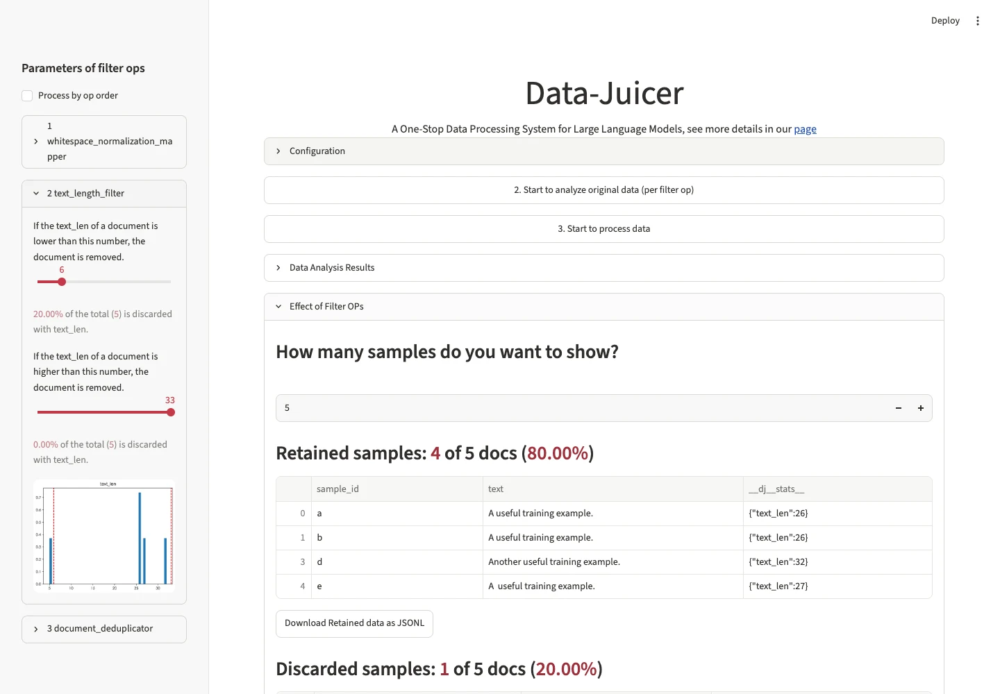

+++
date = '2026-11-14T00:00:00+08:00'
draft = false
isCJKLanguage = true
contentLanguage = 'zh-CN'
title = 'Data-Juicer 架构与产品设计：理解数据配方、执行引擎和交互流程'
description = '从平台开发和产品设计两条线拆解 Data-Juicer：核心抽象、数据与控制流、算子扩展、三种执行器、Playground 调参、Agents 自然语言交互，以及 Sandbox 的数据模型反馈闭环。'
summary = '一份 YAML 配方如何变成可分析、可调试、可恢复的数据处理任务？本文结合版本化源码、官方文档与论文，串起 Data-Juicer 的架构实现、产品组成和真实操作流程。'
categories = ['数据飞轮']
tags = ['Data-Juicer', 'Data-centric AI', '数据处理', '平台架构', '产品设计', 'Ray', '多模态']
featured = false
+++

面对一批训练数据，开发者通常先写脚本：读入、清洗、打分、过滤、去重、导出。随着数据模态、处理模型和使用者增多，真正难维护的部分逐渐浮现：每个脚本的数据格式不同，处理逻辑与运行环境耦合，调一个阈值要重新执行，失败后恢复困难，最后也很难解释这次数据变化是否值得。

Data-Juicer 把这些工作组织成了**数据集抽象、可组合算子、声明式配方和执行运行时**。从产品角度看，它围绕“形成一份可复用的数据处理配方”建立了不同使用入口；从架构角度看，它尝试让同一类处理逻辑跨越本地与分布式环境，并提供分析、追踪和恢复机制。[官方项目](https://github.com/datajuicer/data-juicer/blob/v1.6.2/README.md)

理解它时，需要同时回答两组问题：

- **平台开发者**：配置如何变成执行计划？数据、算子与引擎如何解耦？哪些优化与故障处理有明确边界？
- **产品设计者**：谁在使用它？用户实际操作哪些对象？界面反馈如何帮助用户决定下一步？哪些功能已经实现，哪些属于生态集成或未来计划？

本文核验日期为 **2026 年 11 月 14 日**。Core 源码以 **v1.6.2** 为基线，提交为 `782ebbc4c515`。**“Data-Juicer 2.0”是论文与系统代际名称，不能据此把安装包版本写成 2.0。** Agents、Sandbox 是独立项目，文末分别列出核验快照。文中区分源码行为、论文实验、官方产品说明与本机验证，避免把它们拼成一个已经全部验收的产品。[版本发布记录](https://github.com/datajuicer/data-juicer/releases/tag/v1.6.2)

<!--more-->

## 1 产品定义：它解决谁的什么问题

### 1.1 核心交付是数据处理能力与配方

可以将 Data-Juicer 的产品定义概括为：**面向模型数据研发的可组合处理基础设施，帮助使用者理解数据、制定处理规则、执行配方并检查处理结果。** 这是对其公开实现的归纳；官方当前使用更宽的 “Data Operating System” 定位，判断能力边界仍应落实到具体模块。[项目定位](https://github.com/datajuicer/data-juicer/blob/v1.6.2/README.md)

主要使用者有三类，分别对应不同粒度的操作：


| 使用者 | 主要任务 | 操作对象 | 成功时拿到什么 |
| --- | --- | --- | --- |
| 数据与模型研究人员 | 比较过滤规则、数据配比和模型收益 | 数据样本、统计分布、配方、实验 | 可解释的配方和实验结果 |
| 数据工程与平台开发人员 | 复用处理逻辑，运行大规模任务 | 算子、输入输出配置、执行器、资源与检查点 | 处理数据及可定位的运行记录 |
| 算子开发人员 | 将某种算法封装为可组合能力 | 基类、参数、注册名、依赖与测试 | 可独立安装或按路径加载的算子 |


上述角色划分是产品分析，并非官方账号权限模型。对于研究人员，价值不只是“清洗完成”，还包括知道哪些样本被丢掉、规则是否过严、不同指标是否相关；对于工程人员，价值在于减少一次性脚本与执行环境之间的耦合。对应入口可见 [Python 与 CLI 指南](https://github.com/datajuicer/data-juicer/blob/v1.6.2/docs/ProcessData.md)、[分析指南](https://github.com/datajuicer/data-juicer/blob/v1.6.2/docs/AnalyzeData.md)与[插件机制](https://github.com/datajuicer/data-juicer/blob/v1.6.2/docs/OperatorPlugins.md)。

### 1.2 Core、Playground、Agents、Sandbox 与 PAI 是不同层次

下面是产品组成与依赖关系示意，按职责重绘，箭头不表示所有模块必须同时部署。


flowchart TD
    U[数据研发与工程使用者] --> C[CLI / Python API]
    U --> W[Streamlit Playground]
    U --> A[Data-Juicer Agents]
    U --> P[PAI Designer / DLC]
    H[DJ Hub 配方与示例] -.参考与复用.-> C
    A --> T[工具与能力编排]
    T --> D[Data-Juicer Core]
    C --> D
    W --> D
    P --> D
    S[Data-Juicer Sandbox] --> D
    S --> M[外部训练 / 推理 / 评估框架]
    D --> O[处理数据 / 统计 / 追踪 / 检查点]


**Core** 提供数据处理与分析运行时；**Hub** 存放可参考的配方与示例；**Playground** 是主仓库中的 Streamlit 应用；**Agents** 提供工具发现、计划生成和对话式操作；**Sandbox** 将数据处理与模型实验连接；**PAI** 提供云上的可视化与作业运行入口。它们面向不同任务，并不共享一个天然统一的项目管理界面。[生态入口](https://github.com/datajuicer/data-juicer/blob/v1.6.2/README.md)、[Agents 架构](https://github.com/datajuicer/data-juicer-agents/blob/41dd9703ef7354fd0e3b5b61e23275b2ed5e0d8a/docs/overview.md)、[Sandbox 用户指南](https://github.com/datajuicer/data-juicer-sandbox/blob/54ed2ce6196fd8782ba71fbaa06ad4f938d2d753/docs/UserGuide.md)

这个区分会直接影响产品判断：开源 Playground 的强项是分析与过滤阈值调优。论文展示的拖拽式数据处理画布属于 **PAI Designer 集成**；PAI DLC 的 DataJuicer 任务入口则负责镜像、存储、资源和运行命令等配置。不能仅凭论文架构图就认定安装 Core 后会得到同样的云控制台。[论文界面说明](https://arxiv.org/html/2501.14755v3#S4)、[PAI DLC 官方操作指南](https://www.alibabacloud.com/help/en/pai/quickly-submit-a-datajuicer-task)

## 2 核心对象：从数据到产物的共同语言

阅读源码时，先建立下面这组概念，会比先记目录结构更有效。


| 对象 | 承担的职责 | 需要注意的边界 |
| --- | --- | --- |
| Dataset | 承载样本，提供处理与访问接口 | 抽象一致不代表不同后端的所有功能完全一致 |
| Operator，简称 OP | 封装一次处理、统计、筛选或集合操作 | 并非所有 OP 都能逐样本执行 |
| Recipe | 描述数据来源、输出位置、算子顺序与运行设置 | 常见载体是 YAML，不等同于运行状态 |
| Executor | 将配置、数据、算子及监控恢复机制组织起来 | 本地、Ray 与分区执行器有不同实现 |
| Analyzer | 计算分布与关联，帮助理解数据 | “分析”与“按阈值删除样本”是不同动作 |
| Job 与产物 | 对应一次运行的事件、日志、输出和恢复信息 | 配方可复用，同一配方的不同运行仍需区分 |


这组职责可从 [Dataset 抽象](https://github.com/datajuicer/data-juicer/blob/v1.6.2/data_juicer/core/data/dj_dataset.py)、[Executor](https://github.com/datajuicer/data-juicer/blob/v1.6.2/data_juicer/core/executor/default_executor.py)、[Analyzer](https://github.com/datajuicer/data-juicer/blob/v1.6.2/data_juicer/core/analyzer.py)及[任务管理文档](https://github.com/datajuicer/data-juicer/blob/v1.6.2/docs/JobManagement.md)相互印证。

### 2.1 Recipe 将处理意图变成可检查的配置

下面是一份刻意保持简单的文本配方。参数表达的是操作顺序和阈值；样本数、处理耗时与是否失败属于运行结果。

```yaml
project_name: dj-blog-example
dataset_path: ./input.jsonl
export_path: ./outputs/result.jsonl
executor_type: default
np: 1
open_tracer: true
trace_num: 10
trace_keys: [sample_id]
keep_stats_in_res_ds: true
process:
  - whitespace_normalization_mapper: {}
  - text_length_filter:
      min_len: 10
      max_len: 1000
  - document_deduplicator: {}
```

默认按 `process` 列表顺序执行。这份配方先统一空白，再检查长度，最后按处理后的文本去重。如果交换顺序，重复判断或长度判断的对象可能改变。开启融合与重排后，还需要检查该执行路径对顺序的处理，不能假设源码中的顺序和每种优化后的物理执行始终相同。[配方运行与优化说明](https://github.com/datajuicer/data-juicer/blob/v1.6.2/docs/ProcessData.md)

Recipe 可以纳入 Git 管理、评审和复用，但“有 YAML”本身并不保证实验可复现。数据内容、算子代码、模型权重、依赖版本与随机因素同样会影响结果。应把配方看作复现的一项必要输入，而不是完整实验快照。

### 2.2 多模态数据需要内容、媒体与统计共同表达

Data-Juicer 使用中间数据表示来适配不同上下游格式。文本中可包含图像、视频等特殊标记，媒体字段保存相应路径或数据；分块分隔符表达交错内容的边界。处理期间，内部字段如 `__dj__stats__` 保存计算出来的统计信息，`__dj__meta__` 保存相关标签或元信息。[多模态格式转换说明](https://github.com/datajuicer/data-juicer/blob/v1.6.2/tools/fmt_conversion/multimodal/README.md)、[分析字段说明](https://github.com/datajuicer/data-juicer/blob/v1.6.2/docs/AnalyzeData.md)

例如，文本中的 `<__dj__image>` 与 `images` 中的媒体需要保持对应。这里有两个不同的问题：字段类型能否通过校验，以及媒体与文本在语义和位置上是否正确对齐。前者通过并不自动证明后者成立。删除图片、拆分视频或改写描述的算子，都可能影响这种关联。

这种表示也解释了为什么导出是一个单独模块：内部统计、哈希和元信息是否保留，应由导出配置控制；给训练框架的数据通常还需要转换为其目标格式。[导出实现](https://github.com/datajuicer/data-juicer/blob/v1.6.2/data_juicer/core/exporter.py)

## 3 架构：一份配方如何变成执行

### 3.1 数据通路与运行控制在 Executor 汇合

以下按当前源码职责绘制。配置和控制组件并非每一步都转化成独立服务，图中的框也不代表微服务部署单元。


flowchart TD
    I[CLI / Python / 服务调用] --> C[配置解析与运行设置]
    C --> E[ExecutorFactory 选择执行器]
    E --> X[Executor 组织运行]
    X --> V[Preflight 算子配置检查]
    X --> B[DatasetBuilder 与加载策略]
    B --> S[来源 / 格式 / 数据校验]
    S --> D[DJDataset 抽象]
    R[算子注册表 / 外部插件] --> L[load_ops 实例化]
    X --> L
    L --> A[Adapter 与执行优化]
    A --> O[OP.run 与后端处理]
    D --> O
    O --> H[本地 HF Dataset / Ray Data]
    H --> F[Exporter 输出]
    X -.运行控制.-> J[事件 / 日志 / 监控 / 检查点]
    O -.样本变化.-> T[Tracer]
    D -.分析通路.-> N[Analyzer / RayAnalyzer]


以 `DefaultExecutor.run()` 为例，其主线是预检查、加载数据、实例化算子、后续检查、按配置准备优化，再调用数据集的 `process()`，最后导出并记录完成信息。数据处理不直接塞进 CLI；CLI 负责入口，Executor 组织生命周期，Dataset 和 OP 完成实际处理。[DefaultExecutor 源码](https://github.com/datajuicer/data-juicer/blob/v1.6.2/data_juicer/core/executor/default_executor.py)

这套分工的工程价值是：新增调用入口时，可以复用核心能力；新增算子时，不必把算法复制进每个入口。但这种解耦不是没有成本，后端差异仍要由适配实现承担。

### 3.2 Dataset 抽象隐藏接口差异，保留后端特点

`DJDataset` 定义处理、schema、取样、列访问和计数等共同接口；`NestedDataset` 继承 Hugging Face Dataset，并扩展嵌套字段访问和 OP 处理；`RayDataset` 则将处理映射到 Ray 的执行方式。[本地 Dataset](https://github.com/datajuicer/data-juicer/blob/v1.6.2/data_juicer/core/data/dj_dataset.py)、[RayDataset](https://github.com/datajuicer/data-juicer/blob/v1.6.2/data_juicer/core/data/ray_dataset.py)

论文用 Facade 解释这一设计：用户获得相近的处理接口，底层仍利用原生引擎。当前开源执行器工厂实际提供 `default`（也接受 `local`）、`ray` 和 `ray_partitioned`；论文还讨论 MaxCompute / MaxFrame 的适配与实验，应与这个工厂的现有选项区分。[执行器工厂](https://github.com/datajuicer/data-juicer/blob/v1.6.2/data_juicer/core/executor/factory.py)

这种差异在用户可见行为中也存在。例如，当前文档说明本地执行器可按多个数据源及权重形成混合数据；Ray 的该配置路径加载单个来源。Local Analyzer 提供分布图和相关性分析，RayAnalyzer 主要提供分布式总体统计，不能把两者输出视为完全等价。[数据配置](https://github.com/datajuicer/data-juicer/blob/v1.6.2/docs/DatasetCfg.md)、[分布式分析差异](https://github.com/datajuicer/data-juicer/blob/v1.6.2/docs/Distributed.md)

### 3.3 DatasetBuilder 将“数据从哪里来”从算法中抽离

`DatasetBuilder` 根据配置选择加载策略，处理来源、格式、采样组合和校验；算子因此可以围绕已经形成的数据集工作。`dataset_path` 是简单入口，结构化 `dataset.configs` 则表达更具体的数据源信息。[加载实现](https://github.com/datajuicer/data-juicer/blob/v1.6.2/data_juicer/core/data/dataset_builder.py)

产品上，这让“换数据源”和“改算法”成为两种独立操作，但用户仍需理解采样语义。`max_sample_num` 在本地多源混合中按权重分配样本预算，某个来源预算超过其大小时可能重复采样。它也不意味着只从磁盘读取那么多行；小规模试验若要减少读取量，预先准备样本文件更明确。[数据混合与采样说明](https://github.com/datajuicer/data-juicer/blob/v1.6.2/docs/DatasetCfg.md)、[试跑说明](https://github.com/datajuicer/data-juicer/blob/v1.6.2/docs/ProcessData.md)

## 4 算子设计：为什么“计算统计”和“筛掉数据”分开

### 4.1 算子类型反映数据操作的作用范围


| 类型 | 典型行为 | 架构上的含义 |
| --- | --- | --- |
| Mapper | 清理文本、生成描述、转换媒体 | 可编辑样本；有些实现会改变样本数量 |
| Filter | 计算指标，再按条件保留样本 | 统计与筛选可分离 |
| Deduplicator | 计算哈希并识别重复 | 通常涉及跨样本关系 |
| Selector | 按排名、比例或规则选子集 | 需要考虑整个集合的选择语义 |
| Grouper / Aggregator | 分组后组合或提取信息 | 表达多样本到分组、再到聚合结果 |
| Pipeline | 组合已有处理能力 | 在 OP 体系内封装更高层逻辑 |


表格按当前 [OP 基类实现](https://github.com/datajuicer/data-juicer/blob/v1.6.2/data_juicer/ops/base_op.py)归纳。Formatter 主要位于加载体系；论文还讨论 FusedOP、ScriptOP、HumanOP 等能力，不宜把论文分类直接解释成当前同一目录中的一组同构基类。

这种类型划分不只是给算子库加分类标签。逐样本 Mapper、集合选择和全局去重对内存、并发及恢复边界的要求不同。把一份数据拆成多个分区、在分区内分别去重，并不能自然消除跨分区重复。

### 4.2 Filter 同时服务处理与分析

Filter 的核心包括 `compute_stats` 与 `process`：前者计算长度、质量分数或其他指标，后者根据这些值作出保留判断。基类的 `run(..., reduce=False)` 支持只计算统计并保留输入行；Analyzer 也会选择可统计的 Filter 与标注算子，组织分析流程。[Filter 实现](https://github.com/datajuicer/data-juicer/blob/v1.6.2/data_juicer/ops/base_op.py)、[Analyzer 实现](https://github.com/datajuicer/data-juicer/blob/v1.6.2/data_juicer/core/analyzer.py)

由此得到一个很重要的交互条件：**昂贵的指标计算完成后，改变阈值可以先基于已有统计预览影响。** 这不是任意修改配方都能即时反馈。若用户换了模型、改了文本、调整了前置 Mapper，旧统计就可能不再代表当前数据。

Analyzer 主要输出总体统计、各列分布以及关联分析。它回答“数据表现出什么特征”；过滤步骤回答“按当前规则留下什么”。对产品来说，先让用户看分布再决定阈值，比只给一个默认阈值多了一层可解释性。[分析输出与支持范围](https://github.com/datajuicer/data-juicer/blob/v1.6.2/docs/AnalyzeData.md)

### 4.3 扩展机制：注册能力与安装依赖分别处理

算子继承基类后，通过 `@OPERATORS.register_module(...)` 注册名称。配方引用注册名与参数，实例化过程由 `load_ops` 处理。外部算子有两条入口：本地文件通过 `custom_operator_paths` 显式加载；可安装包通过 `data_juicer.ops` entry points 被发现。[注册加载代码](https://github.com/datajuicer/data-juicer/blob/v1.6.2/data_juicer/ops/__init__.py)、[插件文档](https://github.com/datajuicer/data-juicer/blob/v1.6.2/docs/OperatorPlugins.md)

entry points 让共享算子可以独立发布版本。它的导入失败隔离指某个插件导入异常时跳过并警告，不代表任意第三方算子执行时都被安全沙箱隔离。算子命名冲突、依赖兼容、GPU 使用与序列化仍是开发者必须关注的契约。

依赖方面，Core 使用最小依赖与可选依赖组，并在部分位置采用延迟加载。`dj-install --config recipe.yaml` 按配方扫描所需依赖。按需准备环境能降低初始负担，但具体模型、媒体库和外部程序仍可能有额外要求。[安装指南](https://github.com/datajuicer/data-juicer/blob/v1.6.2/docs/tutorial/Installation.md)、[依赖声明](https://github.com/datajuicer/data-juicer/blob/v1.6.2/pyproject.toml)

## 5 运行时：本地、Ray 与分区恢复的区别

### 5.1 三种执行器改变的是执行与恢复方式


| 执行器 | 主要实现 | 适合观察什么 | 使用时的关键问题 |
| --- | --- | --- | --- |
| `default` | 本地 HF Dataset 与进程并行 | 单机配方开发、样本分析 | 进程数量、模型副本与本机内存 |
| `ray` | Ray Data 与 Tasks / Actors | 分布式处理和总体统计 | 数据块、共享存储、算子后端兼容性 |
| `ray_partitioned` | 逻辑分区、执行分组与检查点 | 长任务的恢复粒度和资源规划 | 分区数量、Actor 并发、检查点开销及全局操作 |


该表依据[执行器工厂](https://github.com/datajuicer/data-juicer/blob/v1.6.2/data_juicer/core/executor/factory.py)、[Ray 处理指南](https://github.com/datajuicer/data-juicer/blob/v1.6.2/docs/Distributed.md)与[分区及检查点文档](https://github.com/datajuicer/data-juicer/blob/v1.6.2/docs/PartitionAndCheckpoint.md)。选择执行器还需要核对具体算子的支持声明；尤其是去重，官方提供了专用的 `ray_*_deduplicator` 实现。

分布式运行时，输入与产物位置也属于执行契约：多节点必须能访问所引用的媒体、配方和输出存储。本地绝对路径在另一台 Worker 上并不会自动存在。[多节点示例要求](https://github.com/datajuicer/data-juicer/blob/v1.6.2/docs/Distributed.md)

### 5.2 自动优化是在具体约束下做选择

Data-Juicer 提供 OP 融合、部分重排、批处理和资源自适应。它们分别试图减少重复处理开销、尽早缩小数据量、摊薄模型调用开销，以及缓解算子之间不同的内存需求。用户看到的是几个配置开关，底层则需要识别操作是否兼容、哪些字段存在依赖、可用资源有多少。[处理优化说明](https://github.com/datajuicer/data-juicer/blob/v1.6.2/docs/ProcessData.md)、[Adapter 实现](https://github.com/datajuicer/data-juicer/blob/v1.6.2/data_juicer/core/adapter.py)

`ray_partitioned` 的一个关键设计是将**逻辑分区数与 GPU 执行并发分开**：前者确定数据和恢复粒度，后者取决于算子吞吐、模型占用和集群资源。执行分组允许多个逻辑分区共享一轮 GPU Actor 生命周期，以摊薄重复加载模型的代价，同时保留分区检查点。[资源规划与执行分组](https://github.com/datajuicer/data-juicer/blob/v1.6.2/docs/PartitionAndCheckpoint.md)

GPU preflight 会抽取样本、测量初始化与稳定运行阶段，再形成资源建议。抽样若不具代表性，规划也会偏：一批按分辨率或文本长度排序的数据，其开头可能并不代表整体。源码文档因此提供偏移或随机块采样等设置。这里的“自动”仍有采样、依赖和硬件条件。[GPU 探测实现](https://github.com/datajuicer/data-juicer/blob/v1.6.2/data_juicer/core/executor/gpu_memory_probe.py)

### 5.3 恢复、追踪与作业监控是三种不同能力

**检查点**保存可继续执行的数据进度；**Tracer**抽样记录内容变化或丢弃原因；**作业事件**用于了解运行状态和各操作的耗时与行数。三者的对象、开销和用途不同。[检查点](https://github.com/datajuicer/data-juicer/blob/v1.6.2/docs/PartitionAndCheckpoint.md)、[追踪](https://github.com/datajuicer/data-juicer/blob/v1.6.2/docs/Tracing.md)、[任务管理](https://github.com/datajuicer/data-juicer/blob/v1.6.2/docs/JobManagement.md)

本地执行器的 `use_checkpoint` 与 `op_fusion` 互斥，并会关闭数据缓存；分区执行器则有每个 OP、每 N 个 OP、手动指定或关闭检查点等策略。恢复命令与作业标识也应按执行器使用，不能把本地恢复和 `ray_partitioned` 的 `--resume` 当成同一条操作。[本地恢复规则](https://github.com/datajuicer/data-juicer/blob/v1.6.2/docs/ProcessData.md)

Tracer 对 Mapper 记录文本变化，对 Filter 记录被丢弃的样本，对 Deduplicator 记录重复对；采集数量受 `trace_num` 等参数约束。它适合调试与质量检查，却不足以证明系统为每一行数据都保留了完整血缘。监控事件同样不能替代数据来源与版本记录。[Tracer 范围](https://github.com/datajuicer/data-juicer/blob/v1.6.2/docs/Tracing.md)

## 6 产品功能：用户到底能够完成哪些工作


| 工作 | 主要入口 | 用户提供什么 | 系统反馈 | 判断边界 |
| --- | --- | --- | --- | --- |
| 接入与格式整理 | Recipe / DatasetBuilder / 转换工具 | 来源、字段、格式与校验规则 | 加载结果、字段或格式错误 | 格式有效不等于语义对齐正确 |
| 清洗、去重与筛选 | CLI / Python / MCP | OP 顺序与参数 | 处理数据、日志、可选统计与追踪 | 不同算子对集合与后端的要求不同 |
| 理解数据质量 | Analyzer / Playground | 分析配方与样本 | 分布、总体统计、关联信息 | 统计指标不直接等于任务效果 |
| 合成与标注 | 模型类 Mapper、配方 | 媒体、提示、模型与调用设置 | 合成内容、标签、元信息 | 需要模型环境；输出需另行检查 |
| 调整过滤策略 | Playground | 已计算统计与阈值 | 保留比例、丢弃样本、图表 | 即时反馈主要基于已有统计 |
| 规模化运行 | Ray / 分区执行器；PAI 可提供云入口 | 资源、路径、依赖与恢复设置 | 运行事件、数据与检查点 | 云侧管理能力与 Core 分别核对 |
| 通过模型反馈改配方 | Sandbox | 探测、训练、评估和调整流程 | 实验指标与迭代产物 | 依赖实际接入的模型和任务 |


这是对[算子目录](https://github.com/datajuicer/data-juicer/blob/v1.6.2/docs/Operators.md)、[处理与分析接口](https://github.com/datajuicer/data-juicer/blob/v1.6.2/docs/ProcessData.md)、[Playground](https://github.com/datajuicer/data-juicer/blob/v1.6.2/docs/Playground.md)和 [Sandbox](https://github.com/datajuicer/data-juicer-sandbox/blob/54ed2ce6196fd8782ba71fbaa06ad4f938d2d753/docs/UserGuide.md)的产品归纳。应以任务能否完成、反馈能否支撑决策衡量功能，而不是只按算子数量衡量覆盖程度。

## 7 交互走读：四条入口对应四种心智负担

### 7.1 CLI 与 Python：明确表达处理过程

CLI 的典型使用路径如下。这里的命令针对前文配方；`dj-analyze` 只对支持的统计与标签进行分析，并不会完整执行所有清洗与去重逻辑。

```bash
dj-analyze --config recipe.yaml
dj-process --config recipe.yaml
```

Python 入口可以加载同一配方，也可以直接实例化算子。相比只提交 YAML，Python 允许观察中间数据、添加条件和自行组织更复杂流程。代价是使用者需要承担更多控制逻辑。[Python 调用方式](https://github.com/datajuicer/data-juicer/blob/v1.6.2/docs/ProcessData.md)

一次典型处理可按下图理解，虚线表示运行中的可选记录。


sequenceDiagram
    actor U as 使用者
    participant C as 配置与入口
    participant E as Executor
    participant D as DatasetBuilder
    participant O as OP与Dataset
    participant F as 输出与运行记录
    U->>C: 提交配方 / 命令参数
    C->>E: 初始化运行配置
    E->>E: 检查配置与执行兼容性
    E->>D: 加载并校验数据
    D-->>E: Dataset
    E->>O: 实例化并执行算子链
    O-->>F: 可选统计 / 追踪 / 检查点
    O-->>E: 处理结果
    E->>F: 导出结果并记录完成
    F-->>U: 数据路径、日志与分析产物


从交互设计看，配方是一份“可检查的执行意图”，输出路径是使用者确认交付的主要入口。日志中出现某个步骤完成，不等于最终数据已成功导出；算子参数正确，也不等于媒体路径可达。

### 7.2 Playground：围绕阈值决策组织界面

Playground 从源码仓库运行 `streamlit run app.py`。它的核心交互可按源码中的实际控件逐步走读：[界面源码](https://github.com/datajuicer/data-juicer/blob/v1.6.2/app.py)、[使用指南](https://github.com/datajuicer/data-juicer/blob/v1.6.2/docs/Playground.md)。

**第一步，解析配置。** 用户输入配置命令或上传 YAML，点击 `1. Parse Cfg`。界面并排显示解析后内存配置和原始 YAML。产品价值是让默认值与覆盖后的设置可见；上传 YAML 表达的是配置，数据路径仍需在运行应用的环境中有效。

**第二步，分析原始数据。** 点击 `2. Start to analyze original data (per filter op)`，等待统计计算。成功后可查看原始数据的总体表格与分析图。这一步为阈值选择建立依据。

**第三步，执行配方。** 点击 `3. Start to process data`，界面调用本地 `DefaultExecutor`，并尝试分析处理后的数据。原始与处理结果并排展示。这里应留意：配置里出现 Ray 字段，不足以证明这个界面会自动切换为分布式任务控制台，应以它实际创建的执行器为准。

**第四步，调阈值并看样本。** `Effect of Filter OPs` 根据已有统计创建侧栏滑块或选项，显示直方图、过滤比例、保留和丢弃样本，也可显示每项过滤条件对应的丢弃详情。`Process by op order` 控制按顺序观察筛选影响；多个 Filter 过滤同一批样本时，独立丢弃比例不能直接相加。

**第五步，导出数据与整理配方。** 可下载 `retained.jsonl` 与 `discarded.jsonl`。当前指南要求将调好的参数写回配方；源码中的这些下载按钮导出的是数据，不能描述为已经存在“一键保存调参后 YAML”的完整配方管理流程。

这个交互还有两点边界。首先，滑块是在当前数据集已有统计上计算条件，并不会因为用户拖动滑块就重新运行所有前置 Mapper 或模型；执行配方后，当前展示的数据也可能已经是处理后的子集。其次，没有可调统计的配方会得到提示，而不是自动生成所有算子的通用参数编辑器。[阈值与样本展示实现](https://github.com/datajuicer/data-juicer/blob/v1.6.2/app.py#L231)

页面保留的 `[WIP] Auxiliary Models on Processed Data` 与 `[WIP] Proxy LM Models Training` 是另一类情况：源码中部分质量分类器按钮直接提示不支持，训练区也不能据其外观认定已完成闭环训练。这些入口应归入未完成能力。

### 7.3 REST 与 MCP：能力暴露方式不同于任务产品模型

`service.py` 使用 FastAPI，扫描模块导出对象，为函数和部分类方法注册路由。请求可以构造对象并调用处理、统计或分析方法。这种服务入口便于远程复用能力，但其路由形态贴近 Python 对象，不应仅凭存在 REST 接口，就推断它还提供完整的多用户项目管理、异步任务队列与权限模型。[服务源码](https://github.com/datajuicer/data-juicer/blob/v1.6.2/service.py)

Core 的 MCP 服务提供两种组织方式：Recipe-Flow 暴露搜索算子、获取配置 schema、发现数据加载策略、分析数据和执行配方等工具；Granular-Operators 将算子分别暴露为工具，并可通过列表约束所暴露范围。前者降低组合流程时的工具粒度，后者给予调用者更细的控制。[MCP 与服务指南](https://github.com/datajuicer/data-juicer/blob/v1.6.2/docs/DJ_service.md)

### 7.4 Agents：从“写配置”转向“表达意图”，仍需检查计划

独立的 Data-Juicer Agents 项目将入口、能力编排、原子工具、运行时适配分层。`djx` 面向明确的工程操作；`dj-agents` 在同一能力栈上提供对话。其流程包括检索候选算子、构造数据与处理规格、组装并校验计划，再保存为可执行输入。[Agents 分层设计](https://github.com/datajuicer/data-juicer-agents/blob/41dd9703ef7354fd0e3b5b61e23275b2ed5e0d8a/docs/overview.md)

例如，用户提出“清理并去重这些文本”，可以先用 `djx retrieve` 看候选能力，再通过 `djx plan` 形成计划，最后使用 `djx apply` 生成配方并运行。产品上的关键变化是把模糊意图翻译为可检查的中间产物，而不是让一句自然语言直接替代所有执行依据。

需要特别说明三个细节：`djx apply --dry-run` 仍会写出配方文件；当前 apply 命令不会额外自动执行一次独立的 `plan_validate`；`dj-agents` 启动需要 LLM。文档中的 `--ui as_studio` 指 AgentScope Studio 接入，与路线图中的 InteRecipe Studio 不能混为一谈。[Agents CLI 行为](https://github.com/datajuicer/data-juicer-agents/blob/41dd9703ef7354fd0e3b5b61e23275b2ed5e0d8a/docs/cli.md)、[路线图](https://github.com/datajuicer/data-juicer-agents/blob/41dd9703ef7354fd0e3b5b61e23275b2ed5e0d8a/README.md)

文档站上的 Q&A Copilot 主要用于生态问答；它与执行处理任务的 Agent 也应分别看待。判断交互成熟度时，要检查最终形成了什么计划、调用了什么工具、输出数据是否实际存在。[官方问答入口说明](https://github.com/datajuicer/data-juicer-agents/blob/41dd9703ef7354fd0e3b5b61e23275b2ed5e0d8a/README.md)

### 7.5 PAI：云作业的配置和运维入口

PAI DLC 指南展示的路径是选择带 DataJuicer 环境的镜像、设置单机或分布式模式、挂载存储、填写 Shell 或 YAML 启动配置，再选择资源提交任务。其资源估算还有配额等使用条件；云侧镜像版本也不能自动等同于本文 Core 版本。[PAI DLC 文档](https://www.alibabacloud.com/help/en/pai/quickly-submit-a-datajuicer-task)

这一入口主要降低部署与作业提交负担，与 Playground 的“观察分布、选择阈值”解决的是不同问题。本文仅根据官方文档说明操作流程，未登录云控制台提交收费任务。

## 8 多模态案例：一条视频配方分别做了什么

PAI 的官方示例组织了视频时长过滤、NSFW 过滤、抽帧描述生成三步。把它拆开，可以看见同一配方中的不同资源与产品语义。[官方案例及配置](https://www.alibabacloud.com/help/en/pai/quickly-submit-a-datajuicer-task)

- `video_duration_filter` 检查时间范围；在此阶段缩小输入，可能减少后续模型处理量。
- `video_nsfw_filter` 按帧采样并计算分数，再依据聚合方式与阈值保留视频；它依赖具体模型和采帧设置。
- `video_captioning_from_frames_mapper` 对采样帧生成描述；其结果可用于后续数据整理，但抽取若干帧不等于理解了全部时序内容。

从平台开发角度，这条链路同时包含媒体读取、模型加载、统计判断和内容生成；从产品角度，用户需要知道“采了哪些帧”“阈值怎样形成视频级判断”“原始样本如何保留”。只显示最终数据条数，会丢掉这些关键解释。

对于图像质量数据也应保持同样区分：美学分数、图文匹配分数和训练任务中的画质真值各自表达不同目标。即使算子能够生成或筛选图像，也不能仅凭处理成功把输出当成可靠的像素级 GT。这里是在分析数据处理结果的含义，本文没有对任何模型做效果验收。

## 9 Sandbox：把配方调整与模型反馈连起来

### 9.1 分布改善还不足以证明模型收益

Core 解决如何处理与理解数据；Sandbox 则把探测、调整、执行和评估组织成实验。比如过滤后平均质量分数上升，可能同时损失了难样本或某些类别的覆盖。要判断是否值得，需要看任务指标、数据多样性与计算成本，而不能只看筛选规则本身是否生效。[Sandbox 定位与用户流程](https://github.com/datajuicer/data-juicer-sandbox/blob/54ed2ce6196fd8782ba71fbaa06ad4f938d2d753/docs/UserGuide.md)

以下是根据其四类 job list 重绘的流程；迭代决策由具体配方和 hook 实现，并非默认存在一个能自动决定所有数据策略的组件。


flowchart TD
    D[初始数据池与模型] --> P[Probe：数据分析 / 模型探测]
    P --> R[Refine：依据结果调整配方或数据池]
    R --> E[Execution：数据处理与模型训练]
    E --> V[Evaluation：数据与模型评估]
    V --> O[指标 / 日志 / 数据池 / 模型产物]
    O -.按配置进行下一轮.-> P


### 9.2 工程实现围绕组件、Hook 和上下文

Sandbox 的可配置组件包括模型 Executor、Evaluator 与 DataPoolManipulator。这里的模型 Executor 负责训练、推理或评估；数据执行仍复用 Core。Hook 将这些组件挂接到 `probe_jobs`、`refine_recipe_jobs`、`execution_jobs`、`evaluation_jobs`，Pipeline 按流程组织执行。[Sandbox 开发指南](https://github.com/datajuicer/data-juicer-sandbox/blob/54ed2ce6196fd8782ba71fbaa06ad4f938d2d753/docs/DeveloperGuide.md)

模型框架还需要数据连接器，将中间数据转成其输入；模型执行与日志观察分别运行，特定实现从日志解析损失和评估指标。Context Infos 用于步骤间共享信息，EnvManager 处理相关环境。所谓闭环，落地为数据接口、指标解析、状态传递和可重复执行的实验步骤，而不只是画一条从评估指回数据的箭头。

论文用图文预训练、图像到文本、文本到视频等任务展示反馈驱动研发，但这些是指定模型、数据与计算预算下的实验。小规模筛选规则能否迁移到更大模型，仍需在目标任务验证。[Sandbox 原论文](https://arxiv.org/abs/2407.11784)

## 10 性能与成熟度：怎样阅读官方结果

Data-Juicer 的优化需要连同负载一起理解：文本清洗可能受 I/O 和进程调度影响，媒体模型算子可能受显存和模型加载影响，去重还涉及全局关系与数据交换。增加节点并不保证每类小任务都更快。

官方分布式文档给出一组 **5 TB 去重、1,280 CPU 核、168.10 分钟**的结果；同一表格还列出其他数据规模和核数。它证明对应实验配置下的扩展能力，不能直接转换为任意媒体配方的服务承诺。[实验设置与结果表](https://github.com/datajuicer/data-juicer/blob/v1.6.2/docs/Distributed.md)


| 能力 | 证据 | 本文判断 |
| --- | --- | --- |
| Core 算子链、分析与导出 | 版本化源码与指南 | 可检查的已实现能力，具体运行见下一节 |
| Playground 滑块与样本下载 | `app.py` 的真实控件和计算路径 | 已实现；有数据规模和统计范围限制 |
| Playground 代理模型训练区 | WIP 标记与未完成处理代码 | 不计作已完成训练闭环 |
| Agents CLI / TUI 与工具编排 | 独立仓库源码文档 | 与 Core 分版本，依赖所选 LLM 环境 |
| InteRecipe Studio | Agents 路线图 | 不能按路线图认定通用前端已交付 |
| PAI Designer / DLC | 论文集成说明与云官方指南 | 单列为云产品能力，本文未做云上验收 |
| Sandbox 数据模型实验 | 独立项目与任务示例 | 已有实现；效果结论依赖实验条件 |


成熟度表主要依据 [Playground 源码](https://github.com/datajuicer/data-juicer/blob/v1.6.2/app.py)、[Agents 文档与路线图](https://github.com/datajuicer/data-juicer-agents/blob/41dd9703ef7354fd0e3b5b61e23275b2ed5e0d8a/README.md)及前述独立项目资料。源码存在、命令可调用、任务跑通、模型收益得到验证，是逐层增加的证据，写作时应保留这几层区别。

## 11 本机验证与复现入口

本文将固定文本样例与配方放在本页附件中。样例刻意包含空白差异、重复文本和过短文本，用于检查处理语义；它不用于测量性能或评价模型效果。

### 11.1 CPU 配方的实际结果

本机使用 macOS arm64、Python 3.13.18 和 `py-data-juicer==1.6.2`，在临时虚拟环境运行前文配方，无 GPU 推理及模型 API 调用。输入、配方和结果可以直接下载：[input.jsonl](input.jsonl)、[recipe.yaml](recipe.yaml)、[expected-output.jsonl](expected-output.jsonl)、[本次环境版本](requirements-tested.txt)。


| 阶段 | 数据量 | 核对结果 |
| --- | --- | --- |
| 读入 | 5 | a、b 完全重复；c 为短文本；e 含连续普通空格 |
| 空白规范化 | 5 | 连续普通空格保留；本样例没有产生文本变更追踪 |
| 长度过滤 | 4 | 移除 c；追踪记录其 `text_len` 为 5 |
| 文档去重 | 3 | 保留 a、d、e；重复对追踪记录 a 与 b |
| 导出 | 3 | 已核对文本与统计字段，不以完成日志替代数据检查 |


其中一个容易误读的行为是：`whitespace_normalization_mapper` 会去除首尾空白并将指定空白字符转换为普通空格，**不会把文本内部连续的普通空格压缩成一个**。因此 e 不会自动与 a 合并。这同时说明，配方评审需要看具体 OP 语义，不能只根据“规范化”这个名字推断处理结果。[对应实现](https://github.com/datajuicer/data-juicer/blob/v1.6.2/data_juicer/ops/mapper/whitespace_normalization_mapper.py)

复现时将附件保存到同一目录，并运行：

```bash
python3.13 -m venv .venv
.venv/bin/pip install -r requirements-tested.txt
.venv/bin/dj-process --config recipe.yaml
```

环境文件记录本次实际安装版本，用于追溯，并不代表官方推荐的跨平台锁文件。本次首次仅安装 Core 后，入口导入遇到缺少 `aiohttp`；补装后，执行路径又触发 Ray 和 Torch 的延迟安装。最终样例运行成功，但这意味着不能将“最小包安装成功”解释为“这条 CPU 配方不会再加载其他依赖”。分析与界面检查还补装了 Matplotlib、Plotly、NLTK、SciPy 等依赖。网络或进程通信受限环境可能在这些阶段中断。

### 11.2 界面验证的范围

Playground 使用 v1.6.2 的 `app.py` 和独立无头 Chromium 检查，以下按实际观察记录；分布式、GPU 模型与 PAI 云任务未在本机运行。

- **配置解析**：命令输入指向本地配方后，解析区实际显示 `project_name`、`executor_type` 和数据路径。
- **原始数据分析**：计算 5 条样本的长度统计，过滤面板初始显示保留 5 条。
- **阈值交互**：展开侧栏 `text_length_filter`，把最小长度滑块调至 6，界面变为保留 4/5、丢弃 1/5，直方图显示对应截断线。
- **结果下载**：点击保留样本下载按钮，实际解析下载的 JSONL，确认有 4 行，与过滤面板一致。
- **完整处理**：点击处理按钮后，实际执行前述配方；结果视图变为当前处理数据集的 3/3。滑块预览与完整配方执行是不同动作，前者的 4 条还包含重复样本。



图为 **2026 年 11 月 14 日**运行官方 v1.6.2 界面源码的截图，样本为本文人工构造文本。界面依赖使用本次实际安装的 Streamlit 1.67.0；这张图表示本地验证状态，不代表云产品界面或其他版本的布局。

## 12 源码阅读路线与资料

若要从平台开发角度继续阅读，建议先跟完一个本地任务，再切换到分布式与实验编排：

1. 配方入口与 `DefaultExecutor.run()`：看运行生命周期。
2. `DatasetBuilder` 与 `NestedDataset.process()`：看数据如何加载与交给 OP。
3. `Filter.run()`、Analyzer 与 Playground：看统计计算如何支撑分析和调参。
4. Ray 执行器、分区检查点与事件：看跨节点执行的代价和恢复边界。
5. Agents 与 Sandbox：分别看意图怎样变成计划、模型反馈怎样进入下一轮实验。

<details>
<summary>展开版本快照与主要源码入口</summary>

- **Core v1.6.2**，提交 `782ebbc4c515`：[发布记录](https://github.com/datajuicer/data-juicer/releases/tag/v1.6.2)。
- **Agents 核验快照**，提交 `41dd9703ef73`：[架构](https://github.com/datajuicer/data-juicer-agents/blob/41dd9703ef7354fd0e3b5b61e23275b2ed5e0d8a/docs/overview.md)、[CLI](https://github.com/datajuicer/data-juicer-agents/blob/41dd9703ef7354fd0e3b5b61e23275b2ed5e0d8a/docs/cli.md)。
- **Sandbox 核验快照**，提交 `54ed2ce6196f`：[用户指南](https://github.com/datajuicer/data-juicer-sandbox/blob/54ed2ce6196fd8782ba71fbaa06ad4f938d2d753/docs/UserGuide.md)、[开发指南](https://github.com/datajuicer/data-juicer-sandbox/blob/54ed2ce6196fd8782ba71fbaa06ad4f938d2d753/docs/DeveloperGuide.md)。
- **核心执行链**：[执行器](https://github.com/datajuicer/data-juicer/blob/v1.6.2/data_juicer/core/executor/default_executor.py)、[DatasetBuilder](https://github.com/datajuicer/data-juicer/blob/v1.6.2/data_juicer/core/data/dataset_builder.py)、[OP 基类](https://github.com/datajuicer/data-juicer/blob/v1.6.2/data_juicer/ops/base_op.py)。
- **运行与产品反馈**：[分区恢复](https://github.com/datajuicer/data-juicer/blob/v1.6.2/docs/PartitionAndCheckpoint.md)、[任务事件](https://github.com/datajuicer/data-juicer/blob/v1.6.2/docs/JobManagement.md)、[Playground](https://github.com/datajuicer/data-juicer/blob/v1.6.2/app.py)。
- **架构论文**：[Data-Juicer 2.0，NeurIPS 2025](https://arxiv.org/abs/2501.14755)。
- **实验闭环论文**：[Data-Juicer Sandbox，ICML 2025](https://arxiv.org/abs/2407.11784)。
- **云产品入口**：[PAI DLC DataJuicer 作业指南](https://www.alibabacloud.com/help/en/pai/quickly-submit-a-datajuicer-task)。

</details>
