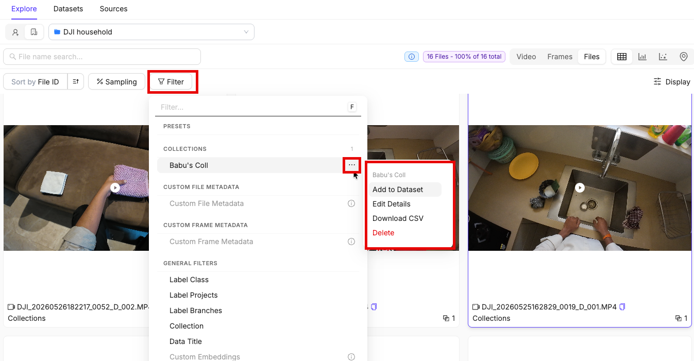

+++
date = '2026-11-14T00:00:00+08:00'
lastmod = '2026-11-14T00:00:00+08:00'
draft = false
isCJKLanguage = true
contentLanguage = 'zh-CN'
title = 'Encord 深度拆解：产品定义、策展标注交互与平台架构'
description = '先了解 Encord 是什么、为谁解决什么问题，再沿数据筛选、标注审核与评测流程，理解产品交互、核心对象和平台架构。'
summary = '先用功能概览了解 Encord 能做什么，再分析对象关系、关键交互与平台架构。'
categories = ['数据飞轮']
tags = ['Encord', '数据平台', '标注平台', '产品设计', '系统架构']
math = false
+++

[专题导读与横向比较]() · [FiftyOne 开源版]() · [Voxel51 商业平台]() · [Encord]()

**资料更新：2026-11-14（Asia/Shanghai）**。基于官方公开资料研究，来源与证据边界见文末。

<!--more-->

## 1 产品介绍与核心功能

**Encord 是用于 AI 数据准备与质量管理的商业平台，支持图片、视频等多种媒体类型，主要通过浏览器使用。** 它的核心功能及作用如下。[产品介绍](https://encord.com/)、[模块划分](https://docs.encord.com/solutions-documentation/enterprise-ai/platform-architecture)

| 核心功能 | 作用 |
| --- | --- |
| 数据接入与管理 | 上传文件或连接已有云存储，通过目录和自定义字段组织数据，为检索、标注和分析提供统一入口。 |
| 数据检索与策展 | 按字段、质量指标或内容相似度寻找样本，并将选中结果保存为集合，用于后续标注或分析。“策展”就是有目的地筛选和整理数据。 |
| 标签规范与项目管理 | 定义要标注的类别、形状和属性，将数据、人员和处理流程组织到项目中，明确工作范围与规则。 |
| 人工标注与审核 | 在编辑器中创建和修改标签，由审核人员检查、接受或退回，形成可追踪的协作流程。 |
| Agents 自动化 | 将模型或自定义程序加入工作流，辅助生成标签、检查数据或选择后续处理路径，减少重复操作。 |
| 标签质量与模型评测 | 检查标签问题，并将模型预测与参考标签比较，通过误检、漏检等结果定位具体样本，帮助确定修正范围。 |
| 标签版本与导出 | 保存标签历史版本并导出标注结果，用于数据交付、结果对照和问题追溯。各版本机制的保存范围见第 3.5 节。 |
| SDK、API 与事件集成 | 用程序读写平台数据、执行自动化，并接收任务事件，将 Encord 的工作结果接入已有系统。 |

## 2 核心对象与数据关系

Data Unit 是一次标注任务处理的数据单位，可以是一张图片、一段视频、一组图像或一个 DICOM 医疗影像序列。Label Row 是该数据单位在某个项目中的整组标签记录。因此，一段视频可以作为一个任务处理，其中包含多帧和多个标签，文件数、任务数与标签数需要分别统计。[术语表](https://docs.encord.com/platform-documentation/General/annotate-glossary)

Collection 是用户选中的文件、数据单位或标签组成的集合。Data > Explore 中管理 File Collection；Project > Explore 中管理 Data Collection 和 Label Collection。不同集合支持不同批量操作，例如对项目内的数据集合处理任务，或对标签集合修改对象类别。[Collections](https://docs.encord.com/platform-documentation/Curate/collections/index-collections)

Dataset（数据集）组织项目要处理的数据；Ontology（标签规范）定义类别、形状和属性；Workflow（工作流）定义处理阶段及流转规则。Project（项目）将这些配置与协作人员组合起来。一个项目可以使用多个数据集和一个 Ontology，同一 Ontology 可以供多个项目复用。[Datasets 与对象关系](https://docs.encord.com/platform-documentation/Annotate/annotate-datasets/annotate-datasets)


flowchart TD
    I[存储集成与文件引用] --> X[Explore 检索与筛选]
    X --> C[Collection 候选分组]
    C --> D[Dataset]
    D --> P[Project]
    O[Ontology 标签协议] --> P
    W[Workflow 阶段与路由] --> P
    U[协作者与角色] --> P
    P --> T[Data Unit 对应的任务]
    T --> L[项目内 Label Row]
    L --> E[审核 评测 导出]


图中展示常见操作路径。Dataset 也可以直接添加已有文件，无需先创建 Collection。

## 3 策展、标注与审核交互

不同媒体使用不同工具：视频涉及帧与时间，文档涉及页面与区域。具体编辑、检索和评测支持范围需查对应模态说明。[支持的数据](https://docs.encord.com/platform-documentation/General/general-supported-data)

### 3.1 接入文件并准备检索所需的数据

Encord 支持直接上传文件，也支持连接云存储并注册文件引用。用户可以为文件添加采集时间、来源等自定义元数据，并通过 schema（字段结构）规定字段类型和可用的筛选条件。[元数据 schema](https://docs.encord.com/platform-documentation/Curate/custom-metadata/index-metadata-schema)

文件导入后可以进行基础浏览和过滤。质量指标、相似检索和特征分布图还需要准备相应计算结果；文档要求为文件夹开通相应能力并计算指标与嵌入。嵌入（embedding）是模型生成的一组数值特征，用来比较样本内容。[Curation basics](https://docs.encord.com/platform-documentation/Curate/curation-basics)

从产品设计角度，这类准备过程适合分别显示“可预览”“字段可查询”“相似检索可用”等状态，让用户知道当前能做什么、还需要等待什么。这是本文的设计建议。

### 3.2 在 Explorer 中结合样本与分析结果筛选

Explorer 是数据浏览与分析页面。左侧网格展示样本，右侧可切换 Embeddings（嵌入分布）、Analytics（统计分析）或 Map（地图）。用户在嵌入图中框选一组点后，可以在网格中检查对应内容，再通过底部工具栏将其加入或移出 Collection。[Data Visualization](https://docs.encord.com/platform-documentation/Validation/active-basics/data-visualization)

嵌入图使用 UMAP 等降维方式，将高维特征投影为二维散点。用户也可以选择导入的自定义嵌入。生成向量、准备相似检索和生成二维投影是不同步骤，各自需要相应计算与配置。[Embedding plots](https://docs.encord.com/platform-documentation/Curate/embedding-plots)

### 3.3 用 Preset 保存条件，用 Collection 保存选中项

Preset 保存筛选条件，适合反复执行同一类查询；Collection 保存用户选中的成员，便于批量添加到数据集、导出 CSV 或执行项目内操作。[筛选与 Preset](https://docs.encord.com/platform-documentation/Curate/curation-basics)、[集合操作](https://docs.encord.com/platform-documentation/Curate/collections/index-collections)

*来源：[Collections 官方文档](https://docs.encord.com/platform-documentation/Curate/collections/index-collections)。此图为官方历史示例，最新菜单已有更细的操作分组。*

创建路径为：搜索、排序和过滤 → 选择数据 → Actions → Add to collection → 创建或选择集合。集合成员可以继续增删；删除集合本身会保留原始成员数据。因此，Collection 适合组织工作范围，交付历史结果还需要使用版本机制。

批量操作还需要确认 **Select all（全选）的范围**。不同页面可能按全部匹配结果或已加载项处理，应结合页面说明核对数量后操作。

### 3.4 将数据加入项目并设置标签规范

Dataset 可以添加已有文件，再关联到项目。普通数据集、Mirrored dataset（镜像数据集）和 Continuous data flow（持续数据流）采用不同更新规则：持续数据流随源目录变化增删文件，镜像数据集则对源目录与数据集之间的同步作出约束。[Dataset 更新与镜像规则](https://docs.encord.com/platform-documentation/Annotate/annotate-datasets/annotate-datasets)

持续同步会改变数据集成员。要复现某次训练或交付，需要记录当时的数据范围、标签版本和标签规范。

创建项目时，用户选择数据集、Ontology、工作流与协作人员。Ontology 定义要标注的类别、形状和属性；原始文件的元数据则用于描述、检索文件，两者分别配置。[Ontology 结构](https://docs.encord.com/platform-documentation/Annotate/annotate-ontologies/annotate-ontologies)

### 3.5 保存标签版本并导出

当前官方文档区分 Label sets、Label Checkpoint / label branches、prediction branches 和旧的 saved versions。Label sets 处于 Beta，需要组织开通，可以将项目 `main` 分支中的选定标签保存为带编号的只读版本。目前需在界面中手动创建，文档尚未提供 SDK 支持。[标签版本机制比较](https://docs.encord.com/platform-documentation/Annotate/annotate-export/annotate-label-versioning-compared)

用户在项目的 Versioning 侧边面板中定义选择规则，点击 Create version 保存当时的标签，再从历史版本导出。Label set 是可复用的选择规则，version 是按规则保存的结果。Checkpoint 则在任务经过某阶段时复制标签到分支，任务重入或 SDK 写入可能改变该分支。两种机制的可变性不同，且都需要另行考虑原始媒体的保存。[Label Sets 的交互和限制](https://docs.encord.com/platform-documentation/Annotate/annotate-export/annotate-label-sets)

### 3.6 分配标注与审核任务

Encord 的工作流画布允许增加阶段与连接路径。Annotate、Review、Consensus、路由与 Agent 等组件具有不同职责；审核不通过可以返回前序，自动处理可以根据结果进入不同出口。[Workflow 与阶段定义](https://docs.encord.com/platform-documentation/Annotate/annotate-projects/annotate-workflows-and-templates)

下面是解释用的常见流程示意，不表示厂商预置模板或必须采取这一顺序：


flowchart LR
    S[开始] --> A[自动处理]
    A --> N[人工标注]
    N --> R[审核]
    R -->|通过| C[完成]
    R -->|退回| N
    C --> E[导出或外部系统]


工作流需要管理人员分工、等待、提交和退回。任务可能长时间等待人工处理，因此开发类似系统时，需要保存业务阶段和处理人，并允许任务在审核后返回标注阶段。

**保存内容、提交审核、审核通过和流程完成**分别表示编辑已保存、工作已移交、结果被接受和任务到达终点。界面与事件接口需要清楚区分这些状态，便于统计进度和触发后续操作。

Encord 的角色文档进一步限制不同人员的操作：管理者控制任务分配和状态，标注员与审核员按职责处理任务；Workflow 项目的 Viewer 可以只读浏览 Explore，但不能执行集合修改和批量操作。[权限矩阵](https://docs.encord.com/platform-documentation/Annotate/roles-and-permissions)

标注员在 Label Editor 中查看媒体画布，选择类别、编辑形状和属性，并通过时间线处理视频标签，完成后提交或跳过任务。视频中的 instance 表示一个可跨帧存在的对象，frame label 表示该对象在某一帧的标注；复制形状与复制对象因此可能产生不同结果。[标注编辑器](https://docs.encord.com/persona-taskers/tasker-label-editor-annotator)

审核模式将注意力转向待审标签、问题和通过／拒绝。文档提供单标签审核模式，突出当前对象、隐藏其他对象，便于连续检查属性；也支持按状态筛选和批量操作。[审核编辑器](https://docs.encord.com/persona-taskers/tasker-label-editor-reviewer)

从交互设计看，标注模式应便于连续创建和修改标签，审核模式应便于快速定位问题、检查属性并作出判断。两者可以共用画布，但需要适合各自工作的默认显示与快捷操作。

### 3.7 在工作流中配置自动处理

Agent 是接入平台工作流的自动处理程序。用户通过 Agent Catalog 选择和配置现有能力，也可以为自定义 Agent 登记 HTTPS 服务地址。配置包括标签规范、处理目标和外部服务凭据。[Agents overview](https://docs.encord.com/platform-documentation/Annotate/automated-labeling/annotate-agents-overview)

配置自动化时，需要明确输入数据、结果写入位置、完成后进入哪个阶段，以及是否安排人工检查。平台与外部服务的调用方式见第 4.2 节。

## 4 平台逻辑架构与集成协议

### 4.1 媒体文件与平台记录如何存储

BYO-storage 是使用客户自有存储的模式：平台注册文件引用，管理元数据、标签和嵌入，原始文件保留在客户存储中。Encord-managed storage 则由 Encord 托管上传文件。普通集成与 strict client external integration（严格客户外部集成）的代理和缓存规则有所不同。[存储与注册模式](https://docs.encord.com/solutions-documentation/enterprise-ai/platform-architecture)

浏览器播放、人工标注和模型处理仍需要读取媒体内容。具体由谁传输、是否经过代理或缓存，取决于集成与部署模式。

以下是基于公开产品和集成接口整理的逻辑架构，不声明内部采用何种数据库、消息中间件或服务框架：


flowchart TD
    UI[Web 工作台与 SDK] --> DATA[文件引用与公共数据对象]
    DATA --> CURATE[检索 筛选 Collection]
    DATA --> ANN[Project 与标签数据]
    ANN --> WF[Workflow 与任务状态]
    ANN --> EV[质量分析与模型评测]
    WF --> HUMAN[标注员与审核员]
    WF --> AG[平台 Agent 或外部服务]
    WF --> HOOK[Webhook 与导出集成]
    DATA --> STORAGE[客户存储或托管存储]
    CURATE -.使用计算结果.-> EMB[指标与嵌入能力]
    EV -.使用计算结果.-> EMB


同一文件可以供不同项目使用，各项目分别管理自己的标签规范、标签结果和任务状态。这样可以复用原始数据，同时保留不同任务的处理结果。[数据集关系](https://docs.encord.com/platform-documentation/Annotate/annotate-datasets/annotate-datasets)、[Label Row 定义](https://docs.encord.com/platform-documentation/General/annotate-glossary)

### 4.2 平台与外部 Agent 如何交换任务和结果

Agent 阶段提供两种执行方式：Auto 模式由平台调用配置的 Agent；Advanced 模式由用户运行自己的服务，通过 SDK 从阶段队列获取任务。外部服务处理后写入结果，并选择 pathway（后续流转路径）推进任务。任务就绪通知可以减少持续轮询，但接到通知后仍需获取具体任务。[Agent 工作流接口](https://docs.encord.com/platform-documentation/Annotate/annotate-projects/annotate-workflows-and-templates#agent)

集成代码需要将任务 ID、输入数据和输出标签对应起来，处理写入失败与重复执行，并明确何时推进任务阶段。公开接口没有充分说明后台锁和事务实现，因此不能据此确认每个任务只会执行一次。

### 4.3 用 Webhook 通知外部系统

Webhook 是平台向指定服务发送的 HTTP 事件通知。Encord 可在标注提交或任务完成时发送 JSON；通知可能重复、乱序，重试次数也有限。接收端应按事件 `uid` 去重，并定期核对平台状态，补齐遗漏事件。[Webhook 交付规则](https://docs.encord.com/platform-documentation/Annotate/annotate-webhooks-notifications)

文档提供签名验证方式。建议接收服务先验证签名、保存事件并确认接收，再异步执行标签导出等耗时操作，避免处理过慢引起重复投递。

普通任务完成通知与 Agent 任务就绪通知也不应混成一种业务事件。前者告诉外部系统某项状态已变化，后者提示队列还有工作，接到通知后仍需读取对应对象。

### 4.4 将评测发现的问题交回数据处理流程

Encord 的产品文档将预测导入、标签与模型分析纳入项目的 Explore 流程。使用者可以检查指标，回到样本或标签，再通过 Collection 和任务动作组织后续工作。[模型预测与评测](https://docs.encord.com/platform-documentation/Validation/active-how-to/active-model-predictions-eval)

用户可以选择类别，调整 IoU（预测区域与参考区域的重合程度）和置信度阈值，查看指标与错误分布。官方说明，其 mAP（平均精度均值）的部分类别处理与匹配规则，与所比较版本的 TorchMetrics / pycocotools 存在差异。与训练脚本比较指标前，需要先对齐计算规则。

发现错误后，还需要确认参考标签、安排修订、导出结果，并在外部训练流程中使用新数据，再将预测导回评测。各步骤之间需要配置明确的数据与事件接口。

### 4.5 云服务与私有部署的维护责任

Encord 公开列出 Cloud、VPC 和 On-Premise 部署。私有部署文档要求客户具备 Kubernetes 等运维能力，承担相应兼容、版本和网络管理；离线部署属于企业支持范围。[部署选项与要求](https://docs.encord.com/platform-documentation/Other/deployment-options)

部署架构需要分别说明应用、媒体和计算资源的位置，以及各部分由谁维护。将媒体保存在客户存储中，与将整个平台部署在客户网络内，是两种不同配置。

## 5 理解其设计取舍

Encord 的设计重点是将数据筛选结果交给后续项目处理，并保留文件、标签和任务之间的关联。Collection 用来组织选中项，Dataset 组织项目数据，Project 安排人员与流程，标签版本保留特定时刻的结果。职责划分便于管理复杂工作，也增加了用户需要理解的概念。

[FiftyOne 篇]()可以对照可编程数据工作台的组织方式，[Voxel51 篇]()可以对照共享作业与部署扩展。这里不预设采购或自建结论。

## 附录：资料与验证边界

阅读旧资料时，Index、Annotate、Active 大致对应数据管理策展、标注、质量分析与评测方向，不能据此认定旧模块与当前套餐一一对应。历史 Encord Active OSS 已归档；当前公开的 Python SDK 和 Agents 库用于访问、扩展商业平台，并不包含完整商业后台。[旧开源仓库](https://github.com/encord-team/encord-active)、[Python SDK](https://github.com/encord-team/encord-client-python)、[Agents](https://github.com/encord-team/encord-agents)

本文以公开资料理解产品和逻辑架构。文中的示例流程与自绘图用于解释设计，不是租户操作记录或内部部署拓扑。

- [文档索引](https://docs.encord.com/llms.txt)：用于定位当前有效页面，避免只靠旧教程导航。
- [术语](https://docs.encord.com/platform-documentation/General/annotate-glossary)、[Collection](https://docs.encord.com/platform-documentation/Curate/collections/index-collections)、[Dataset](https://docs.encord.com/platform-documentation/Annotate/annotate-datasets/annotate-datasets)：核心对象。
- [元数据 schema](https://docs.encord.com/platform-documentation/Curate/custom-metadata/index-metadata-schema)、[Ontology](https://docs.encord.com/platform-documentation/Annotate/annotate-ontologies/annotate-ontologies)：资产描述与标注协议。
- [Curation](https://docs.encord.com/platform-documentation/Curate/curation-basics)、[可视化](https://docs.encord.com/platform-documentation/Validation/active-basics/data-visualization)、[嵌入图](https://docs.encord.com/platform-documentation/Curate/embedding-plots)：筛选、观察和选择。
- [Workflow](https://docs.encord.com/platform-documentation/Annotate/annotate-projects/annotate-workflows-and-templates)、[Agent](https://docs.encord.com/platform-documentation/Annotate/automated-labeling/annotate-agents-overview)、[Webhook](https://docs.encord.com/platform-documentation/Annotate/annotate-webhooks-notifications)：任务与外部处理。
- [模型评测](https://docs.encord.com/platform-documentation/Validation/active-how-to/active-model-predictions-eval)、[权限](https://docs.encord.com/platform-documentation/Annotate/roles-and-permissions)、[部署](https://docs.encord.com/platform-documentation/Other/deployment-options)：结果分析与组织运行。

标签版本补充：[版本机制比较](https://docs.encord.com/platform-documentation/Annotate/annotate-export/annotate-label-versioning-compared)、[Label Sets Beta](https://docs.encord.com/platform-documentation/Annotate/annotate-export/annotate-label-sets)。编辑器补充：[标注模式](https://docs.encord.com/persona-taskers/tasker-label-editor-annotator)、[审核模式](https://docs.encord.com/persona-taskers/tasker-label-editor-reviewer)。

本文依据官方文档与公开示例还原交互，未登录 Encord 租户，未调用生产 API，也未验证闭源后台和容量。Label sets 的 Beta 与组织启用条件按访问时文档理解。
