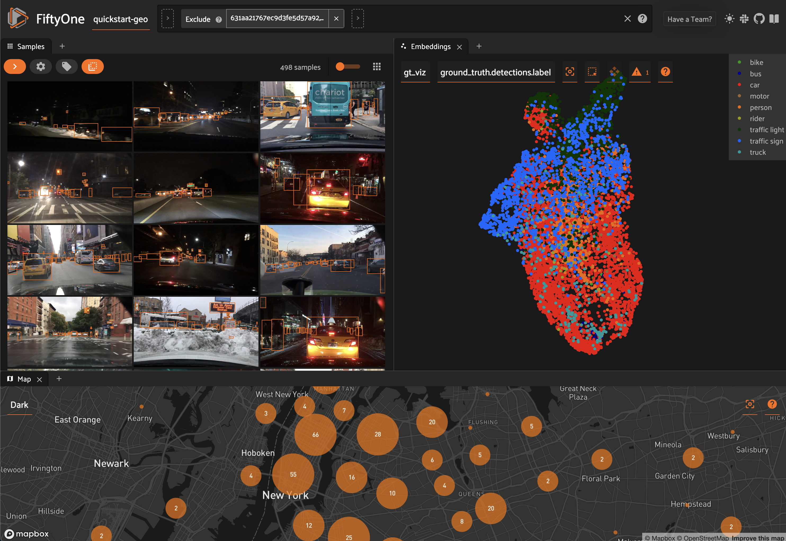

+++
date = '2026-11-14T00:00:00+08:00'
lastmod = '2026-11-14T00:00:00+08:00'
draft = false
isCJKLanguage = true
contentLanguage = 'zh-CN'
title = 'FiftyOne 开源版深度拆解：产品定义、交互与源码架构'
description = '研究 FiftyOne 的数据对象、样本浏览、原生标注、评测、插件，以及 React、Python 服务端、MongoDB 与媒体访问的架构。'
summary = '沿样本、视图与一次筛选操作理解 FiftyOne，区分开源工具本身和企业平台扩展。'
categories = ['数据飞轮']
tags = ['FiftyOne', '数据平台', '产品设计', '系统架构']
math = false
+++

[专题导读与横向比较]() · [FiftyOne 开源版]() · [Voxel51 商业平台]() · [Encord]()

**资料更新：2026-11-14（Asia/Shanghai）**。基于官方公开资料研究，来源与版本边界见文末。

<!--more-->

## 1 产品介绍与核心功能

**FiftyOne 是 Voxel51 开发的开源视觉与多模态数据工具，由 Python SDK 和浏览器 App 组成。** 它主要帮助算法工程师和研究者检查数据、标签及模型预测，核心功能如下。[官方快速入门](https://docs.voxel51.com/getting_started/index.html)

| 核心功能 | 作用 |
| --- | --- |
| 数据浏览与多面板工作区 | 在同一工作区查看样本、标签、嵌入分布和地图，结合原始内容与统计结果分析问题。 |
| 筛选与保存视图 | 按字段、标签和评测结果筛选、排序数据，并保存查询规则，便于重复分析或导出子集。 |
| 相似检索与数据质量分析 | 通过向量特征查找相似样本或局部对象，并提供重复、离群和疑似标签错误等线索，帮助确定检查范围。 |
| 模型评测与错误分析 | 将预测与参考标签比较，计算指标，并把误检、漏检等结果关联到具体对象，便于查明错误原因。 |
| 原生标签编辑 | 在样本详情中修改类别、属性和几何标注，适合检查数据时直接修正单个样本。 |
| 插件与自定义操作 | 将自己的分析或处理程序加入工作台，使用户可以针对当前数据集、视图或选中项执行操作。 |

## 2 核心对象：Dataset、Sample 与 View

Dataset 是数据集，保存样本及其字段结构（schema）；Sample 是其中的一条样本记录，通常通过 `filepath` 引用图片、视频等媒体文件。字段可保存分类、检测、分割标签、模型预测和自定义信息。视频使用 Frame 记录帧级信息；Grouped dataset 将需要一起查看的多视角或多模态样本组织为一组。[基础对象](https://docs.voxel51.com/user_guide/basics.html)、[分组数据](https://docs.voxel51.com/user_guide/groups.html)

本文所查版本的多模态文档以 episode（一段连续采集记录）作为样本，支持同步查看 MCAP 与 LeRobot 数据。多个播放面板共享时钟，便于对照同一时刻的不同数据。多模态可视化对所有用户开放；MCAP 列式索引、片段嵌入等商业能力则处于 Beta 阶段。[多模态说明](https://github.com/voxel51/fiftyone/blob/acc8bd98992008031fb5cd821b70f71372a8606d/docs/source/user_guide/multimodal.rst)

参考标签和模型预测可以保存在同一样本的不同字段中。这样，用户检查一个错误的检测框时，可以直接对照原图、参考答案和其他模型的预测。

DatasetView 是一组作用于数据集的筛选、排序和转换规则。例如，用户可以只查看验证集，或按预测置信度排序。**保存视图会保存查询规则，底层数据变化后，查询结果也可能变化。**[Dataset views](https://docs.voxel51.com/user_guide/using_views.html)

下面是概念关系，省略了大量字段与实现细节：


flowchart TD
    D[Dataset 与 schema] --> S[Sample 与媒体引用]
    S --> F[视频 Frame]
    S --> L[标签与预测字段]
    D --> V[DatasetView 操作序列]
    V --> R[当前查询结果]
    D --> E[评测记录与结果]
    D --> B[Brain 分析与索引引用]


## 3 功能与关键交互

### 3.1 在同一工作区查看样本与分析结果

FiftyOne App 使用样本网格展示数据，点击样本后进入详情。Spaces 是工作区布局功能，可将 Samples（样本）、Embeddings（嵌入分布）、Map（地图）等 Panel 面板放在一起。[App 文档](https://docs.voxel51.com/user_guide/app.html)



*官方历史示例图，来自 [App / Spaces 文档](https://docs.voxel51.com/user_guide/app.html#spaces)。界面图用于说明多面板结构，不代表固定提交对应的最新全部视觉样式。*

图中顶部显示当前数据集和视图，左侧网格展示样本，右侧散点图和底部地图分别展示特征分布与地理分布。用户可以结合这些面板检查同一批数据。

开发这类工作台时，需要让各面板共享当前筛选条件、选中项和样本记录。用户从散点图切换到样本详情时，应能继续检查刚才关注的数据。

### 3.2 浏览、过滤与保存视图

一条常见路径是：加载 Dataset，选择需要查看的标签和字段，组合筛选及排序，打开某个样本核查，再保存有价值的视图。FiftyOne 的程序接口与 App 共享 DatasetView 概念，让交互发现可以转为可复用的查询。[视图操作](https://docs.voxel51.com/user_guide/using_views.html)

下面是文档接口的示意用法，假设本机已有相应数据集和字段；本文未在本地安装 FiftyOne 执行此例：

```python
import fiftyone as fo
from fiftyone import ViewField as F

dataset = fo.load_dataset("my_dataset")
view = dataset.match(F("split") == "validation").limit(100)
session = fo.launch_app(view)
```

这段代码加载一个已有数据集，筛选 `split` 为 `validation` 的前 100 条样本，再通过 Session 在 App 中展示结果。

需要区分**过滤样本与过滤样本中的标签**。一张图片包含多个对象时，“保留含有某类对象的图片”会筛选整张图片；“只显示符合条件的标签”则会改变图片中展示的标注。界面应明确用户正在操作哪一层数据。

### 3.3 用向量特征查找相似数据

嵌入（embedding）是模型生成的一组数值，用于表示图片或对象的特征。FiftyOne Brain 利用这些特征提供可视化、相似检索、重复与近重复分析等功能，也提供唯一性、潜在标签错误和困难程度等分析。检索范围可以是整张图片，也可以是图片中的对象区域（patch）。[Brain 官方文档](https://docs.voxel51.com/brain.html)

用户可以从散点图中的点打开原始样本，再检查相似内容。二维投影适合发现分布线索；判断标签是否正确、样本是否值得保留，仍要结合原始内容和生成嵌入的模型。

### 3.4 从评测指标定位误检和漏检

FiftyOne 的检测评测可以生成 evaluation patches view，单独展示正确匹配（TP）、误检（FP）、漏检（FN）对应的对象。用户可以筛选某类错误，检查对应区域，再打开原始样本。[检测评测与 patches](https://docs.voxel51.com/user_guide/evaluation/detections.html)

评测结果因此可以继续参与查询。用户找到一类错误后，还能核对参考标签（Ground Truth，GT），或查找相关样本。

误检和漏检表示预测与指定参考标签不匹配，具体原因仍需检查样本。修改参考标签后，需要重新评测，才能判断新数据上的模型表现。

### 3.5 在样本详情中编辑标签

固定提交的 In-App Annotation 文档标注其从 OSS 1.13.0、Enterprise 2.16.0 引入。用户打开样本详情后，在右侧 Annotate 页签编辑；先定义 Annotation Schema，才能使用其中配置的字段、类别和属性。文档列出的能力包括图像、视频与 3D，以及分类、回归、检测、分割、折线、多边形、三维框和时段事件等。[原生标注定义与版本](https://github.com/voxel51/fiftyone/blob/acc8bd98992008031fb5cd821b70f71372a8606d/docs/source/user_guide/annotation.rst)

查看与编辑都在样本详情中完成。修改会自动保存，界面显示保存状态；撤销和重做仅覆盖当前标注会话。标签审核与长期版本记录需要另行管理。

该文档把开源版原生标注定位为逐样本编辑。批量分工、任务分配和团队审核由商业平台的 Projects 等功能组织。

## 4 平台架构与调用链

### 4.1 前端、Python 服务和通信方式

固定提交中的 Web App 是 React 生态的应用，依赖 Relay、Recoil 以及 `@fiftyone/state`、`@fiftyone/relay` 等内部包。Python 服务端使用 Starlette 和 Strawberry GraphQL，服务启动代码使用 Hypercorn。这里说的是所查代码，不推断所有商业服务都使用同一技术栈。[前端依赖](https://github.com/voxel51/fiftyone/blob/acc8bd98992008031fb5cd821b70f71372a8606d/app/packages/app/package.json)、[服务端 App](https://github.com/voxel51/fiftyone/blob/acc8bd98992008031fb5cd821b70f71372a8606d/fiftyone/server/app.py)、[启动入口](https://github.com/voxel51/fiftyone/blob/acc8bd98992008031fb5cd821b70f71372a8606d/fiftyone/server/main.py)

服务端同时提供 GraphQL 和专用 HTTP 接口，后者处理聚合、媒体、视频帧、样本选择、标签、嵌入与插件等请求。界面状态更新使用 SSE（服务端通过 HTTP 持续推送事件），并提供轮询分支。[路由表](https://github.com/voxel51/fiftyone/blob/acc8bd98992008031fb5cd821b70f71372a8606d/fiftyone/server/routes/__init__.py)、[事件路由](https://github.com/voxel51/fiftyone/blob/acc8bd98992008031fb5cd821b70f71372a8606d/fiftyone/server/routes/events.py)


flowchart TD
    UI[浏览器 React App] -->|GraphQL 与专用 HTTP| API[Python Web 服务]
    API -->|SSE 或 polling 分支| UI
    PY[Python SDK 与 Session] --> CORE[Dataset View 与分析逻辑]
    API --> CORE
    CORE --> DB[MongoDB 元数据与标签]
    CORE --> IDX[相似检索后端]
    API --> MEDIA[媒体读取与帧访问]
    MEDIA --> FS[文件系统或媒体存储]
    OP[插件与 Operator] --> CORE
    UI --> OP


图中以职责简化调用关系；不表示全部模块在不同进程，也不表示所有媒体都必须经过同一中转路径。Brain 支持的检索后端和配置可见[相似检索文档](https://docs.voxel51.com/brain.html#similarity)。

### 4.2 元数据、媒体和向量分别存储

样本字段与标签由 MongoDB 管理，图片和视频通过媒体路径访问，相似检索可以连接不同后端。数据库模块中的 ODM 负责将 Python 数据对象映射为数据库记录。[数据库模块](https://github.com/voxel51/fiftyone/blob/acc8bd98992008031fb5cd821b70f71372a8606d/fiftyone/core/odm/database.py)

| 数据种类 | 主要访问方式 | 需要保留的关联 |
| --- | --- | --- |
| 样本、字段结构、自定义字段 | 按条件查询、过滤、聚合 | 数据集与样本 ID |
| 标签与预测 | 按样本、对象或帧访问 | 字段、对象 ID 与帧号 |
| 图片、视频和大文件 | 按需读取、解码与播放 | 媒体路径及内容版本 |
| 高维向量与相似结果 | 最近邻查询和排序 | 向量模型、样本或对象 ID |
| 分析和评测记录 | 依据运行配置解释结果 | 数据、字段和协议 |

表中关联要求是从平台开发角度提出的设计考虑。不同存储适应不同的访问需求，同时也带来一致性问题：删除样本后需要处理外部索引，媒体路径变化后需要检查历史记录能否继续访问文件。

### 4.3 筛选条件如何更新界面

用户修改筛选条件后，样本列表、字段统计、可见标签和关联面板都可能需要更新。服务端按视图规则查询与聚合数据，前端更新显示，Session 事件则用于同步相关会话状态。

下面是依据上述模块组织的概念时序，不对应逐行网络抓包：


sequenceDiagram
    participant U as 用户
    participant A as App
    participant S as 服务端
    participant D as 数据与索引
    U->>A: 修改筛选条件
    A->>S: 提交查询或视图变更
    S->>D: 按视图读取与聚合
    D-->>S: 样本和统计结果
    S-->>A: 返回数据与状态
    A-->>U: 更新网格与关联面板
    U->>A: 打开样本
    A->>S: 请求媒体或帧内容
    S-->>A: 返回所需内容


从实现上需要区分两类状态：当前筛选条件、正在查看的样本等会话状态，以及标签、评测记录等持久数据。前者用于同步界面，后者需要可靠写入数据库；多人编辑产生的冲突还需要单独处理。

### 4.4 插件如何获取输入并执行操作

FiftyOne 的插件包含界面扩展和 Operator（可执行操作）。Python Operator 通过 `resolve_input()` 定义输入表单，通过 `execute()` 执行处理，并能获取当前数据集、视图和选中项。Panel 用于在工作区内提供可持续操作的自定义面板。[插件开发文档](https://docs.voxel51.com/plugins/developing_plugins.html)

开发者可以把处理逻辑和输入表单一起交给平台，用户直接在当前工作区调用，无需切换到另一个应用。

集成时还需要约定操作范围：处理整个当前视图，还是仅处理选中项；结果写入原字段，还是新字段；操作何时完成，界面何时刷新。这些规则决定了后台任务、权限检查与进度提示怎样实现。

## 5 理解其设计取舍

FiftyOne 的设计重点是让代码分析与样本检查使用同一套数据。可扩展字段、可组合查询和插件给开发者较大自由，同时要求每个操作明确处理哪些数据、修改哪些字段，以及怎样保存和导出结果。

多人共享、项目分工、历史快照和后台任务的组织方式见 [Voxel51 商业平台篇]()。[Encord 篇]()则介绍另一套以项目和工作流组织数据处理的产品。

## 附录：源码阅读路线与验证边界

FiftyOne 源码与商业产品公开文档固定于提交 [`acc8bd989920`](https://github.com/voxel51/fiftyone/commit/acc8bd98992008031fb5cd821b70f71372a8606d)。它代表开发分支当时的状态，不保证全部进入稳定版或客户部署。

自绘图解释对象、职责与调用关系；商业服务内部未公开的部分不作实现推断。

### FiftyOne：固定提交的实现入口

统一版本为 `acc8bd98992008031fb5cd821b70f71372a8606d`。建议按“界面数据需求 → 服务端入口 → 查询与事件 → 存储 → 扩展”阅读，而不是先遍历所有目录。

| 入口 | 可核查的内容 |
| --- | --- |
| [App package](https://github.com/voxel51/fiftyone/blob/acc8bd98992008031fb5cd821b70f71372a8606d/app/packages/app/package.json) | 前端依赖与内部包边界 |
| [Server App](https://github.com/voxel51/fiftyone/blob/acc8bd98992008031fb5cd821b70f71372a8606d/fiftyone/server/app.py) | GraphQL schema、Starlette 与中间件 |
| [Routes](https://github.com/voxel51/fiftyone/blob/acc8bd98992008031fb5cd821b70f71372a8606d/fiftyone/server/routes/__init__.py) | 样本、媒体、聚合、标签等 HTTP 路由 |
| [Events route](https://github.com/voxel51/fiftyone/blob/acc8bd98992008031fb5cd821b70f71372a8606d/fiftyone/server/routes/events.py) | SSE 与 polling 分支 |
| [Event listener](https://github.com/voxel51/fiftyone/blob/acc8bd98992008031fb5cd821b70f71372a8606d/fiftyone/server/events/listener.py) | 事件监听、状态发送与连接清理 |
| [Database utilities](https://github.com/voxel51/fiftyone/blob/acc8bd98992008031fb5cd821b70f71372a8606d/fiftyone/core/odm/database.py) | MongoDB 客户端、数据库版本和连接工具 |
| [Plugin development](https://github.com/voxel51/fiftyone/blob/acc8bd98992008031fb5cd821b70f71372a8606d/docs/source/plugins/developing_plugins.rst) | Operator 输入、执行上下文与 Panel |


本篇已核对上述固定版本源码与相关文档，未安装和完整运行 FiftyOne。示例代码用于说明接口，未作为端到端运行结果。界面图采用官方历史示例，不能据此认定全部最新视觉样式。
