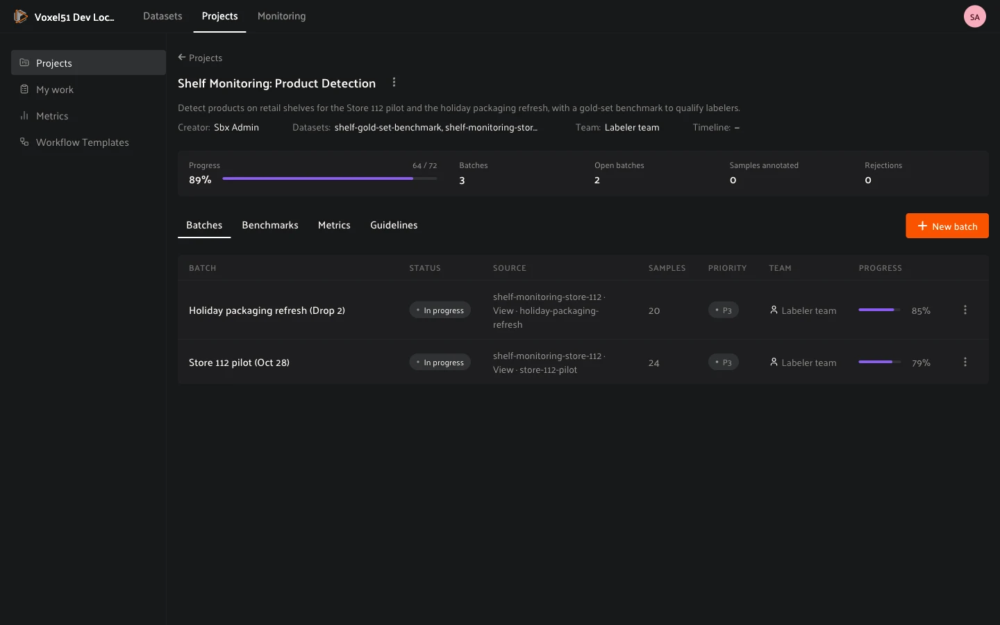

+++
date = '2026-11-14T00:00:00+08:00'
lastmod = '2026-11-14T00:00:00+08:00'
draft = false
isCJKLanguage = true
contentLanguage = 'zh-CN'
title = 'Voxel51 商业平台深度拆解：团队产品、任务交互与部署架构'
description = '研究 Voxel51 如何在 FiftyOne 底座上增加项目、批次、标注审核、权限、版本、委派执行与共享部署。'
summary = '从 Projects、Batches、Tasks 到共享服务，理解数据工作台怎样发展为团队平台。'
categories = ['数据飞轮']
tags = ['Voxel51', 'FiftyOne Enterprise', '数据平台', '产品设计', '系统架构']
math = false
+++

[专题导读与横向比较]() · [FiftyOne 开源版]() · [Voxel51 商业平台]() · [Encord]()

**资料更新：2026-11-14（Asia/Shanghai）**。基于官方公开资料研究，来源与版本边界见文末。

<!--more-->

## 1 产品介绍与核心功能

**Voxel51 商业平台是基于 FiftyOne 的团队数据平台，旧资料常称其为 FiftyOne Enterprise。** 它保留开源版的数据分析方式，并提供团队共享与工作管理能力，核心功能如下。[企业文档](https://docs.voxel51.com/enterprise/)

| 核心功能 | 作用 |
| --- | --- |
| 共享数据工作台 | 让团队访问同一套数据集和分析工具，减少各自维护数据副本造成的差异。 |
| 角色与数据集权限 | 控制不同人员可以查看、编辑和管理哪些数据，为团队协作设置访问范围。 |
| 数据集快照 | 保留平台内数据记录的只读历史状态，便于对照不同版本；外部媒体和向量库需要另行保留。 |
| 项目、批次与任务 | 将待处理数据按工作流组织，并分配给标注员和审核员，方便跟踪进度与结果。 |
| 质量控制 | 通过审核、与参考答案比较、多人标注一致性等机制发现质量问题，并安排修订。 |
| 自动标注与后台执行 | 调用自动处理能力生成标签，并将耗时操作交给后台资源运行；结果可继续交由人员检查。 |

## 2 核心对象：版本、项目、批次与任务

Snapshot（快照）保存数据集某一时刻的只读状态，HEAD 是当前可编辑的状态。快照包含平台内的数据集信息、字段结构、样本、帧及分析评测记录。外部媒体和向量库内容不在快照范围内，版本机制假定这些外部内容保持不变。[版本说明](https://docs.voxel51.com/enterprise/dataset_versioning.html)

例如，同一路径的图片被覆盖后，历史快照即使保留了原路径，也可能读到新图片。要复现一次实验，除了数据集记录，还需要保留当时的媒体文件和外部索引。

本文所查的 **Projects** 文档将团队工作分为三层：Project（项目）组织整体工作，Batch（批次）指定一个数据集及一条 Workflow（工作流），Task（任务）是某阶段分配给人员的工作。管理者查看项目、批次与质量，执行者通过 My work 进入个人任务。[Projects 文档](https://github.com/voxel51/fiftyone/blob/acc8bd98992008031fb5cd821b70f71372a8606d/docs/source/enterprise/projects.rst)

Project 管理工作目标、批次和人员，Dataset 保存被处理的数据。同一项目可以通过多个批次处理不同数据集，删除项目与删除数据集也是两种独立操作。

> **版本提醒**：该提交于 2026-11-13 UTC 将原 Workflows 文档替换为 Projects 文档。网站导航、稳定版和客户租户可能处在不同阶段。本文引用这一对象模型时，以固定提交为依据，不宣称所有部署已具备相同界面。


flowchart TD
    D[Dataset 的可编辑 HEAD] --> S[只读 Snapshot]
    P[Project 团队工作] --> B[Batch 明确来源的批次]
    D --> B
    B --> W[Workflow 阶段与路由]
    W --> T[Task 个人工作份额]
    T --> A[样本标注与审核]
    U[角色与数据集权限] --> P
    U --> T


图中快照记录数据历史，项目、批次和任务记录工作进度。开发类似系统时，这两类信息需要分别管理。

## 3 角色、页面与核心交互

### 3.1 管理者与执行者使用不同入口

最新 Projects 文档将管理者与执行者的路径明确分开：管理者创建项目、组织批次、配置工作流并查看进度；标注员通过 My work 领取或进入任务。项目页包含 Batches、Benchmarks、Metrics 和 Guidelines 等入口。[Projects 固定版本文档](https://github.com/voxel51/fiftyone/blob/acc8bd98992008031fb5cd821b70f71372a8606d/docs/source/enterprise/projects.rst)

*官方开发文档示例图，来源为上述 Projects 文档。图中进度和项目名称是厂商演示内容，不是本文测试结果。*

项目页帮助管理者查看进度、发现阻塞并调整分工；个人任务页则让执行者集中处理当前工作。两类页面共享底层任务数据，但展示的信息与可用操作不同。

### 3.2 从项目到批次，再到任务

管理者先设置项目说明、数据集和默认团队，再创建批次并配置工作流。Annotate 阶段用于标注，Review 阶段通过 Accepted（接受）或 Rejected（拒绝）决定任务去向；Consensus 阶段比较多人的独立标注，将不一致的结果交给后续处理。

批次有 Not started（未开始）、In progress（进行中）和 Done（完成）等状态。样本经过多个阶段时，会产生多次处理记录，因此统计已交付样本数时需要去重，不能直接相加各阶段完成次数。[批次、阶段与进度说明](https://github.com/voxel51/fiftyone/blob/acc8bd98992008031fb5cd821b70f71372a8606d/docs/source/enterprise/projects.rst#how-projects-work)

这种组织方式允许同一项目按数据来源、优先级和团队分批推进。实现时，需要分别记录项目汇总进度、批次状态、个人任务状态和样本所在阶段，才能准确计算工作量。

### 3.3 字段可见性也是工作流的一部分

Label schema（标注字段配置）可以为不同阶段指定可编辑、只读和隐藏字段。例如，模型预测可以供审核员参考，而参考答案可以在独立标注阶段隐藏，以免影响判断。

文档列出两个限制：查询依赖的字段在任务中可能继续可见；删除正在使用的标注配置后，阶段会回退到默认配置。设置隐藏字段时，需要结合这些规则检查实际显示内容。[Label schemas 的行为与限制](https://github.com/voxel51/fiftyone/blob/acc8bd98992008031fb5cd821b70f71372a8606d/docs/source/enterprise/projects.rst#choosing-what-annotators-see-label-schemas)

开发类似功能时，需要同时检查界面显示、查询返回字段和接口权限，确保隐藏信息不会通过其他入口暴露。

### 3.4 权限采用组织角色与数据集权限共同约束

当前文档列出 Admin、Member、Collaborator、Labeler 和 Guest 等组织角色；数据集又具有 Can view、Can tag、Can edit、Can manage 等访问级别。角色会限制能够获得的数据集权限，某些任务操作还有特定规则。[角色与权限](https://docs.voxel51.com/enterprise/roles_and_permissions.html)

实现这类权限时，需要分别检查读取、编辑、导出、删除和任务处理等操作。界面菜单与 SDK 都应由服务端执行相应授权检查。

Benchmark 将人员答案与已知参考答案比较；Consensus 衡量多人答案的一致性。前者依赖参考答案的质量，后者适合发现分歧，两种结果需要分别解释。

### 3.5 自动标注的配置与结果检查

商业平台 Agentic Labeling 文档的交互从选择数据与输出字段开始，配置提示及相关输入，启动运行后查看执行进度和错误，再回到网格检查写入的标签。结果可以交给后续人工审核；一次推理完成与标签被接受仍是不同状态。[Agentic Labeling 公开文档](https://github.com/voxel51/fiftyone/blob/acc8bd98992008031fb5cd821b70f71372a8606d/docs/source/enterprise/agentic_labeling.rst)

这类操作需要明确显示输入范围、输出字段和运行结果。用户应能判断已有标签是否会被覆盖，以及部分失败后哪些样本已经生成结果；相关覆盖与恢复行为仍需按具体版本核实。

## 4 共享服务与执行架构

### 4.1 团队门户、数据工作台与执行服务

官方 Helm 部署文档列出 `teams-app`（团队门户）、`teams-api`（团队 API）、`teams-cas`（认证服务）、`fiftyone-app`（数据工作台），以及可独立运行的插件服务和 delegated-operator 执行资源。Helm 配置说明了这些组件如何部署到 Kubernetes 集群。[官方部署入口](https://helm.fiftyone.ai/)


flowchart TD
    U[浏览器与企业 SDK] --> G[入口与认证]
    G --> CAS[teams-cas]
    G --> PORTAL[teams-app 团队门户]
    G --> API[teams-api]
    G --> APP[fiftyone-app 数据工作台]
    API --> DB[MongoDB]
    APP --> DB
    APP --> PL[可选独立插件服务]
    API --> DO[委派执行资源]
    DO --> STORE[媒体与产物存储]
    APP --> STORE
    API -.按版本与配置启用.-> OBS[活动记录与观测组件]


这是根据公开工作负载整理的职责图，线条不穷举内部调用，也不表示所有能力默认启用。Kubernetes 自部署是本文有配置证据的路径，不能据此概括全部托管环境的实现。

### 4.2 SDK 如何认证并访问数据

企业 SDK 保留 `fiftyone` 包名和相同模块结构，已有脚本可以沿这一体系迁移；连接方式可以使用团队 API，或在相应配置下连接数据库。[安装与连接说明](https://docs.voxel51.com/enterprise/installation.html)

官方 API Connection 文档允许 SDK 使用 API URI 与 API key，并支持服务账户连接。相比让每位使用者直接接触数据库，API 连接提供了另一个身份和访问入口。[API Connection](https://docs.voxel51.com/enterprise/api_connection.html)

从平台开发角度看，API 连接便于由服务统一认证和授权；直接连接数据库则需要另行管理数据库访问、网络和客户端兼容性。采用哪种方式取决于部署配置。

用户账号、服务账户和媒体存储各有访问条件。SDK 能读取样本记录后，其运行环境还需要获得相应图片或视频的读取权限。

### 4.3 将耗时操作交给后台执行

委派执行（delegated execution）将算子提交给后台资源运行，适合耗时分析和批量处理。公开配置提供按需执行、GPU 资源和常驻服务等设置，使计算任务可以与页面交互服务分开运行。[官方执行配置目录](https://github.com/voxel51/fiftyone-teams-app-deploy)

实现后台任务时，需要保存任务 ID、执行资源、运行状态和输出位置。这样，用户关闭页面后可以再次查询进度，并在任务完成后找到对应数据集中的结果。

公开配置可用于理解任务提交与资源分工；跨任务依赖、失败补偿和跨服务事务的完整实现仍未由这些资料确认。

### 4.4 多模态数据采用不同的存储方式

公开 Helm 升级说明指出，2.22+ 的多模态数据支持将较大的模态内容存入基于 Parquet 文件的 Iceberg 表，并由后台流程负责导入和文件合并整理。Parquet 是列式文件格式，Iceberg 用于管理这些文件组成的数据表；具体启用条件见升级配置。[多模态升级与配置说明](https://helm.fiftyone.ai/#version-222)

样本元数据需要灵活的字段查询，大规模时序数据则需要高效的批量读取。底层可以使用不同存储，但界面应将它们关联到同一段采集记录，支持同步查看。

### 4.5 查询性能提示与服务隔离

侧栏可显示字段的索引状态，并引导创建索引或 summary field（用于加速查询的汇总字段）。一些额外统计的查询成本较高，界面提示可以帮助用户理解为何查询变慢，以及可以采取什么措施。[Query Performance](https://docs.voxel51.com/enterprise/query_performance.html)

公开部署配置还允许将自定义插件放进独立工作负载，以降低扩展代码对交互服务的资源影响。活动记录、遥测和队列等组件具有版本及启用条件；例如 Activity Core 不应被描述为任意安装默认具备的完整审计系统。[Helm 配置与升级说明](https://helm.fiftyone.ai/)

将插件与交互服务分开部署，有助于控制扩展代码的资源影响。实际效果还取决于资源限制和监控配置，例如插件内存增长是否影响页面响应，以及后台积压是否可见。

## 5 开源能力与商业扩展的分工

| 层次 | 主要职责 | 阅读重点 |
| --- | --- | --- |
| 数据与分析基础 | 样本、字段、视图、评测、媒体查看 | 开源篇的数据与调用链 |
| 团队业务 | 项目、批次、任务、角色、审核 | 工作属于谁，怎样完成与移交 |
| 部署与运行管理 | 认证 API、执行资源、版本、监控 | 如何共享、持续运行并追溯 |

表中按系统职责归纳商业扩展，便于对应前面的产品流程与部署组件。

[FiftyOne 开源篇]()解释底座实现，[Encord 篇]()解释另一套项目与工作流产品；整体比较见[专题导读]()。

## 附录：资料与验证边界

FiftyOne 源码与商业产品公开文档固定于提交 [`acc8bd989920`](https://github.com/voxel51/fiftyone/commit/acc8bd98992008031fb5cd821b70f71372a8606d)。它代表开发分支当时的状态，不保证全部进入稳定版或客户部署。

自绘图解释对象、职责与调用关系；商业服务内部未公开的部分不作实现推断。

- [Enterprise 文档](https://docs.voxel51.com/enterprise/)与[企业安装](https://docs.voxel51.com/enterprise/installation.html)：产品能力、SDK 及连接方式。
- [API Connection](https://docs.voxel51.com/enterprise/api_connection.html)、[权限](https://docs.voxel51.com/enterprise/roles_and_permissions.html)、[版本](https://docs.voxel51.com/enterprise/dataset_versioning.html)：身份、访问与历史状态。
- [Query Performance](https://docs.voxel51.com/enterprise/query_performance.html)：索引与统计的产品入口。
- [Helm 文档](https://helm.fiftyone.ai/)及[公开部署仓库](https://github.com/voxel51/fiftyone-teams-app-deploy)：工作负载、插件、执行资源和升级条件。动态文档访问日期为 2026-11-14，页面展示 Chart 2.25.2；正文的版本条件按相应升级章节理解。

Projects 的对象和交互依据固定提交中的[公开产品文档](https://github.com/voxel51/fiftyone/blob/acc8bd98992008031fb5cd821b70f71372a8606d/docs/source/enterprise/projects.rst)，不是商业后台源码。未登录租户，未部署商业镜像，未验证真实资源隔离、吞吐或恢复效果。
