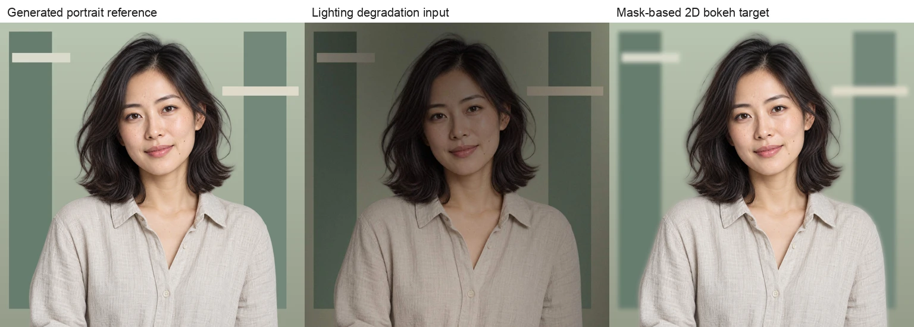

+++
date = '2026-10-13T00:00:00+08:00'
lastmod = '2026-10-14T00:00:00+08:00'
draft = false
isCJKLanguage = true
contentLanguage = 'zh-CN'
title = '影像画质 Auto GT 生成方案与数据平台设计'
description = '研究人像重打光、背景虚化与画质恢复的四条数据生产路线，解释物理渲染、生成式伪参考、Agent 修图和好图退化的监督边界，并设计可追溯生产、审核、评测与失败回流。'
summary = '从一张光影不佳的人像到可训练的数据对，需要定义目标、保留内容、核查参考可信度并验证真实域效果。本文结合原始论文、作者实现和官方模型卡，讨论四条 Auto-GT 路线及其在 Data Flywheel 中的实施方式。'
categories = ['数据飞轮']
tags = ['Auto-GT', '画质提升', '人像重打光', '背景虚化', '合成数据', '数据闭环', 'Agent']
featured = true
+++

一张人像可能有很多种光影问题：窗外太亮、脸部太暗，顶光让眼窝显得沉重，混合色温让脸和脖子颜色不同，背景太杂又抢走注意力。把照片整体提亮只能解决其中一部分。真正的画质提升还要让照明符合目标、人物身份与皮肤纹理保持稳定，并让头发、眼镜和背景边缘自然。

这些要求会直接改变训练数据的生产方式。我们可以在 3D 场景中重渲染同一个人，可以让生成模型制造柔光或侧光候选，也可以让 Agent 操作可追溯的修图工具，或者从好照片合成低质量输入。四条路线都能批量产生数据，但提供的监督并不相同。**一个可靠的 Auto-GT 系统，要能解释目标图根据什么成立、哪些内容允许变化，以及审核通过之后能用于什么训练与评测。**

本文属于[数据飞轮专题]()，聚焦人像重打光、摄影背景虚化以及相关的曝光、噪声、清晰度和色彩恢复。资料与动态许可核验日期为 **2026 年 10 月 13 日**。研究事实按原论文和具体版本理解；平台架构、预算和实施顺序属于本文的工程设计。最后一节说明本轮实现设计与交付边界。

<!--more-->

## 1 先把画质任务和参考目标定义清楚

“光影不好”包含物理、成像和审美三个层面。照明方向影响鼻侧、眼窝和颈部阴影，光源面积影响阴影软硬，环境反射影响肤色和衣服相互染色；相机曝光、白平衡和色调映射决定这些光能怎样进入最终图片；用户又可能偏好明亮自然、暖色氛围或戏剧感。数据配方需要把这三层写开，否则不同目标会在训练中互相冲突。

重打光任务应描述目标光源或目标效果，并规定身份、表情、姿态、衣服、构图和背景的保持范围。将一张暗图改成柔光人像，和把它改成夜景霓虹肖像，是两个不同目标。真实过曝区域已经丢失的纹理还涉及内容补全，必须另记生成属性，不能在“只调光”的标签下悄悄改变任务。

虚化也需要明确方向。摄影人像背景虚化通常让焦点人物保持清晰，背景按照离焦关系变软；修复人物自身失焦则是恢复问题；主动让人物模糊是另一类编辑需求。多人合照还存在焦点选择，不能默认所有人的脸都处于同一个焦平面。平台配方应记录焦点主体、允许失焦的区域及目标强度。

审美目标通常具有多个有效答案。MIT-Adobe FiveK 原论文收集 5,000 张 RAW，并让五位受过训练的摄影师分别修图，明确呈现不同修图解释。它适合说明如何学习编辑偏好，不宜把其中一位修图师的结果当作所有图片唯一的正确答案。[FiveK 原论文](https://people.csail.mit.edu/vladb/photoadjust/db_imageadjust.pdf)

在产品上，可以先建立两种规格：一种是条件明确的任务，例如“给定目标 HDR 环境光和固定光圈”；另一种是意图明确的任务，例如“脸部更易辨认、保留自然肤色、背景弱化”。前者可以检查目标条件符合性，后者需要允许多个候选和偏好评审。把两者区分开，才知道数值误差和人工选择各自该承担什么作用。

## 2 参考来源与审核状态是两个维度

Auto-GT 中的 GT 指 ground truth，即任务使用的参考答案。自动化能降低生产成本，却不会自动增加参考的证据强度。实拍、渲染、退化、修图和生成输出都可能进入训练集，平台应保留它们各自的性质。


| 参考类型 | 典型来源 | 可以监督什么 | 主要限制 |
| --- | --- | --- | --- |
| 实测参考 | 受控光照、固定机位、多曝光或重复采样 | 采集条件与配准误差范围内的真实变化 | 人物微动、设备噪声、曝光关系 |
| 物理渲染参考 | 固定 3D 场景改变光照或孔径 | 指定几何、材质、光学模型下的对应图像 | 真实感与相机域差异 |
| 合成退化参考 | 保留 HQ，产生可复现 LQ | 指定退化过程的恢复 | 退化模型和原 HQ 的质量 |
| 工具编辑伪参考 | 曲线、局部曝光、白平衡、规则虚化 | 编辑结果与操作轨迹 | 未测量原场景光传输 |
| 生成式伪参考 | 重打光或通用图像编辑模型 | 候选目标、偏好和受限伪监督 | 内容漂移与幻觉 |
| 人类偏好 | A/B、平局、可接受性与问题标注 | 某个目标下的选择分布 | 无法定义唯一像素真值 |


这个表是数据组织建议。它的重点是**来源类型和审核状态分别保存**。一个生成目标可以处于“人工接受”，但它仍然是生成式伪参考。审核者认可图像的照明和自然度，不代表真实人物原本具有模型补出的睫毛、牙齿或衣服纹理。

可信度也不宜只压成单一从高到低的等级。实拍图在真实感上占优，但可能配准不佳；渲染对几何对齐可靠，但真实域覆盖有限；工具编辑可复现，但不能创造受遮挡区域的真实观测。更实用的做法是保留来源类型，以及配准、内容保持、物理条件、审美接受和授权状态等独立维度。

还要保留源图自身的性质。一张生成肖像经过压缩和加噪，确实形成了可重放的退化对，但它的目标仍来自生成图。建议分别存 `source_origin_kind` 与配对生成方式：退化过程可靠，不会把源图升级为实拍观测。这也让演示样例、物理渲染人物和真实照片可以使用同一生产流程，同时在训练与评测时正确分组。

导出时再按任务建立过滤规则。曝光恢复实验可以接受严格配对的合成退化图；偏好学习可以使用人工选择的多种修图候选；物理重打光 benchmark 则需要明确目标光照与可靠参考。训练可以混合这些来源，但比例、权重和实验结果应可追溯。

## 3 3D 物理生成路线

### 固定场景后改变光照

3D 路线最有价值的能力，是把真实拍摄中难以保持的变量锁住。定义场景为人物几何、皮肤和衣服材质、头发、背景、相机与时间状态。同一场景先在输入照明下渲染，再在目标照明下渲染，就能得到对应的重打光对。配方只改变灯光时，身份、姿态、表情和构图也应保持一致。

Lumos 使用虚拟灯光台生产人像监督，项目描述 30 万合成样本，每个样本在两个不同 HDR 光照下渲染，并输出 albedo、normal 等属性；外观包括身份、发型、服装和相机姿态的变化。这提供了物理配对加真实域适配的研究先例。[Lumos 官方项目](https://research.nvidia.com/labs/cosmos-lab/lumos/)

SynthLight 则把重打光建模为重渲染，使用 Blender/Cycles 制造合成人像，并用真实无光照标签的肖像联合训练来缓解域差异。其公开数据构造约含 350 位人物、每人约 10 种外观、10 个 HDR 环境及 36 次旋转，总量约 126 万张 512² 图；论文也指出面部细节、服装纹理与姿态覆盖的限制。[SynthLight 原论文](https://arxiv.org/html/2501.09756v1)

这些数量帮助理解如何扩大组合覆盖，却不能等价于独立人物数量。用同一人物渲染大量 HDRI 旋转，模型仍可能缺少新的脸型、发质和材料。实际采样应分层管理人物身份、外观、相机和光照，分别报告覆盖情况；把发丝、眼镜、胡须、耳朵透光和高反射饰品作为困难子组。

人物模型的逼真程度也由多种因素共同决定。几何轮廓、眼睛与口腔、皮肤高光、粗糙度、次表面散射、毛发分布和衣服反射都会改变重打光效果。首批可以只做授权的静态单人近景，先验证配对与颜色，再逐步增加姿态和材料。资产准备、授权和质量检查应计入生产成本。

### 辅助通道与颜色管理

除了输入与目标 RGB，渲染数据还适合保存深度、法线、反照率和主体覆盖。它们帮助训练几何条件模型，也帮助解释失败。不过，平台需要记录每个通道的单位、坐标系、相机模型和用途，避免把“有深度文件”误认为“它与景深 RGB 在所有边缘都精确对应”。

主体覆盖尤其重要。Cryptomatte 的原始工具支持透明、运动模糊与景深，并使用渲染时的对象或材料信息生成 ID matte；Blender/Cycles 的公开实现按对象 ID 和贡献权重记录这些信息。它适合表达一个像素混合多个对象的情况。发丝边缘因此应保留连续覆盖，而不是直接变成硬二值 mask。[Cryptomatte 官方说明](https://github.com/Psyop/Cryptomatte)、[Cycles 官方实现](https://github.com/blender/blender/blob/main/intern/cycles/kernel/film/cryptomatte_passes.h)

建议把 scene-linear EXR 作为可计算的渲染产物，并另存统一 view transform 的 PNG 预览。后续如果在一种颜色映射上审核、在另一种映射上计算误差，就可能把显示差异误判为重打光失败。manifest 应保存曝光、白平衡、颜色空间、OCIO 配置和预览变换，指标执行器按指定域读取。

高样本渲染也有收敛边界。降噪会改变皮肤细节和发丝，高样本参考与降噪参考应分别标记。可以对代表性样本增加采样再次渲染，用残差判断噪声是否仍显著；不能仅因为目标更平滑，就宣称参考质量更高。视频还应缓存动画与物理状态，确保输入和目标对应同一个时间点。

### 从光照配对扩展到景深配对

物理虚化数据应固定场景、视点、焦距、焦点和曝光，再改变孔径。目标是给定光学模型下的景深效果。前景可能也失焦，背景不同深度的模糊程度也可能不同；只有背景二值区域的统一模糊不能覆盖完整任务。

Unreal Path Tracer 的官方文档提供 Reference Depth of Field，说明其可处理透明、体积和毛发几何；MRQ 可以配置采样输出。与此同时，deferred render passes 并不能提供传统离线渲染器的一整套可重组 AOV，具体管线应按实际版本验证。[Path Tracer 官方文档](https://dev.epicgames.com/documentation/en-us/unreal-engine/path-tracer-in-unreal-engine)、[MRQ 官方 render passes](https://dev.epicgames.com/documentation/en-us/unreal-engine/cinematic-render-passes-in-unreal-engine)

引擎能力与素材许可需要分别检查。当前 UE EULA 对 Licensed Technology 的生成式 AI 输入用途，以及 MetaHuman 字符、动画曲线和特定条件下的渲染输出作专门限制。渲染视频免 royalty 的条款不能代替这些用途条款，也不能据此概括所有 Unreal 渲染数据的许可。自有场景和人物资产仍应逐项登记权利范围。[Unreal 官方 EULA](https://www.unrealengine.com/eula/unreal)

## 4 生成式伪参考路线

### 让模型制造受约束的候选

生成式路线适合真实照片中复杂光影的改写，尤其是在没有精确 3D 结构时。它可以生产柔光、侧光、补光或背景匹配候选，但模型会结合先验重建内容。配方应同时表达编辑目标和保持约束，然后把输出送入独立的保真检查与人工审核。

IC-Light 的 SD1.5 路线提供文字与前景条件，以及文字、前景和背景条件；作者用光传输一致性约束训练。界面中的 Left/Right Lighting Preference 实际影响初始 latent 的亮暗布局，不能直接作为标定灯位。官方 README 也提示原 demo 中 BRIA RMBG 1.4 的非商用限制，说明分割依赖必须单独核查。[IC-Light 官方仓库](https://github.com/lllyasviel/IC-Light)

Qwen-Image-Edit-2511 官方模型卡声明改善人物一致性、几何推理，并包含 lighting enhancement 能力；它列出 20B、BF16 和多图编辑示例，模型卡标为 Apache-2.0。这些是具体版本的公开能力与许可声明，平台仍需测实际输入上的漂移、边缘和纹理失败率。[Qwen 2511 官方模型卡](https://huggingface.co/Qwen/Qwen-Image-Edit-2511)

几何与身份条件可以加强控制。DiFaReli 用提取的光照、形状、身份条件和渲染 shading 引导扩散人像重打光，展示了从 2D 数据建立条件的路径。但条件估计本身也会出错，依赖的估计器和权重还具有各自的授权边界。[DiFaReli ICCV 2023 对应论文版本](https://arxiv.org/abs/2304.09479v3)、[作者实现](https://github.com/diffusion-face-relighting/difareli_code)

批量生成时，应从同一原图独立派生候选。若不断用上一轮编辑结果继续编辑，纹理与几何误差可能累积。每个候选需要保存原图摘要、模型与权重 revision、seed、prompt、采样配置、分割或参考条件，以及允许变化区域；同一个 prompt 的新 seed 也是新候选，不能覆盖旧记录。

### 模型许可要一直追到训练用途

Auto-GT 的最终用途通常是训练，因此“可生成”“输出可商用”和“允许拿输出训练这个模型”必须分别核查。例如 FLUX.1 Kontext dev 当前公开许可为 dev 非商用许可，模型运行用途和输出用途分别约束，其中包括输出不得训练、微调或蒸馏与指定 FLUX 模型竞争的模型。这个条件会直接影响训练数据设计，不能用推理代码的开源许可代替。[Kontext dev 当前 LICENSE](https://huggingface.co/black-forest-labs/FLUX.1-Kontext-dev/blob/main/LICENSE.md)

平台模型登记应保存具体文件与版本的许可链接、基础模型、分割依赖、输出训练限制及用途审核记录。这样更换权重或 provider 时，能找出哪些数据集需要重核。不同商业协议可能改变权限，但公开协议中的条件不能被界面上一个“允许商业使用”勾选框概括。

### 避免用同一个模型自证质量

生成器、自动裁判和最终训练模型如果共享先验，可能同时偏好光滑皮肤、明亮肤色或某种构图。多模型投票可帮助找分歧，不能因此提高参考的物理可信度。真正的验证应包含独立受控参考和真实照片盲评，并报告身份保持与照明达成两个不同轴。

恢复模型也具有同样边界。GFPGAN 使用生成式人脸先验，CodeFormer 提供恢复与 fidelity 控制；输出细节来自模型推断，适合成为候选或辅助结果。对于训练配对，未经独立证据核查的恢复图仍应标记伪参考。[GFPGAN 官方实现](https://github.com/TencentARC/GFPGAN)、[CodeFormer 官方实现](https://github.com/sczhou/CodeFormer)

## 5 Agent 修图路线

### 把编辑动作变成可以检查的程序

以参数化曝光和色彩工具为执行器的 Agent 适合需要保留内容的编辑任务。它可以先识别用户意图，再选择工具及参数，观察结果并修订。相较于只保存最终图，操作轨迹能解释脸部为什么变亮、白平衡为什么变化，也能形成动作监督和审美偏好数据。

IEA 的公开系统基于 Qwen2.5-VL-7B，控制参数化编辑器，提供曝光、对比、高光、阴影、饱和度和温度等 16 个全局工具，并输出编辑轨迹。PhotoAgent 则研究探索式视觉审美规划；其公开仓库仍列 Code/Demo Coming，不能仅凭论文名称把它当成已可部署的执行引擎。[IEA 官方实现](https://github.com/OpenDFM/Image_Edit_Agent)、[PhotoAgent 论文](https://arxiv.org/abs/2602.22809)、[PhotoAgent 作者仓库](https://github.com/mdyao/PhotoAgent)

本地基线可以先做有预算的自动化工具编辑：诊断亮度与 clip，生成一小组参数，渲染候选，再按约束筛选和人评。没有模型规划时，界面应称为工具编辑基线。后续接入 Agent，规划器返回结构化工具名、参数与目的；执行器负责白名单、范围校验、超时和文件权限。

要记录完整轨迹，需要给工具定义明确语义。曝光在什么域修改，阴影工具是否含局部 tone mapping，锐化是否影响 alpha，曲线如何插值，都属于配方的一部分。相同工具名而不同实现不能共享一个版本。局部操作还要保存 ROI 或 mask，允许全局变化的编辑应注明原因。

这条路线可以生产可重放的编辑参考，但 2D 局部提亮并没有重新求解脸部光传输。它能改善曝光与对比，也可能留下不合理的阴影。数据类型要根据工具实际能力记录，避免把“左半脸变亮”直接命名为“真实左侧柔光”。

### 限制探索和循环重试

规划器的目标可能与保真约束冲突。例如自动质量分鼓励更清晰，Agent 就持续锐化；整体曝光分鼓励脸部变亮，又可能剪裁高光。执行器需要同时维护目标改善和不可破坏项，并给候选数、编辑轮数、模型调用和 GPU 时间设置上限。

每轮最好可从原图重放动作，保存版本和失败原因。裁判分歧、高质量分但身份漂移、肤色不自然等案例应进入人审，而不是无限尝试到某个分数达标。审核界面提供原图、候选、差异区域和操作时间线，让人判断变化是否符合意图。

## 6 好图退化路线

### 保留可靠目标再合成问题输入

从高质量图制造低质量输入，是最容易在本地先跑通的路线。目标图保留原始内容，输入通过有参数的退化产生，因而可以准确记录来源与变换。它适合噪声、压缩、清晰度、曝光和色偏恢复，也适合部分虚化伪影修复。

BSRGAN 扩展了模糊、重采样与噪声，并随机打乱部分退化顺序；Real-ESRGAN 使用高阶退化，包含 ringing 和 overshoot 等合成过程。这些研究说明复杂退化可以提高真实场景覆盖，但仍需让业务数据验证采样范围。[BSRGAN 原论文](https://arxiv.org/abs/2103.14006)、[Real-ESRGAN 原论文 v2](https://arxiv.org/abs/2107.10833v2)

配方可以根据实际问题组合退化，而不是平均分配随机噪声。低光照片需要考虑曝光与信号相关噪声；社交平台图片可能多次缩放编码；运动模糊和散焦具有不同空间结构；局部逆光不能简单等同于全图降低亮度。两层高阶退化也不应自动应用于所有输入。


| 问题 | 输入生产方式 | 目标与记录 |
| --- | --- | --- |
| 噪声与低光 | 线性曝光变化、shot/read 模型，或明确标注 RGB 噪声 | 保留 HQ，记录噪声域、gain、seed、variance |
| 清晰度与压缩 | 指定 PSF、缩放、JPEG 或重复编码 | 保留尺寸关系、kernel、编码版本和参数 |
| 曝光与色偏 | WB、曲线、渐晕、局部乘性变化 | 记录色域、bit depth、clip mask 与允许范围 |
| 不佳光影代理 | 规则 shadow/shading mask | 标记 lighting proxy，不声称完整 3D 照明 |
| 虚化伪影 | 错误 alpha、边缘漏 blur、焦点错误 | 保留正确规则目标和伪影参数 |


目标 HQ 也需要筛选。过度磨皮、锐化光晕、压缩块、与源图及约定目标不一致的肤色或白平衡，以及生成幻觉，都可能被学习成正确风格。肤色变白不应成为默认改善目标。审核过的照片还要保留 provenance；resize 或裁剪之后，平台保存坐标变换，指标在正确尺度和区域上计算。

### RAW 和 ISP 需要独立建模

在 sRGB 上加高斯噪声便于演示，RAW 训练则需要更接近传感器和 ISP 的过程。Unprocessing 研究从处理后图片近似反转成像管线，制造 RAW 监督；作者实现明确建议按设备调整颜色矩阵、gain 与 noise levels，并说明模型面向 RAW。其噪声方差近似包含信号相关项和独立 read-noise 项。[Unprocessing 原论文](https://arxiv.org/abs/1811.11127)、[作者实现说明](https://github.com/timothybrooks/unprocessing)

反 ISP 从已有 RGB 推断传感器数据，输出应标为 synthetic RAW。已经剪裁的高光、压缩损失和非线性处理不能被唯一逆转。真正的 RAW recipe 需要 Bayer pattern、black/white level、白平衡增益、CCM、曝光、bit depth 和校准噪声；不同设备的 holdout 应单独统计。


flowchart LR
  A[有来源的高质量参考] --> B[真实 RAW 或近似反 ISP]
  B --> C[曝光与传感器噪声]
  C --> D[固定 ISP 和颜色映射]
  D --> E[可选缩放和压缩]
  E --> F[低质量输入]
  A --> G[目标及参考类型]
  F --> H[参数 哈希 变换 manifest]
  G --> H


图为工程设计。先确定参考处于哪个域，再明确每一步发生的域与顺序，才能区分模型没学好、退化不匹配和颜色处理错误。把颜色矩阵或噪声参数改动纳入 recipe version，也方便复现实验。

## 7 人像虚化的边缘和遮挡问题

人物虚化任务值得单独建一组质量门。人物检测框只能说明人物大致在哪里，alpha 表示像素覆盖，depth/disparity 则表达深度关系；三者解决不同问题。单目深度的相对尺度不能自动当成米制距离，多人和透明物也需要特殊处理。

MODNet 提供仅 RGB 输入的人像 matting，官方声明代码、模型与 demo 的 Apache-2.0 范围，排除指定 GIF；RVM 利用循环时间记忆处理人像视频，代码重新发布为 GPL-3.0。它们适合作为可选 alpha 估计器，输出仍是预测，需要困难边缘审核。[MODNet 官方实现](https://github.com/ZHKKKe/MODNet)、[RVM 官方实现](https://github.com/PeterL1n/RobustVideoMatting)

FBA Matting 展示另一个常见许可边界：代码页显示 MIT，但作者明确其在 Adobe matting 数据上训练的模型受数据协议约束，仅可非商用使用与分发。登记模型时需要沿依赖链追到权重和数据，不能只读取仓库 badge。[FBA Matting 官方说明](https://github.com/MarcoForte/FBA_Matting)

低成本 alpha 背景 blur 可以先支持真实产品体验，但应标为近似虚化。只有可见 RGB 时，前景挡住的背景无法从原图直接观测；大孔径可能让不同光路看见那部分背景，单张深度图后处理会遇到漏色、halo 和遮挡补全问题。对于细发丝、透明镜片、半透明衣物和亮点，必须查看局部放大结果。

SYNDOF 提供从深度制造 defocus map 和虚化图的生成方式；其原论文讨论更精确的光线采样与光学模型仍能改善合成数据。它适合说明 2.5D 生成的成本与边界，而不宜直接归为完整镜头真值。[SYNDOF 官方实现](https://github.com/codeslake/SYNDOF)、[原论文](https://openaccess.thecvf.com/content_CVPR_2019/papers/Lee_Deep_Defocus_Map_Estimation_Using_Domain_Adaptation_CVPR_2019_paper.pdf)

验收可以分别观察焦点主体、分深度背景、边缘和亮斑。主体不能因为背景模糊而损伤眼睛与头发；边缘检查应覆盖眼镜、耳朵、手指和复杂轮廓；视频还要查看 alpha 时间稳定性与 blur 强度闪烁。全图平均误差可能掩盖这些面积很小但影响体验的缺陷。

## 8 用真实基准验证合成数据

合成数据的价值最终要在真实照片上验证。渲染域成绩高，可能只说明模型学会了特定人物资产和颜色映射；大量同源伪参考训练，也可能让模型更接近教师风格。基准应同时覆盖受控参考和真实业务人评，并与配方调参集分开。

MIT Multi-Illumination 数据含 1000 多个真实场景，每场景 25 种光照，提供 JPG 和 EXR，官方标注 CC-BY。它有助于检查一般场景光照变化与颜色稳定性，不能代替人像材质与身份评测。[MIT 数据项目](https://projects.csail.mit.edu/illumination/)

HumanOLAT 提供多视角全身 OLAT 和环境光照，官方 datasheet 记录设备、运动校正、压缩与分割误差，并说明面向机构非商业研究申请。它适合获批后建立真实人像验证；处理过的数据也要保留量化与配准误差的解释。[HumanOLAT 官方仓库](https://github.com/TMT22/HumanOLAT)、[官方 datasheet](https://raw.githubusercontent.com/TMT22/HumanOLAT/main/DATASHEET.md)

虚化基准中，EBB 使用约 5K 深浅景深对，源于 Canon 7D 与 50mm 镜头，原始对并非精确对齐，经过匹配、裁剪和降采样；RealBokeh 扩展到 23K 高分辨率图片，覆盖多光圈与焦距。评测时要保留配准检查和实际光圈条件。数据下载与使用还应按具体协议核查，项目网站许可不能替代数据许可。[EBB 作者项目](https://aiff22.github.io/pynet-bokeh.html)、[RealBokeh 作者项目](https://timseizinger.github.io/BokehliciousProjectPage/)、[官方代码和数据入口](https://github.com/TimSeizinger/Bokehlicious)

灯光素材可以优先使用 Poly Haven 的 CC0 HDRI 与材质；官方 FAQ 明确允许 AI training。平台仍应保存资产标识、摘要和下载来源，网站预览内容与服务接口的条款另行记录。[Poly Haven 资产许可](https://polyhaven.com/license)、[官方 AI FAQ](https://docs.polyhaven.com/en/faq)

防泄漏要发生在生成之前。先按人物身份、基础 mesh、源照片、场景族和拍摄 session 分组，再生成全部变体。同一 HDRI 的不同分辨率和旋转属于同族；同一视频的临近帧和所有派生候选也整体进入同一划分。否则模型可能在测试时见到同一人的新光照，实际却没有获得跨身份泛化能力。

数据分布报告要同时展示数量和覆盖。每种肤色、材料、眼镜、发型、光照强度与虚化强度有多少独立来源；模型在哪些子组接受率低；某类失败是否被自动 gate 大量筛掉。只报最终训练数量，会让筛选产生的偏差难以发现。

## 9 质量门和评测指标

### 先检查数据契约

第一层质量门可以在 CPU 上完成：解码、尺寸、颜色标记、坐标变换、源文件摘要、输入与目标关联、mask/depth 有效范围、重复样本和缺失产物。渲染对还检查身份、相机、姿态与时间是否符合固定变量契约。失败立即保留原因，不进入视觉评分阶段。

对于可重放配方，再抽样检查同一版本与参数能否再现输出。跨硬件生成模型不一定逐 bit 相同，因此要明确重放保证是文件哈希一致、工具数值容差，还是可接受的视觉等价。不要给不同执行环境一个含糊的“可复现”状态。

### 分开检查目标改善和内容保持

第二层判断目标是否改善：脸部曝光、clip、光照连续性、目标色温、背景弱化和局部伪影。第三层判断不该改变的内容：身份、表情、几何、妆容、衣服图案、文本及非编辑区域。身份 embedding 与 landmark 适合预筛，却不能单独证明人物完全保持；困难姿态和不同子组需要人审校准。

PSNR 和 SSIM 适用于配准可靠、目标确定且计算域一致的参考比较。照明本来允许改变时，不能拿输出对输入的 PSNR 直接判断编辑质量。LPIPS 表达感知差异，作者实现说明越低越相似，并要求注明网络与版本；它也不是身份或物理照明的认证。[LPIPS 作者实现](https://github.com/richzhang/PerceptualSimilarity)

无参考指标可以排序候选，但不应合成一个未经校准的绝对画质分。IQA-PyTorch 提供多种指标与 `lower_better` 方向，评分器版本、权重、分辨率和预处理都要固定。让指标分歧暴露困难样本，通常比简单取平均更有助于人审。[IQA-PyTorch 官方实现](https://github.com/chaofengc/IQA-PyTorch)

对于无可靠参考的真实照片，应做盲评。随机候选顺序、隐藏模型名、允许平局和无法判断，分别问照明、身份、肤色、边缘、自然度与整体偏好。报告评审人数、接受率、分歧和置信区间，并保留被拒候选。只展示最好的若干张会丢掉生产系统最关键的失败分布。

视频评测还应在运动补偿后检查残差、身份与纹理漂移。真实阴影会随运动变化，不能把所有帧间差异都定义成 flicker；静态或固定照明片段和运动片段需要不同判定。一个 shot 应作为完整序列审查，避免随机抽帧漏掉中间的跳变。

## 10 批量预算和产能

Token 额度、GPU 时间和磁盘容量是不同资源。工具编辑主要受解码、分辨率、CPU 并发和 I/O 影响；扩散模型受权重、采样步数、激活与显存影响；物理渲染受场景材料、光路和收敛要求影响。任何路线都需要按目标机器做代表性 pilot。

先生产 100 张有难度分层的样本，记录端到端秒数、峰值内存或显存、失败率、人工接受率和产物大小。产能应按“审核接受的唯一 pair”计算。一个原图产生几十个高度相似候选，不能据此声称真实覆盖扩大几十倍。

设源图数为 N，每图候选数为 K，候选耗时为 t 秒，有效并发为 C，候选接受率为 a，则粗略生成时间为 `N × K × t / C`，接受数为 `N × K × a`。这只描述候选级统计；若每源图最多保留一个目标，还需要“至少一个候选通过”的源图覆盖率，不能直接使用前一个公式。

例如，**假设** 10,000 张源图、每图 3 个候选、每候选 20 秒、有效并发 4、候选接受率 40%，纯生成约需 41.7 小时，得到 12,000 个接受候选。若每张审查耗时另假设 8 秒，审核全部 30,000 候选约需 66.7 人小时。这些数字仅为预算算例，包含重复来源且未计失败重试和 I/O，不是模型或开发机实测。

存储也应按产物计算。假设一个 pair 的两张图各 1 MB，100,000 对就约 200 GB；EXR、多 pass、源图、候选、日志和缓存还会增加。可重放 CPU 退化适合按需产生大量训练输入，而被选择的目标、原始证据和版本 manifest 持久保留。生成式和渲染候选代价更高，优先缓存与去重。

更重要的成本是每个有效样本成本：总计算、存储和审核成本除以接受数。预算面板应显示失败耗时、重试、被拒候选和困难子组。接受率低时，先检查资产、配方或目标是否合适，再决定是否扩 GPU 队列。

## 11 平台中的配方和血缘

### 统一 pair 协议与不同执行器

四条路线可以共用入口和资产协议。用户从源图片、RAW 或视频 shot/frame 创建生产任务，选择不可变 recipe version；执行器输出 input、target、辅助产物和 manifest；质量门产生结构化结果；人审决定接受或拒绝；导出固定数据集快照。


flowchart TD
  A[源资产和视频帧] --> B[任务规格与配方版本]
  B --> C[CPU 工具与退化]
  B --> D[生成式模型 Worker]
  B --> E[3D 渲染 Worker]
  C --> F[候选对与血缘]
  D --> F
  E --> F
  F --> G[契约检查和质量门]
  G --> H[人工审核与偏好]
  H --> I[固定数据集版本与导出]
  G --> J[失败分类]
  H --> J
  J --> K[筛选 标注 补采或配方修订]
  K --> B


图为 Data Flywheel 的扩展设计。执行器可以本地或远端，但不能绕过资产、权限和审核。未安装的模型、无能力的引擎或缺失 alpha 应返回具体 blocker，任务保持阻塞；用中心椭圆代替人像检测，或用调整亮度冒充扩散重打光，会让数据来源失真。

最小血缘需要保存源资产与帧位置、recipe 和工具版本、模型权重摘要、参数与 seed、坐标/颜色/光学约定、输入与目标 hash、参考类型、审核状态、指标版本和问题关联。文件不应通过任意客户端路径读取；下载与导出由服务端按项目和资产授权解析。

队列要有 queued、running、blocked、failed、completed 等运行状态，并把它们与人工审核状态分开。输出写入临时目录，验证后原子发布；失败恢复可以复用完整缓存，不能把部分文件登记成完整 pair。幂等键根据源、配方、参数和版本形成，取消和重试也需要记录。

### 让对比结果可以解释

方案对比必须使用同一输入集合、目标规格和审核规则。可以比较工具编辑与生成式柔光候选，也可以比较不同模型的保真与接受率；若一方目标是物理 HDRI 另一方只有审美 prompt，报告应说明评测轴不同，不强行用同一总分排序。

页面适合展示原图与候选对照、目标说明、局部放大、差异图和操作轨迹。用户接受时可填写保真、照明、边缘和自然度；拒绝时选择结构化问题并补充 ROI。模型名称隐藏的盲评与排查模型日志的工程视图应是两种模式。

导出物包含接受样本、相对路径、摘要、配方和参考属性，并单独导出许可清单与 split 规则。将图复制到一个 ZIP 只是文件交付，manifest 才让训练者知道该怎样解读和过滤。新版本不能覆盖旧审核结论，指标重算也应产生新的报告版本。

## 12 失败案例怎样回流

失败回流的目的，是改变下一轮行动。发现发丝 halo，可以建立 alpha 边缘标注任务，或者补一批透明/细发丝场景；身份漂移进入内容一致性标注与教师筛除；错误光照进入目标符合性复核；真实低光恢复差则需要检查 ISP 和噪声校准，可能触发设备补采。

任务必须关联源 shot/frame、pair、recipe、指标和 reviewer 原因。修正完成后保存新 alpha、新目标或新 recipe，再链接原失败记录。这样可以检查失败是否真的被解决，同时保留旧版本供回归。直接修改原目标文件会切断训练证据。

回流也要防止新的选择偏差。若自动 gate 总是拒绝深肤色、眼镜或夜景样本，最终数据集可能只剩容易样本。每轮应对比原始候选与接受集合的场景分布，查看哪类被过滤、谁做了审核，以及是否需要调整质量门或采样，而非只提高总体接受率。

下一轮验证保留独立 test，配方修订在 validation 上完成。生成器不应接触真实 holdout 的参考目标，人工盲评结果也不能无限用来调提示词后继续当最终测试。训练数据增加了多少，和真实域失败降低了多少，是两个分别报告的结论。

## 13 本轮实现设计和扩展边界

视频实验室已经有源视频、shot、检索、人工固定选集和导出链路。画质 Auto-GT 可以在这些资产上增加帧级生产对象，同时复用项目权限、任务和版本机制。一个问题镜头可以先转为筛选或标注任务，再从选定帧发起配对生产，最后让审核结果进入新的数据集快照。

本轮工程范围包括批量图片上传与审核、可重放的 `degradation_v1`，以及使用显式 mask 的 `portrait_bokeh_v1`。后者是 2D 近似背景虚化，保留近似属性；缺少或未审核有效 mask 时阻止提交。样例使用生成的人像测试资产，登记为 `generated_pseudo` 来源，其退化产物用于检查生产契约与界面，不作为实拍画质效果的证据。

外部 3D、生成式与 Agent 结果通过配对导入进入同一资产协议，保留参考类型、producer、recipe、model 和 seed。这实现了接入与治理边界，并不表示本机运行了这些外部生产器。审核的 pending、accepted、rejected 与运行状态分别保存，数据集和 ZIP 只纳入 accepted 样本；持久 Worker 与 source group 承担生产恢复和划分追踪。

当前开发环境没有 Blender、Unreal、CUDA 或 Qwen 图像编辑权重，外部引擎未配置时显示 blocked。后续接入分别登记硬件、模型、素材和用途条件，再用真实产物验收。浏览器可操作、文件真实生成、参数可重放、权限与跨项目隔离、人工决策和导出 manifest 都属于工程验收；GPU 模型效果、真实人像质量和训练增益需要各自的独立实验报告。

下面是本地配方实际生成的示例。左侧为生成式合成人像与自制二维背景，中间是曝光、色温、不均匀光、噪声和压缩形成的退化输入，右侧为显式 alpha 掩码控制的二维背景模糊目标。人物并非真实拍摄对象，背景也不是三维场景；这组图用于检查数据生产机制。

本轮真实批次产生 3 个退化配对、2 个近似虚化配对，并导入 1 个已有配对。浏览器验收完成源图与掩码确认、配对接受和拒绝、只导出接受项，以及候选数据集创建。独立复算 5 个本地产物时，输入和目标文件的 SHA-256 均与原批次一致；不透明前景掩码内的像素保持原样，背景区域确有变化。这些结果证明本机冻结配方的文件重放、审核与资产契约，不能用于声明真实人像画质、光学真实性或训练效果提升。

下一步的价值来自一组可解释的数据，而不仅是产量：同一批源图怎样经过不同方案成为候选，哪些候选被接受，失败集中在哪里，配方改变后哪些问题减少。把这些记录保留下来，Auto-GT 才能持续改善训练数据，画质实验也才拥有可以复查的依据。
