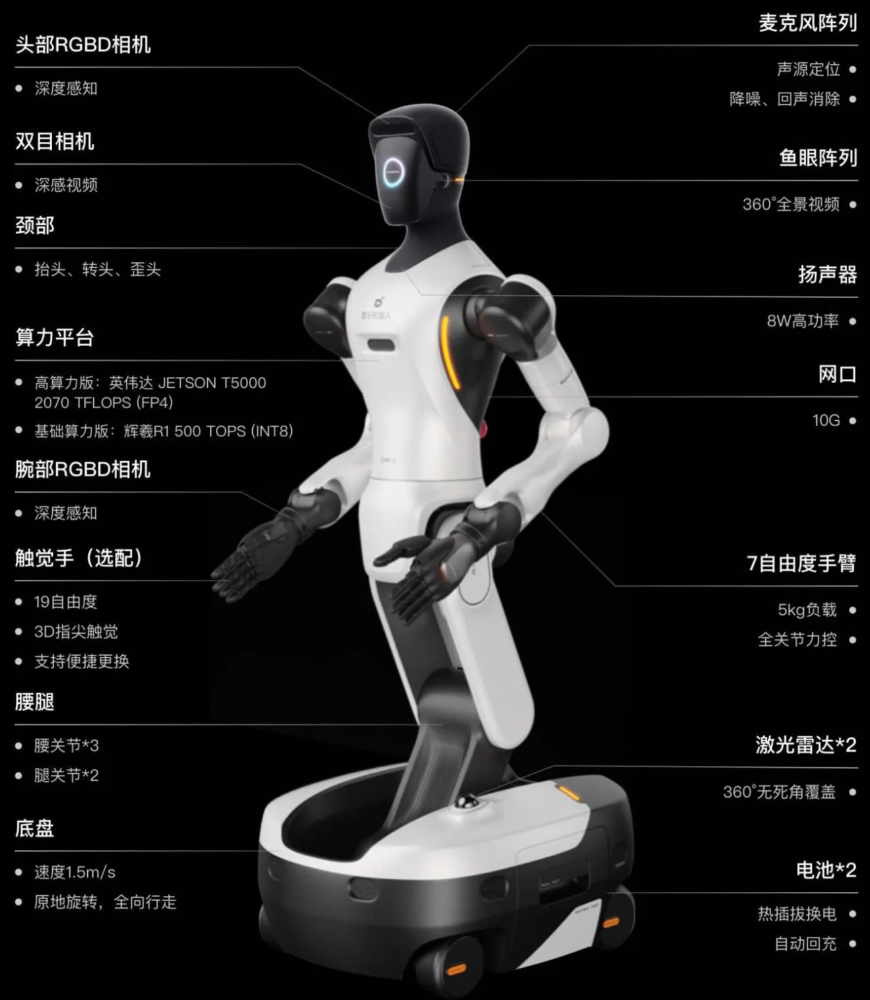

+++
date = '2026-04-05T13:46:44+08:00'
draft = false
title = 'agibot-world-2026'
categories = []
tags = []
featured = false
+++

:(fas fa-award fa-fw):
:(fas fa-building fa-fw):
:(fas fa-file-pdf fa-fw):[arXiv ]()
:(fab fa-github fa-fw):

:(fas fa-globe fa-fw):
:(fas fa-blog fa-fw):

https://agibot-world.cn/

100%真实环境，涵盖了商业空间、家居等多类通用场景

多视角 RGB(D) + 触觉 + 力觉 + LiDAR + IMU + 关节状态

高层指令、段落文本标注（任务描述）与步骤文本标注（操作序列分解）构建任务逻辑框架，并进一步进行细粒度拆解，标注原子技能（如抓取、放置）、2D边界框等，同时特别纳入错误恢复过程的轨迹记录。

https://huggingface.co/collections/unitreerobotics/unifolm-wbt-dataset
https://huggingface.co/datasets/agibot-world/AgiBotWorld2026

  

    

<table>
<thead>
<tr>
<th>机器人本体</th>
<th>全身参数</th>
<th>手臂</th>
<th>末端执行器</th>
<th>躯干参数</th>
<th>底盘参数</th>
<th>传感器</th>
<th>算力参数</th>
</tr>
</thead>
<tbody>
<tr>
<td style="min-width:9rem;max-width:10.5rem">

<a href="https://www.agibot.com.cn/products/G2" rel="noopener noreferrer" target="_blank">精灵 G2</a>

工业级轮式人形双臂机器人，100% 车规级零部件

</td>
<td>

最大高度1795 mm（可调）

重量185 kg（含电池）

全身自由度26

最大速度1.5 m/s

防护等级IP42

</td>
<td>

构型十字腕力控臂 × 2

单臂自由度7 DoF

负载5 kg / 臂

操作精度亚毫米级

力感知全臂关节扭矩传感

</td>
<td>

灵巧手19-DoF（选配）

触觉3D 指尖触觉

</td>
<td>

腰部3-DoF（旋转 / 俯仰 / 侧摆）

颈部3-DoF（抬头 / 转头 / 歪头）

腿部2 DoF

</td>
<td>

类型全向底盘

舵轮4 舵轮

自由度4 DoF

</td>
<td>

headRGB-D × 1 + stereo × 1

wristRGB-D × 2

鱼眼× 3（含头部后方 × 1）

LiDAR底盘前后 × 2

超声波底盘 × 8

</td>
<td>

芯片NVIDIA Jetson Thor T5000

算力2070 TFLOPS (FP4)

延迟&lt; 10 ms

</td>
</tr>
</tbody>
</table>

Table 1. AgiBot World dataset scale. (100 台同构机器人采集, 5 大场景)

<table>
<thead>
<tr>
<th style="text-align:center">trajectories</th>
<th style="text-align:center">task types</th>
<th style="text-align:center">scenes (real-world)</th>
<th style="text-align:center">unique objects</th>
<th style="text-align:center">skills</th>
</tr>
</thead>
<tbody>
<tr>
<td style="text-align:center">
1,000,000+
</td>
<td style="text-align:center">
217
</td>
<td style="text-align:center">
100+
</td>
<td style="text-align:center">
3,000+
</td>
<td style="text-align:center">
87 atomic skills 家居 · 餐饮 · 工业 · 商超 · 办公
</td>
</tr>
</tbody>
</table>

