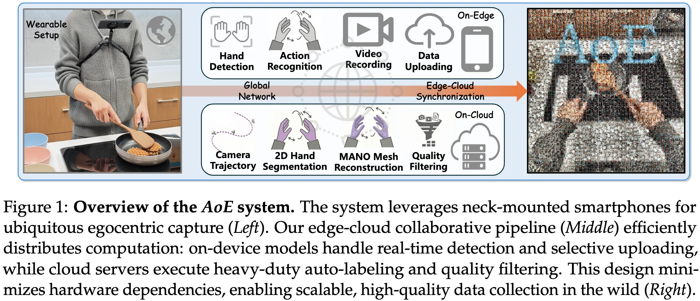
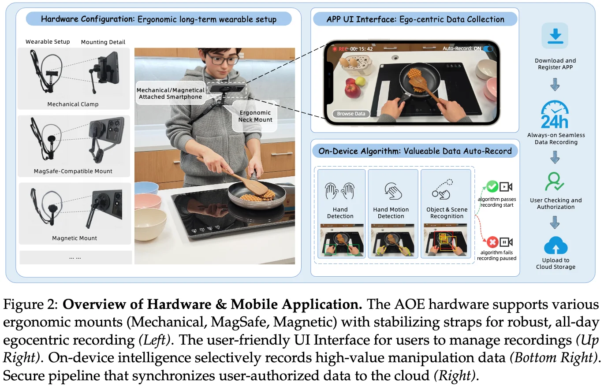
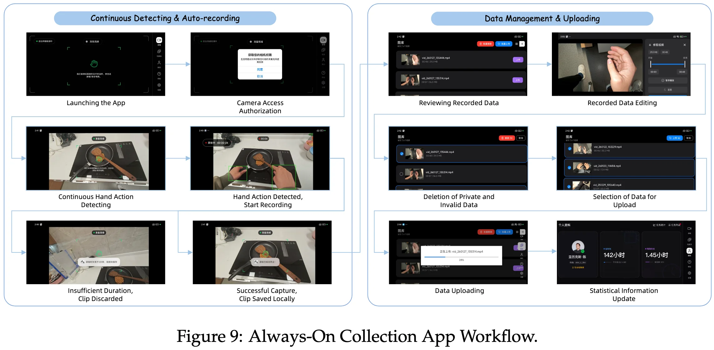
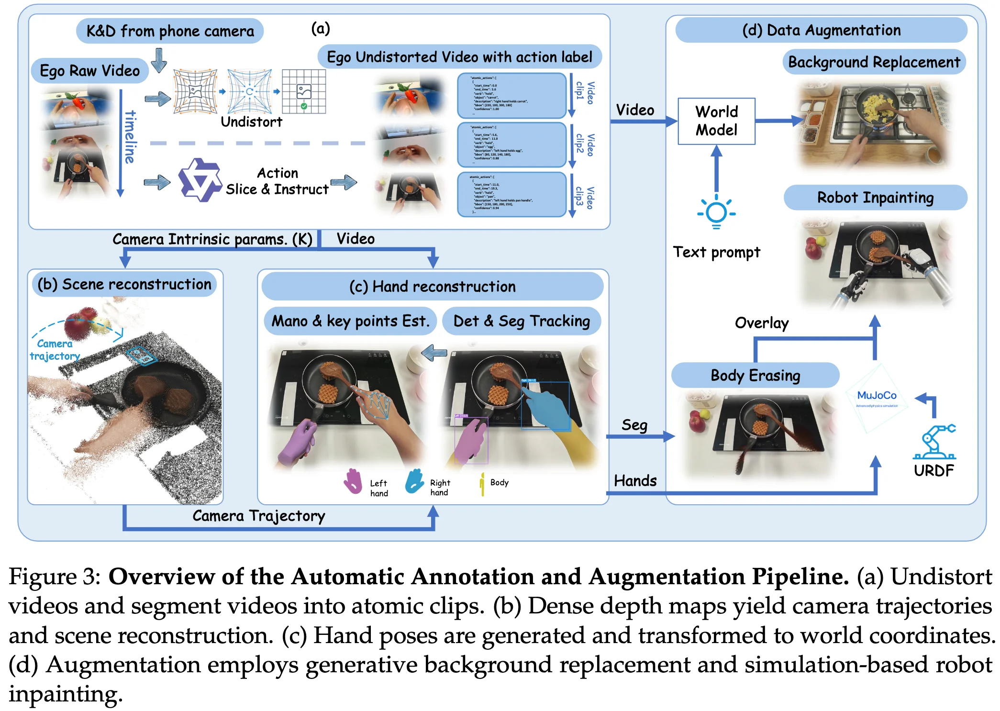

+++
date = '2026-04-16T14:20:11+08:00'
draft = false
title = 'Index'
categories = []
tags = []
featured = false
+++

:(fas fa-award fa-fw):
:(fas fa-building fa-fw):
:(fas fa-file-pdf fa-fw):[arXiv ]()
:(fab fa-github fa-fw):

:(fas fa-globe fa-fw):
:(fas fa-blog fa-fw):

Data collection:
- **Hand-held Gripper-based Interfaces**
    - UMI
    - FastUMI
    - DexUMI
- **Wearable AR/VR Systems**
Humanoidexo: Scalable whole-body humanoid manipulation via wearable exoskeleton
- **Passive Egocentric Videos**

## Always-On Egocentric Data System
### Hardware

### Mobile Software

- begin with explicit camera authorization in the cross-platform (Android/iOS) app
- on-device lightweight models scan for hand-object interactions for triggers
    - hand detection
    - motion tracking
    - open-set recognition
- **automatically triggers recording locally only during relevant hand-object interactions**
- autonomously discards clips with insufficient duration
- an automated pipeline deidentifies sensitive attributes (e.g., faces, text) prior to upload to the cloud
- built-in tools for data curation
    - browse the local gallery
    - utilize a built-in editor to trim irrelevant or sensitive frames from the recording
    - to ensure privacy and data integrity, the app requires users to manually select and validate clips before batch-uploading them to the cloud along with synchronized sensor metadata.

### Automated Annotation and Quality Filtering Pipeline

- **Video Undistortion**: undistorted images with retrieved factory-calibrated intrinsics via Camera2
- **Atomic Action Segmentation**:
    - Segment videos into semantic atomic clips with **Qwen3-VL-235B-A22B**
    - **Human verification** corrects potential VLM hallucinations in boundaries and labels.
- **Camera Trajectory Estimation**
- **Hand Reconstruction**
- **Data Augmentation**
    - **Background Replacement**: employ video diffusion on contact-free frames frames conditioned on depth and segmentation.
    - **Hand Replacement** follows Masquerade: GAN-based removal, 6-DoF robot alignment, and photometric re-rendering.
- **Quality Control**:
    - filter kinematic outliers (> 3σ joint velocities)
    - filter high reprojection errors (> 5px)
