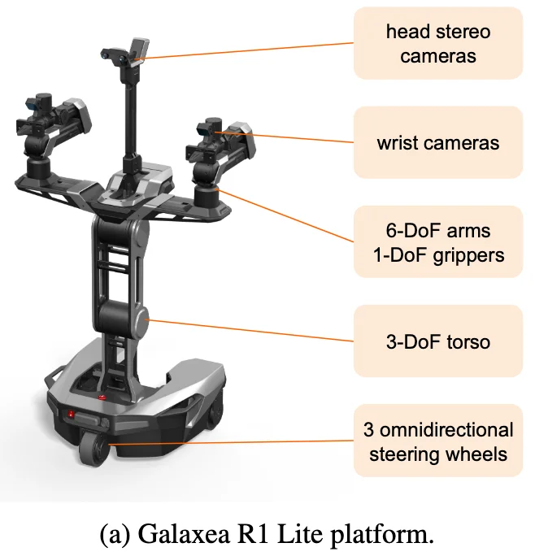
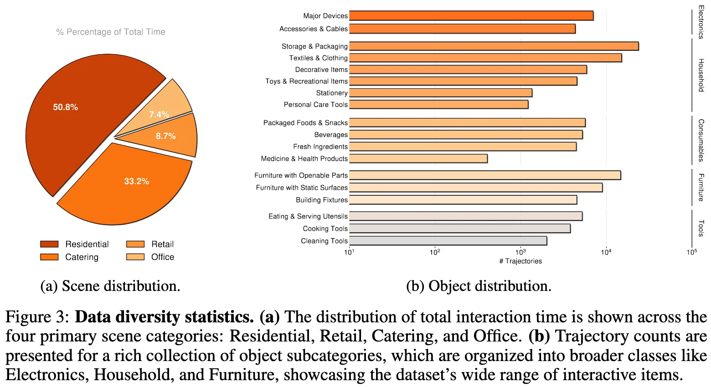
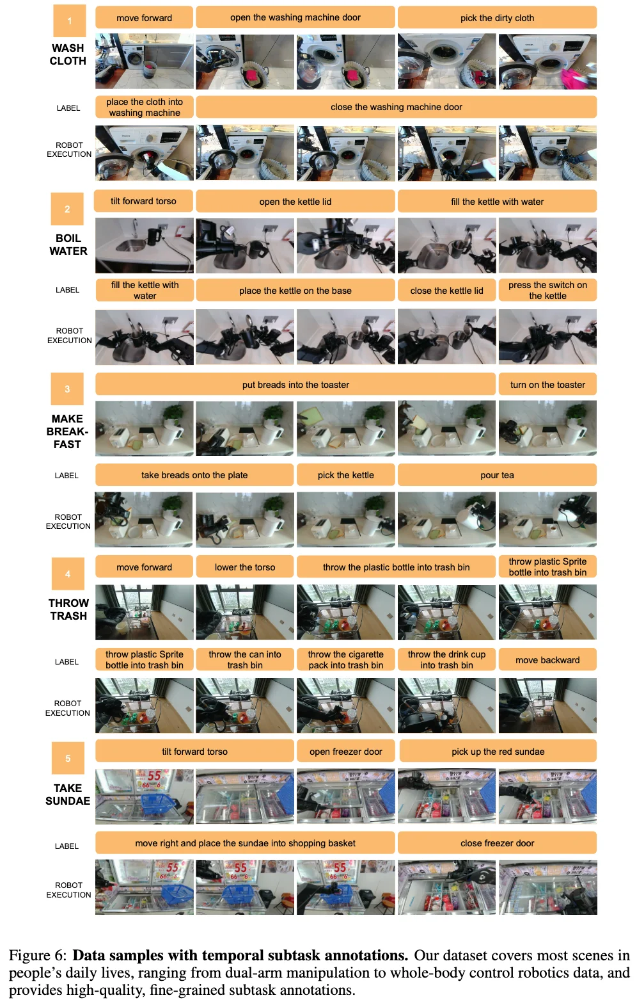

+++
date = '2026-04-05T11:44:23+08:00'
draft = false
title = 'galaxea-open-world-dataset'
categories = []
tags = []
featured = false
+++

:(fas fa-award fa-fw):
:(fas fa-building fa-fw):
:(fas fa-file-pdf fa-fw):[arXiv ]()
:(fab fa-github fa-fw):

:(fas fa-globe fa-fw):
:(fas fa-blog fa-fw):

https://huggingface.co/datasets/OpenGalaxea/Galaxea-Open-World-Dataset

500+ hours of real-world mobile manipulation data.
All data collected using one uniform robotic embodiment for consistency.
Fine-grained subtask language annotations.
Covers residential, kitchen, retail, and office settings.
Dataset in RLDS and LeRobot format.

  

<table>
<thead>
<tr>
<th>机器人本体</th>
<th>全身参数</th>
<th>手臂</th>
<th>末端执行器</th>
<th>躯干参数</th>
<th>底盘参数</th>
<th>传感器</th>
<th>算力参数</th>
</tr>
</thead>
<tbody>
<tr>
<td style="min-width:9rem;max-width:10.5rem">

<a href="https://galaxea-ai.com/cn/products/R1-Lite" rel="noopener noreferrer" target="_blank">Galaxea R1 Lite</a>

全向轮式移动双臂机器人，躯干可升降

</td>
<td>

总高1280 mm

底盘宽600 mm

平台宽670 mm

全身自由度23

</td>
<td>

双臂6-DoF x2

臂长600 mm

负载额定 3 kg，最大 5 kg

安装上装

</td>
<td>

类型平行夹爪

腕部球形腕

</td>
<td>

自由度3

工作空间0–1.7 m

</td>
<td>

自由度6

移动速度1.5 m/s

</td>
<td>

headstereo RGB ×1

wristRGB-D ×2（选配）

</td>
<td>

CPUi9-12900HK，14 核，2.5 GHz

内存32 GB RAM

存储1 TB SSD

</td>
</tr>
</tbody>
</table>

Table 1. Galaxea Open-World dataset scale. (identical embodiment, isomorphic teleoperation)

<table>
<thead>
<tr>
<th style="text-align:center">trajectories</th>
<th style="text-align:center">task categories</th>
<th style="text-align:center">scenes (real-world)</th>
<th style="text-align:center">unique objects</th>
<th style="text-align:center">skills</th>
</tr>
</thead>
<tbody>
<tr>
<td style="text-align:center">
~100K
</td>
<td style="text-align:center">
150
</td>
<td style="text-align:center">
50
</td>
<td style="text-align:center">
1600+
</td>
<td style="text-align:center">
58 operational skills fine-grained pick-and-place → coordinated whole-body manipulation
</td>
</tr>
</tbody>
</table>

