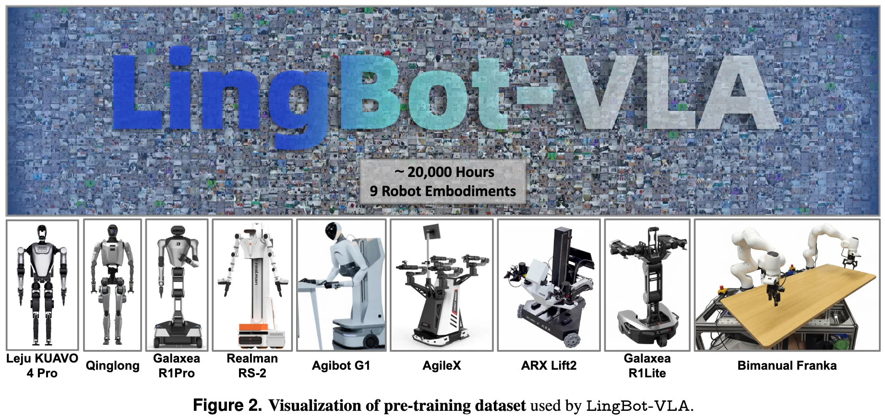
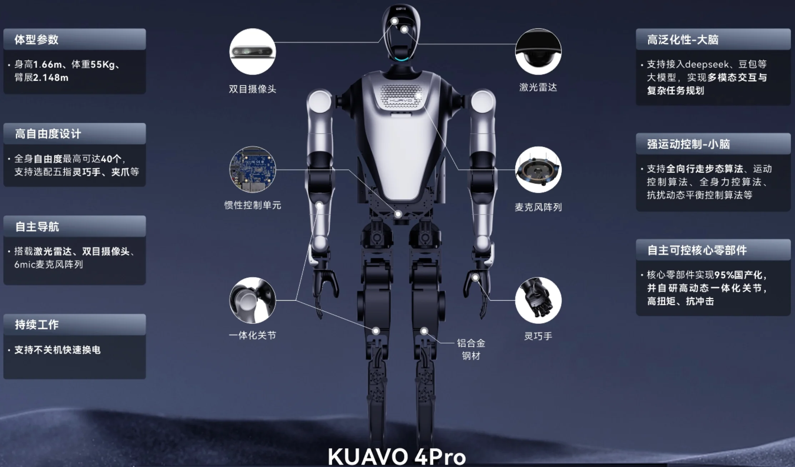
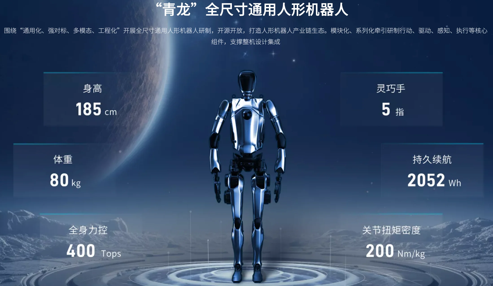

+++
date = '2026-04-05T10:00:30+08:00'
draft = false
title = 'lingbot-vla-data'
categories = []
tags = []
featured = false
+++

:(fas fa-award fa-fw):
:(fas fa-building fa-fw):
:(fas fa-file-pdf fa-fw):[arXiv ]()
:(fab fa-github fa-fw):

:(fas fa-globe fa-fw):
:(fas fa-blog fa-fw):

能把 最近机器人相关的数据集 帮忙做一个整理吗？

比如 星海图/高德/宇树/智元 等放出来的 数据集

关注下 具体场景吧

当前这些数据集都是用于哪些场景，是通用场景还是专业场景？
开源的数据集中机器人专注于哪些任务，不同数据集之间任务是否有共性？
目前机器人用于执行命令的部件，手部是灵巧手还是那种夹子？足部是轮式还是足式？
PS: 康哥说他还要去其他工厂再看看，看一下其他家都是怎么用的，工厂模式是啥样的，看看咱们公司能不能从某些特性上找到切入点（我理解可能是想跟机器狗这种项目做出统一的感知或控制架构，不局限于机器狗？这个是我的猜测）

20,000 hours of real-world teleoperated data from 9 popular dual-arm robot embodiments.

- **Leju KUAVO 4 Pro.** This setup features two 7-DoF arms, two parallel grippers, one camera on the head, and two cameras on the wrists.
- **Qinglong.** A humanoid robot with two 7-DoF arms and three cameras: one on the head and one on each wrist.
- **Galaxea R1Pro.** Two 7-DoF arms, one stereo camera, and two wrist cameras are used in this setup.
- **Realman Rs-02.** This setup uses three cameras and features a 16-dimensional configuration and action space: two 7-DoF arms and two parallel grippers.
- **AgiBot G1.** This setup has two 7-DoF arms with three RGB-D cameras. Robot data are collected via VR-based teleoperation on this setup.
- **AgileX.** This setup is equipped with three cameras and two 6-DoF arms. Robot control is achieved using isomorphic arms during the data collection process.
- **ARX Lift2.** This setup uses three cameras and two 6-DoF arms.
- **Galaxea R1Lite.** This setup has two 6-DoF arms, with one stereo camera and two wrist cameras.
- **Bimanual Franka.** This setup uses two 7-DoF arms and two parallel grippers, forming a 16-dimensional action space, with three cameras.

| 机器人 | 本体类型 | 手臂 | 末端执行器 | 底盘 / 移动方式 | 传感器方案 | 数据角色 |
|:---:|:---:|:---:|:---:|:---:|:---|:---:|
| **[Leju KUAVO 4 Pro](https://www.lejurobot.com/en/application/kuavo-my)** | 人形 1.66 m / 55 kg | 双臂 7-DoF x2  （可选配 5-DoF） | **平行夹爪** ×2 可选配：五指灵巧手 | **足式**双足 | RGB 头部 ×1 RGB 腕部 ×2 | 预训练 |
| **Qinglong（青龙）** | 人形 1.85 m / 80 kg | 双臂 7-DoF x2 | 本体：**五指灵巧手** | **足式**双足 | RGB 头部 ×1 RGB 腕部 ×2 | 预训练 |
| **[Galaxea R1Pro（星海图）](https://galaxea-ai.com/cn/products/R1-Pro)** | 双臂台式 | 双臂 7-DoF x2 | **标配夹爪** | **底盘 6-DoF, 舵轮x3** | 双目立体相机 ×1 RGB 腕部 ×2 | 预训练 + GM-100 评测 |
| **AgiBot G1（智元）** | 人形 | 双臂 **7-DoF** | **平行夹爪** | **足式**双足 | **RGB-D** 相机 ×3 （头部 + 腕部） | 预训练 + GM-100 评测 |
| **Realman Rs-02（睿尔曼）** | 双臂台式 | 双臂 **7-DoF**；16 维动作空间 | **平行夹爪** ×2 | **固定底座** | RGB 相机 ×3 | 预训练 |
| **Bimanual Franka** | 双臂台式 | 双臂 **7-DoF**；16 维动作空间 | **平行夹爪** ×2 | **固定底座** （桌面安装） | RGB 相机 ×3 | 预训练 |
| **AgileX（松灵）** | 移动双臂 | 双臂 **6-DoF** | **平行夹爪** | **轮式**底盘 | RGB 相机 ×3 （头部 + 腕部） | 预训练 + GM-100 评测 |
| **ARX Lift2** | 移动双臂 | 双臂 **6-DoF** | 平行夹爪 | **升降式**底盘 | RGB 相机 ×3 | 预训练 |
| **Galaxea R1Lite（星海图）** | 双臂台式 | 双臂 **6-DoF** | 平行夹爪 | **固定底座** | 双目立体相机 ×1 RGB 腕部 ×2 | 预训练 |

> **要点总结：**
> - **末端执行器**：数据集中 9 个平台均使用**平行夹爪**；但 KUAVO 4 Pro 本体支持选配 6-DoF 灵巧手，Qinglong 本体标配**五指灵巧手**——说明当前采集数据时普遍回退到更稳定的夹爪方案
> - **底盘类型**：足式人形 3 个（KUAVO 4 Pro / 青龙 / AgiBot G1）、轮式 1 个（AgileX）、升降式 1 个（ARX Lift2）、固定底座 4 个（R1Pro / Rs-02 / Franka / R1Lite）
> - **传感器**：多数方案为 RGB 相机，仅 AgiBot G1 使用 **RGB-D**（含深度）；Galaxea 系列使用**双目立体相机**；无激光雷达方案
> - **场景类型**：全部为**通用桌面操作**场景，无专业工业场景；GM-100 评测覆盖放置、堆叠、开合、抓取、移动、按压、翻转、交接等 100 类任务
> - **评测平台**：仅 AgileX / AgiBot G1 / Galaxea R1Pro 三个平台用于下游 GM-100 评测，其余 6 个仅贡献预训练数据

### KUAVO 4Pro

人形本体，1.66m，55kg，全身自由度22/30/40, 单臂自由度5/7，颈关节自由度0/2，灵巧手(选配) 6自由度，10个可活动关节

### Qinglong

人形本体，1.85m, 灵巧手五指，体重80kg，

### Galaxea R1Pro

高1.7m，全身自由度26（标配夹爪），单臂自由度7，末端执行器夹爪，躯干自由度4， 底盘自由度6， 整机传感器7xcamera, 1xlidar
