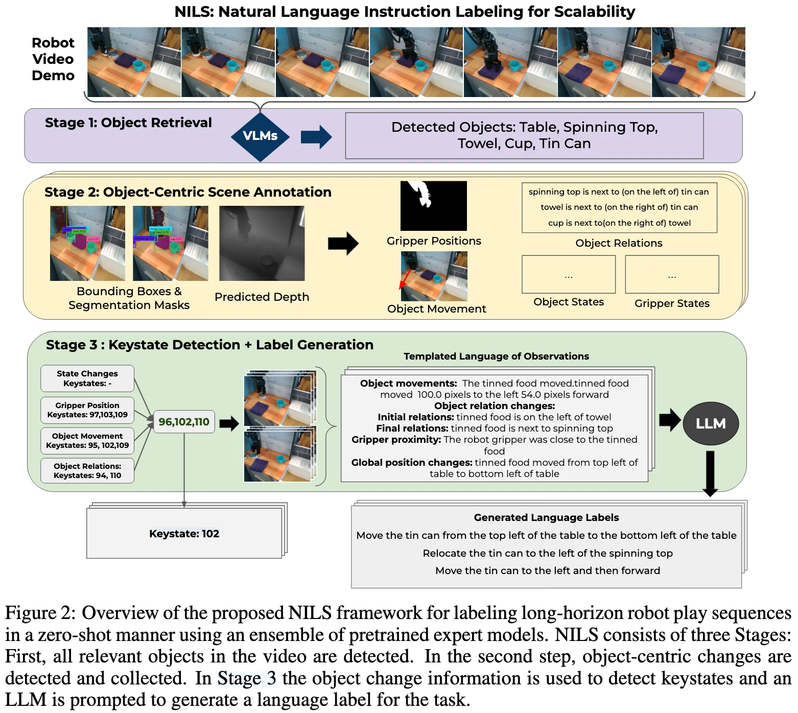
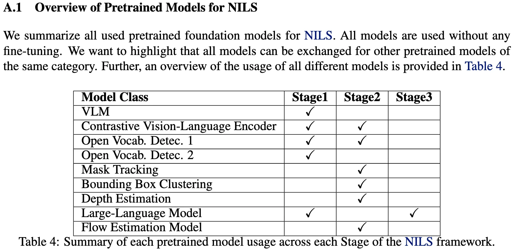

+++
date = '2026-04-13T16:36:41+08:00'
draft = false
title = 'Index'
categories = []
tags = []
featured = false
+++

:(fas fa-award fa-fw):
:(fas fa-building fa-fw):
:(fas fa-file-pdf fa-fw):[arXiv ]()
:(fab fa-github fa-fw):

:(fas fa-globe fa-fw):
:(fas fa-blog fa-fw):

## TL;DR

### Identifying Objects in the Scene

-> objects and properties.

VLMs, Grounding DINO, SigLIP

### Object-Centric Scene Annotation

using an ensemble of open-vocabulary detection and segmentation models.

### Keystate Detection and Label Generation

