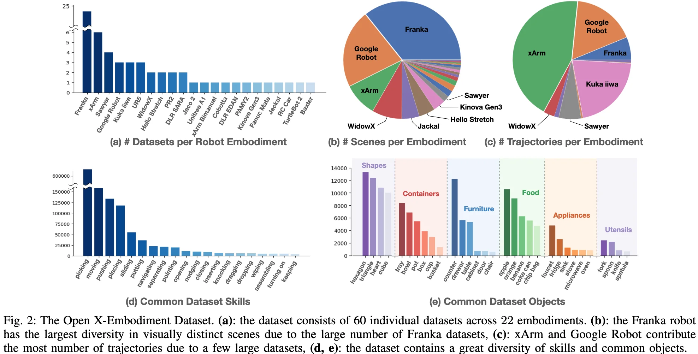
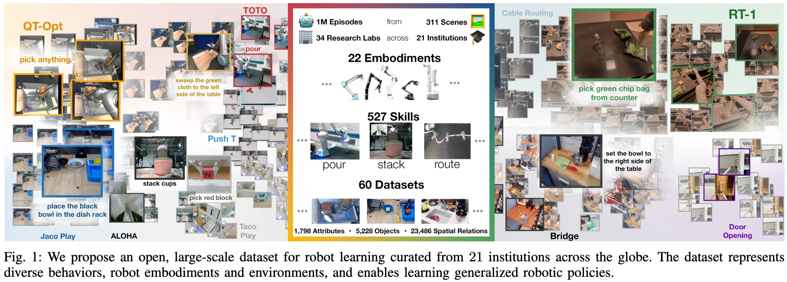

+++
date = '2026-04-13T14:40:49+08:00'
draft = false
title = 'Open X-Embodiment: Robotic Learning Datasets and RT-X Models'
categories = []
tags = []
featured = false
+++

:(fas fa-award fa-fw):
:(fas fa-building fa-fw):
:(fas fa-file-pdf fa-fw):[arXiv ]()
:(fab fa-github fa-fw):

:(fas fa-globe fa-fw):
:(fas fa-blog fa-fw):

## Open X-Embodiment Dataset

robot learning dataset with 1M+ robot trajectories from 22 robot embodiments.

### Dataset Analysis

## Pre-Trained Checkpoints

a selection of RT-X model checkpoints ready for inference and finetuning.

## TL;DR

