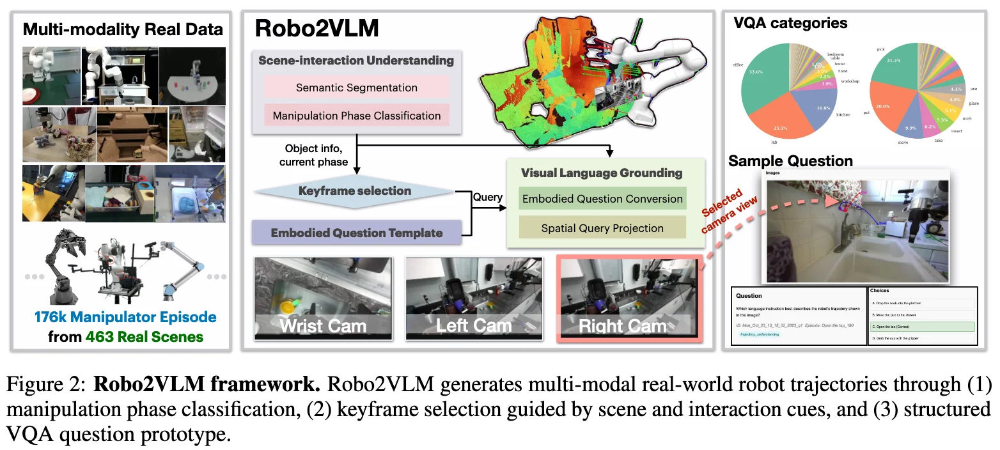

+++
date = '2026-04-13T16:02:27+08:00'
draft = false
title = 'Robo2VLM'
categories = []
tags = []
featured = false
+++

:(fas fa-award fa-fw):
:(fas fa-building fa-fw):
:(fas fa-file-pdf fa-fw):[arXiv ]()
:(fab fa-github fa-fw):

:(fas fa-globe fa-fw):
:(fas fa-blog fa-fw):

## TL;DR

## Motivations & Innovations

## Data Recipe

### Scene-Interaction Understanding

**Embodied Scene Understanding:**

Input: 
- a task description in nature language
- images from different camera views

Output:
- using an off-the-shelf LLM such as Qwen 2.5 to obtain target object, scene, task and skill description.

**Manipulation Phase Segmentation:**

Input:
- 12

Output:
- 12