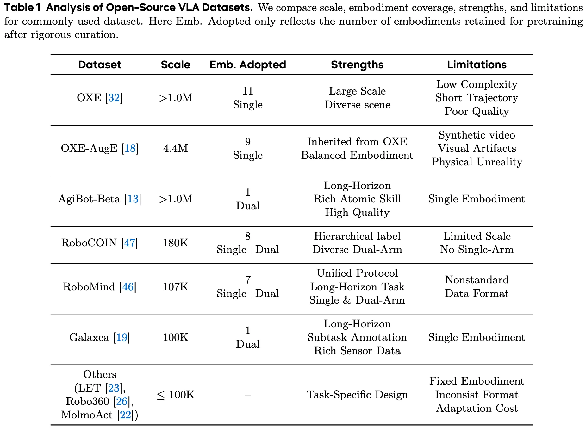
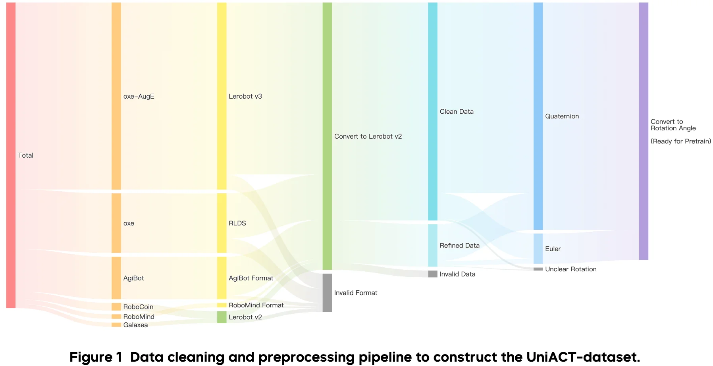
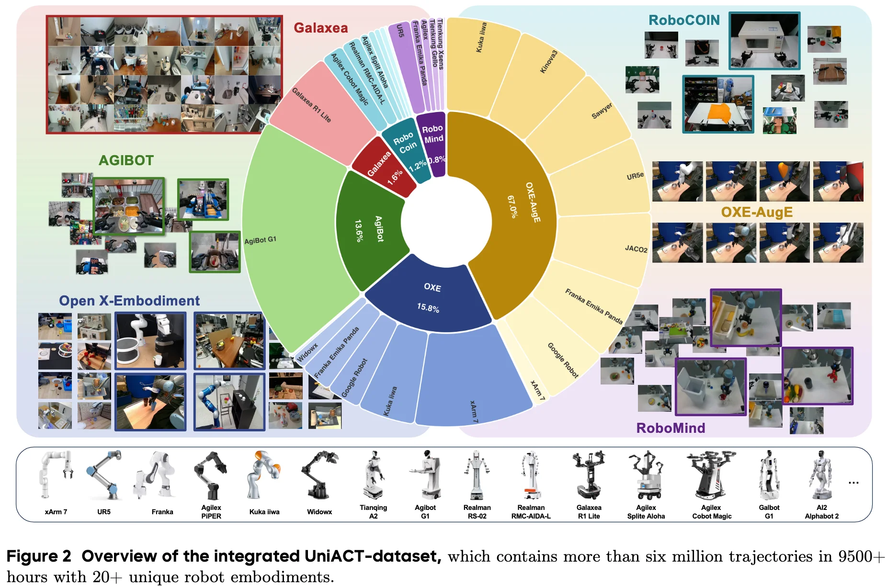

+++
date = '2026-04-07T14:49:10+08:00'
draft = false
title = 'UniACT-dataset'
categories = []
tags = []
featured = false
+++

:(fas fa-award fa-fw):
:(fas fa-building fa-fw):
:(fas fa-file-pdf fa-fw):[arXiv ]()
:(fab fa-github fa-fw):

:(fas fa-globe fa-fw):
:(fas fa-blog fa-fw):

From six public datasets, we clean, standardize, and balance samples to construct UniACT-dataset, a large-scale dataset with over 6 million trajectories and 9,500 hours of data,

Action Representation: Delta Actions in End-Effector Position with Rotation Vectors.

- Unified Single- and Dual-Arm Training via Zero Padding.
    - all single-arm data are uniformly treated as right-arm executions within a dual-arm configuration.
    - the action dimensions corresponding to the ununsed arm are filled with zeros.
- Data Distribution: Diverse Embodiments and Task Scenarios. more than six million trajectories spans more than twenty unique robot embodiments and 9500+ hours
    - dataset scale distribution
    - embodiment distribution