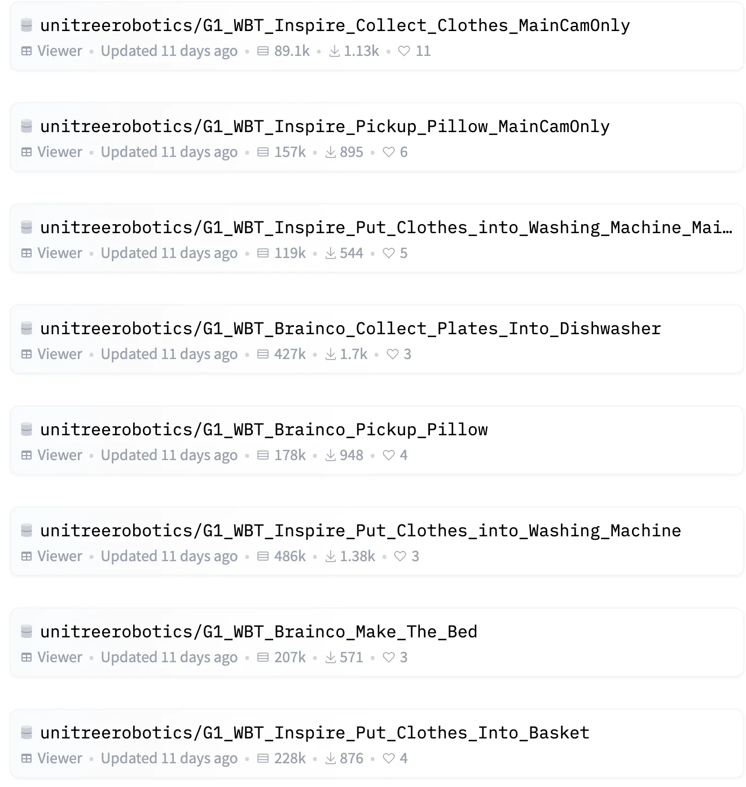

+++
date = '2026-04-05T14:30:09+08:00'
draft = false
title = 'unifolm-wbt-dataset'
categories = []
tags = []
featured = false
+++

:(fas fa-award fa-fw):
:(fas fa-building fa-fw):
:(fas fa-file-pdf fa-fw):[arXiv ]()
:(fab fa-github fa-fw):

:(fas fa-globe fa-fw):
:(fas fa-blog fa-fw):

2026-03-05 开源，人形机器人

https://huggingface.co/collections/unitreerobotics/unifolm-wbt-dataset

  

<table>
<thead>
<tr>
<th>机器人本体</th>
<th>全身参数</th>
<th>手臂</th>
<th>末端执行器</th>
<th>躯干参数</th>
<th>腿部参数</th>
<th>传感器</th>
<th>算力参数</th>
</tr>
</thead>
<tbody>
<tr>
<td style="min-width:9rem;max-width:10.5rem">

<a href="https://www.unitree.com/g1" rel="noopener noreferrer" target="_blank">Unitree G1 EDU</a>

小型双足人形双臂机器人，模仿 / 强化学习驱动

</td>
<td>

站立尺寸1320 × 450 × 200 mm

折叠尺寸690 × 450 × 300 mm

重量~35 kg+（含电池）

全身自由度23–43（可配置）

移动速度2 m/s

</td>
<td>

单臂自由度7 DoF

shoulder3 DoF

elbow2 DoF

wrist2 DoF（选配）

臂展~0.45 m

负载~3 kg

</td>
<td>

灵巧手Dex3-1 力控三指（选配）

单手自由度7 DoF

拇指3 DoF

食指 / 中指各 2 DoF

触觉触觉传感阵列（选配）

</td>
<td>

腰部1 DoF（Z ±155°）

选配扩展+2 DoF（X ±45° / Y ±30°）

</td>
<td>

单腿自由度6 DoF

hip3 DoF（P ±154° / R −30°~+170° / Y ±158°）

knee1 DoF（0–165°）

ankle2 DoF

腿长0.6 m（小腿 + 大腿）

膝关节扭矩120 N·m

</td>
<td>

head RGB-DIntel RealSense D435i

head 3D LiDARLivox Mid-360

音频4-mic 阵列 + 5W 扬声器

关节双编码器

连接Wi-Fi 6 / Bluetooth 5.2

</td>
<td>

高算力模块NVIDIA Jetson Orin

基础算力8 核高性能 CPU

电池9000 mAh 快拆锂电（54V）

续航~2 h

</td>
</tr>
</tbody>
</table>

衣物处理：

G1_WBT_Inspire_Collect_Clothes：收集衣物。

G1_WBT_Inspire_Put_Clothes_into_Washing_Machine：将衣服放入洗衣机。

物品搬运与收纳：

G1_WBT_Inspire_Pickup_Pillow：捡起枕头。

G1_WBT_Inspire_Put_Kettle_on_Induction_Cooker：将水壶放到电磁炉上。

G1_WBT_Inspire_Stack_Blocks：堆叠方块（精细操作）。

清洁与日常：

涵盖了清理台面、收纳杂物等多种开放场景任务。

23~43 joint motors