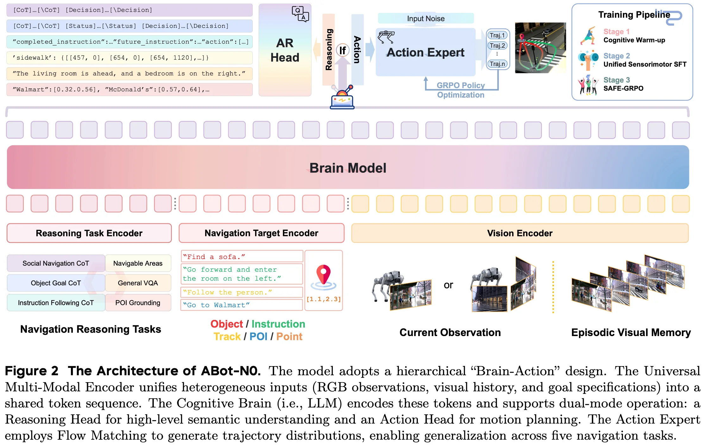
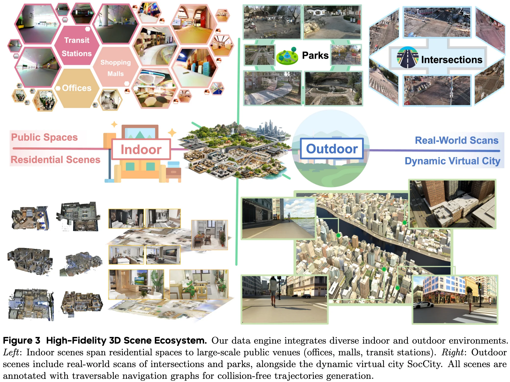
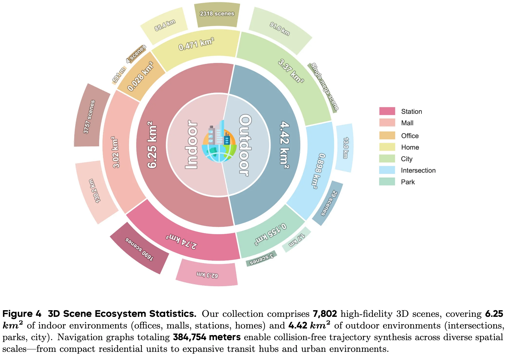
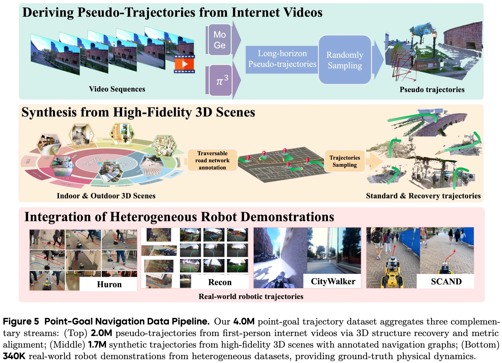
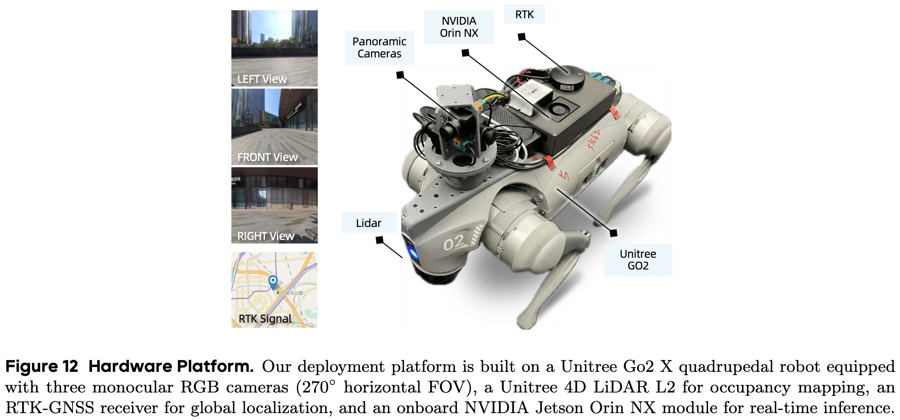

+++
date = '2026-04-28T10:15:56+08:00'
draft = false
title = 'ABot-N0: Technical Report on the VLA Foundation Model for Versatile Embodied Navigation'
categories = []
tags = []
featured = false
+++

:(fas fa-award fa-fw):
:(fas fa-building fa-fw):AMAP CV Lab
:(fas fa-file-pdf fa-fw):[arXiv ]()
:(fab fa-github fa-fw):

:(fas fa-globe fa-fw):
:(fas fa-blog fa-fw):

## TL;DR

## Motivations & Innovations

Embodied navigation has long been fragmented by task-specific architectures. -> We introduce ABot-N0, a unified Vision-Language-Action (VLA) foundation model that achieves a “Grand Unification” across 5 core tasks: Point-Goal, Object-Goal, Instruction-Following, POI-Goal, and Person-Following.

- **Point-Goal.** The agent must reach precise metric coordinates defined in a local frame, serving as the foundational primitive for robust locomotion and obstacle avoidance.
- **Object-Goal.** The agent actively searches for and navigates to a specific object category in unseen environments, requiring sophisticated semantic reasoning and multimodal integration.
- **Instruction-Following.** The agent must execute long-horizon, complex natural language paths, focusing on the rigorous alignment between linguistic input and sequential action execution.
- **POI-Goal.** requires the agent to identify specific Points of Interest (POIs) and precisely navigate to their physical entrances, bridging outdoor and indoor environments while addressing the last-meters navigation challenge.
- **Person-Following.** This involves real-time tracking of dynamic human targets, representing a critical social capability for human-robot interaction.

## Model Architecture

### Encoder

### LLM Backbone

a pre-trained LLM (Qwen3-4B)

### Action Expert

## Data Recipe

### High-Fidelity 3D Scene Ecosystem

-> generalize across diverse physical environments.

high-fidelity 3D scenes.

closed-loop simulation.

#### Indoor Environments: From Domestic to Public

**Residential Scenes (Home)** 
- HM3D
- InteriorGS

**Public Spaces (Office, Mall, Station)**

#### Outdoor Environments: Static Scans and Dynamic City

**Real-World Scans (Intersection, Park)**
- **Intersections**
- **Parks**

**Dynamic Virtual City (SocCity)**

### ABot-N0 Trajectories Dataset
#### Point-Goal Trajectories (4M)

**Deriving Pseudo-Trajectories from Internet Videos (2M).** We collectfirst-person urban exploration videos to capture the long-tail distribution of global architectural styles and weather conditions.
- **Structure Recovery**: utilize $\pi^3$ for dense 3D reconstruction from monocular streams.
- **Metric Alignment**: apply MoGe to resolve scale ambiguity and align the reconstructed paths with real-world metric units.
- **Episode Synthesis**: sample diverse point-goal pairs along the camera’s motion manifold to generate kinematically consistent navigation samples

**Synthesis from High-Fidelity 3D Scenes (1.7M).** 3D scenes and dynamic SocCity.

Point-goal episodes are generated by sampling reachable coordinate pairs (s, g) and computing optimal paths using path-finding algorithms. Crucially, we incorporate recovery trajectories by initializing agents in off-path or near-collision states, forcing the model to learn error-correction behaviors essential for real-world robustness.

https://arxiv.org/abs/2511.21135

https://amap-eai.github.io/SocialNav/

**Integration of Heterogeneous Robot Demonstrations (340K).** diverse real-world robotic platforms (e.g., SCAND [22], HuRoN [18], Recon [41], and CityWalker [36] teleoperation data).

#### Instruction-Following Trajectories

#### Object-Goal Trajectories

**HM3D and OVON**

**OVON-sub**

**InteriorGS**

### ABot-N0 Reasoning Dataset

#### General Navigation Skills
#### Navigation Chain-of-Thought (CoT):

#### Instruction-Following Reasoning

#### Object-Goal Reasoning

#### POI Grounding

#### General VQA (1.1M)
- VQA
- Embodied Question Answering (EQA)

## Training Recipe

## Deploy

### Real-world Deployment

- Unitree Go2 quadrupedal robot with 12 DoF
    - Sensors:
        - RTK-GNSS for global localization
        - 3 RGB cameras (forward/left/right, H120°, V90°)
        - Unitree 4D LiDAR L2
        
- NVIDIA Jetson Orin NX (157 TOPS, 16GB RAM), in which perception and execution tasks are performed, including the real-time inference of the optimized VLA model.
- 2Hz VLA inference and 10Hz closed-loop control

