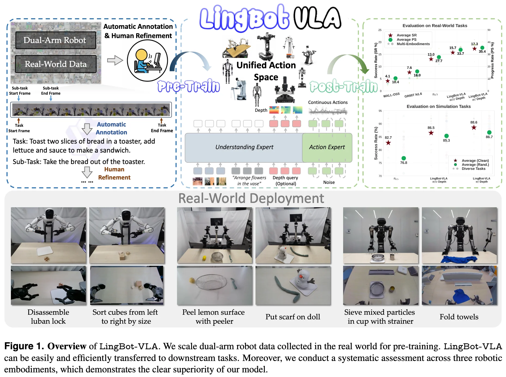
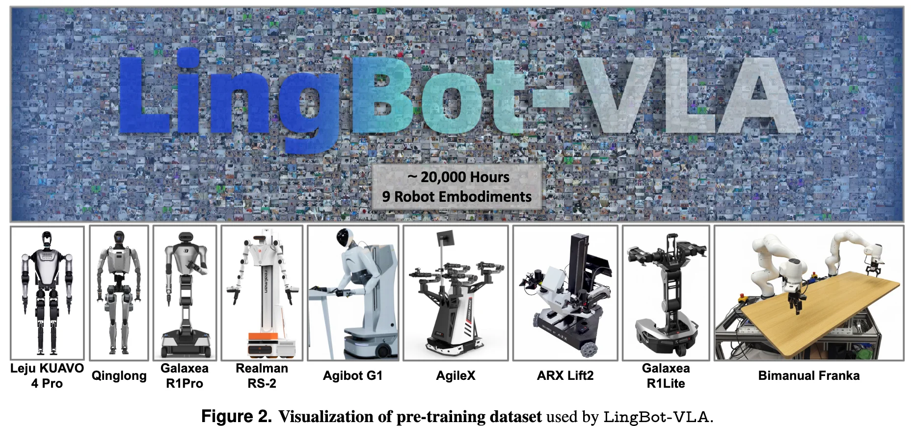
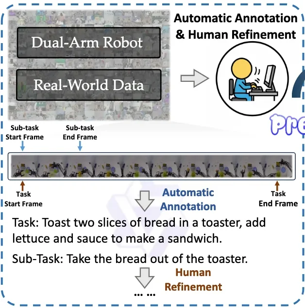
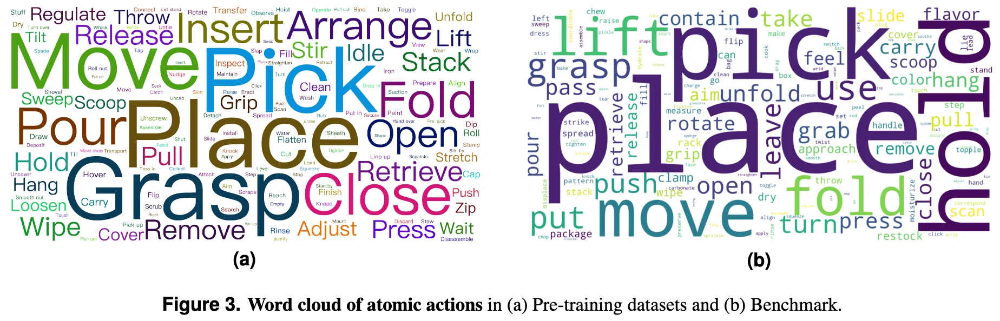

+++
date = '2026-04-01T00:00:00+08:00'
draft = false
title = 'LingBot-VLA'
categories = []
tags = []
featured = false
+++

## TL;DR

## Model Architecture

## Data Recipe

### Data Collection

1. **teleoperated data** collected from **9 popular dual-arm robot embodiments** with **grippers as end-effectors.**

### Data Filtering
#### Automated Filtering
static frames at the start and end of the videos are eliminated at this stage.

#### Manual Review

### Data Labeling

  

    
  

  

    
    <ul>
    <li><b>Video Segment</b>: <b>Decomposed into clips by human annotators</b> according to <b>predefined atomic actions</b>.</li>
    <li><b>Instruction Annotation</b>: Employ <b>Qwen3-VL-235B-A22B</b> for precise annotation of <b>task and sub-task instructions</b>.</li>
    </ul>
  

## Training Recipe

## Deployment

## Experiments
