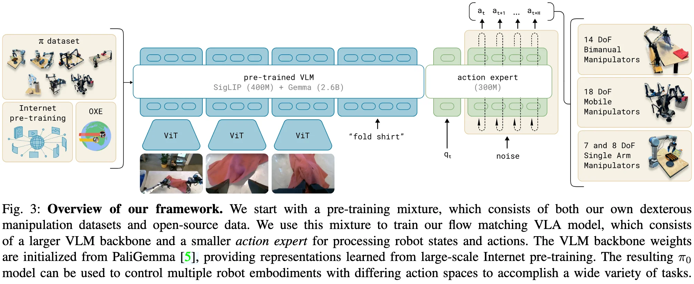

+++
date = '2024-10-31T10:31:51+08:00'
draft = false
title = '$\pi_0$: A Vision-Language-Action Flow Model for General Robot Control'
categories = ['VLAs']
tags = ['VLAs', 'Embodied Intelligence']
featured = false
+++

:(fas fa-award fa-fw):<span style="color:gray"></span>
:(fas fa-building fa-fw):<span style="color:gray">Physical Intelligence</span>
:(fas fa-file-pdf fa-fw):[arXiv 2410.24164](https://arxiv.org/abs/2410.24164)
:(fab fa-github fa-fw):[Physical-Intelligence/openpi](https://github.com/Physical-Intelligence/openpi)
[]()
:(fas fa-globe fa-fw):[](https://www.pi.website/blog/pi0)
:(fas fa-blog fa-fw):[Blog](https://www.pi.website/blog/pi0)

RT-2、OpenVLA、π0-FAST。A. 动作 token 化 / 自回归 路线

代表：RT-2、OpenVLA、π0-FAST。
特点是：

思维方式最接近你熟悉的 VLM / LLM
图像、语言、动作都可以统一成 token 视角
推理上往往是 autoregressive 或近 autoregressive 的 token 生成逻辑。
B. 连续动作 expert / diffusion / flow matching 路线

代表：π0、RDT、SmolVLA。
特点是：

VLM 主要负责提供条件语义
动作不再强行离散成 token，而是由专门的 action expert 生成连续 action chunk
推理常见为 diffusion 迭代或 flow matching 迭代。

OpenVLA → π0 → RDT / SmolVLA

RT-2 / 早期 token 化路线：更像“VLM 既能说话，也能输出动作 token”。
OpenVLA / π0 / SmolVLA / 现在多数执行型 VLA：更像“语言只是条件输入，最终主要输出动作”。
GR00T 这类双系统：语言/推理模块可能还在，但最终对控制栈暴露的仍主要是动作。


## TL;DR

<span style="color:red;">flow matching VLA model</span>

## Motivations & Innovations

## Approach

### Model Architecture



inspired by Transfusion, which trains a single transformer using multiple objectives:
- tokens corresponding to continuous outputs supervised via a conditional flow matching loss.
- tokens corresponding to discrete outputs supervised via a cross-entropy loss.

**VLM Backbone**: 
- initialized from PaliGemma (3B)
- learning representations from large-scale Internet pre-training.

**Action Expert**:
- initialized from scratch (300M)

**Adapter**:
- a linear projection layer

### Training Recipe

### Data Recipe

## Experiments


## Inference

```python
def preprocess_observation_pytorch(
    observation,
    *,
    train: bool = False,
    image_keys: Sequence[str] = IMAGE_KEYS,
    image_resolution: tuple[int, int] = IMAGE_RESOLUTION,
):
    """Torch.compile-compatible version of preprocess_observation_pytorch with simplified type annotations.

    This function avoids complex type annotations that can cause torch.compile issues.
    """
    if not set(image_keys).issubset(observation.images):
        raise ValueError(f"images dict missing keys: expected {image_keys}, got {list(observation.images)}")

    batch_shape = observation.state.shape[:-1]

    out_images = {}
    for key in image_keys:
        image = observation.images[key]

        # TODO: This is a hack to handle both [B, C, H, W] and [B, H, W, C] formats
        # Handle both [B, C, H, W] and [B, H, W, C] formats
        is_channels_first = image.shape[1] == 3  # Check if channels are in dimension 1

        if is_channels_first:
            # Convert [B, C, H, W] to [B, H, W, C] for processing
            image = image.permute(0, 2, 3, 1)

        if image.shape[1:3] != image_resolution:
            logger.info(f"Resizing image {key} from {image.shape[1:3]} to {image_resolution}")
            image = image_tools.resize_with_pad_torch(image, *image_resolution)

        if train:
            # Convert from [-1, 1] to [0, 1] for PyTorch augmentations
            image = image / 2.0 + 0.5

            # Apply PyTorch-based augmentations
            if "wrist" not in key:
                # Geometric augmentations for non-wrist cameras
                height, width = image.shape[1:3]

                # Random crop and resize
                crop_height = int(height * 0.95)
                crop_width = int(width * 0.95)

                # Random crop
                max_h = height - crop_height
                max_w = width - crop_width
                if max_h > 0 and max_w > 0:
                    # Use tensor operations instead of .item() for torch.compile compatibility
                    start_h = torch.randint(0, max_h + 1, (1,), device=image.device)
                    start_w = torch.randint(0, max_w + 1, (1,), device=image.device)
                    image = image[:, start_h : start_h + crop_height, start_w : start_w + crop_width, :]

                # Resize back to original size
                image = torch.nn.functional.interpolate(
                    image.permute(0, 3, 1, 2),  # [b, h, w, c] -> [b, c, h, w]
                    size=(height, width),
                    mode="bilinear",
                    align_corners=False,
                ).permute(0, 2, 3, 1)  # [b, c, h, w] -> [b, h, w, c]

                # Random rotation (small angles)
                # Use tensor operations instead of .item() for torch.compile compatibility
                angle = torch.rand(1, device=image.device) * 10 - 5  # Random angle between -5 and 5 degrees
                if torch.abs(angle) > 0.1:  # Only rotate if angle is significant
                    # Convert to radians
                    angle_rad = angle * torch.pi / 180.0

                    # Create rotation matrix
                    cos_a = torch.cos(angle_rad)
                    sin_a = torch.sin(angle_rad)

                    # Apply rotation using grid_sample
                    grid_x = torch.linspace(-1, 1, width, device=image.device)
                    grid_y = torch.linspace(-1, 1, height, device=image.device)

                    # Create meshgrid
                    grid_y, grid_x = torch.meshgrid(grid_y, grid_x, indexing="ij")

                    # Expand to batch dimension
                    grid_x = grid_x.unsqueeze(0).expand(image.shape[0], -1, -1)
                    grid_y = grid_y.unsqueeze(0).expand(image.shape[0], -1, -1)

                    # Apply rotation transformation
                    grid_x_rot = grid_x * cos_a - grid_y * sin_a
                    grid_y_rot = grid_x * sin_a + grid_y * cos_a

                    # Stack and reshape for grid_sample
                    grid = torch.stack([grid_x_rot, grid_y_rot], dim=-1)

                    image = torch.nn.functional.grid_sample(
                        image.permute(0, 3, 1, 2),  # [b, h, w, c] -> [b, c, h, w]
                        grid,
                        mode="bilinear",
                        padding_mode="zeros",
                        align_corners=False,
                    ).permute(0, 2, 3, 1)  # [b, c, h, w] -> [b, h, w, c]

            # Color augmentations for all cameras
            # Random brightness
            # Use tensor operations instead of .item() for torch.compile compatibility
            brightness_factor = 0.7 + torch.rand(1, device=image.device) * 0.6  # Random factor between 0.7 and 1.3
            image = image * brightness_factor

            # Random contrast
            # Use tensor operations instead of .item() for torch.compile compatibility
            contrast_factor = 0.6 + torch.rand(1, device=image.device) * 0.8  # Random factor between 0.6 and 1.4
            mean = image.mean(dim=[1, 2, 3], keepdim=True)
            image = (image - mean) * contrast_factor + mean

            # Random saturation (convert to HSV, modify S, convert back)
            # For simplicity, we'll just apply a random scaling to the color channels
            # Use tensor operations instead of .item() for torch.compile compatibility
            saturation_factor = 0.5 + torch.rand(1, device=image.device) * 1.0  # Random factor between 0.5 and 1.5
            gray = image.mean(dim=-1, keepdim=True)
            image = gray + (image - gray) * saturation_factor

            # Clamp values to [0, 1]
            image = torch.clamp(image, 0, 1)

            # Back to [-1, 1]
            image = image * 2.0 - 1.0

        # Convert back to [B, C, H, W] format if it was originally channels-first
        if is_channels_first:
            image = image.permute(0, 3, 1, 2)  # [B, H, W, C] -> [B, C, H, W]

        out_images[key] = image

    # obtain mask
    out_masks = {}
    for key in out_images:
        if key not in observation.image_masks:
            # do not mask by default
            out_masks[key] = torch.ones(batch_shape, dtype=torch.bool, device=observation.state.device)
        else:
            out_masks[key] = observation.image_masks[key]

    # Create a simple object with the required attributes instead of using the complex Observation class
    class SimpleProcessedObservation:
        def __init__(self, **kwargs):
            for key, value in kwargs.items():
                setattr(self, key, value)

    return SimpleProcessedObservation(
        images=out_images,
        image_masks=out_masks,
        state=observation.state,
        tokenized_prompt=observation.tokenized_prompt,
        tokenized_prompt_mask=observation.tokenized_prompt_mask,
        token_ar_mask=observation.token_ar_mask,
        token_loss_mask=observation.token_loss_mask,
    )


def _preprocess_observation(self, observation, *, train=True):
    """Helper method to preprocess observation."""
    observation = _preprocessing.preprocess_observation_pytorch(observation, train=train)
    return (
        list(observation.images.values()),
        list(observation.image_masks.values()),
        observation.tokenized_prompt,
        observation.tokenized_prompt_mask,
        observation.state,
    )

images, img_masks, lang_tokens, lang_masks, state = self._preprocess_observation(observation, train=False)
prefix_att_2d_masks = make_att_2d_masks(prefix_pad_masks, prefix_att_masks)
prefix_position_ids = torch.cumsum(prefix_pad_masks, dim=1) - 1

# prefill
prefix_att_2d_masks_4d = self._prepare_attention_masks_4d(prefix_att_2d_masks)
_, past_key_values = self.paligemma_with_expert.forward(
    attention_mask=prefix_att_2d_masks_4d,
    position_ids=prefix_position_ids,
    past_key_values=None,
    inputs_embeds=[prefix_embs, None],
    use_cache=True,
)
```

