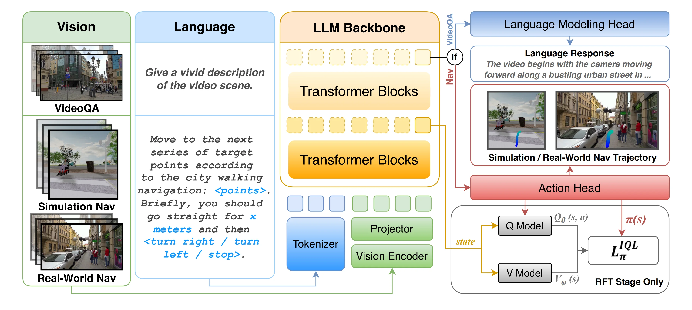
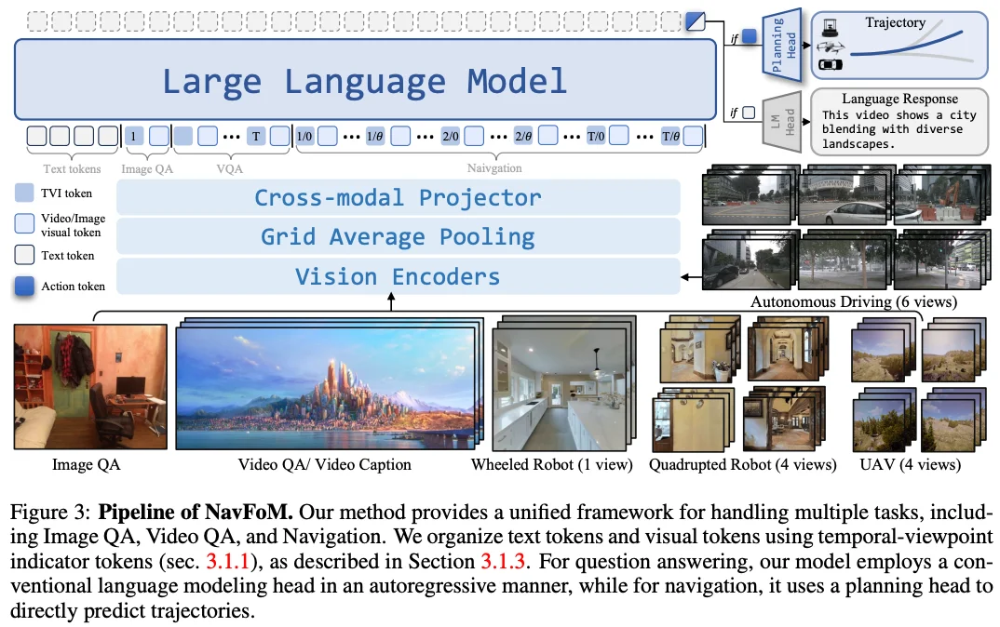
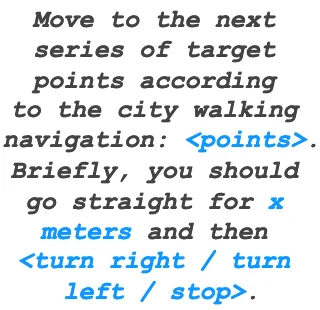
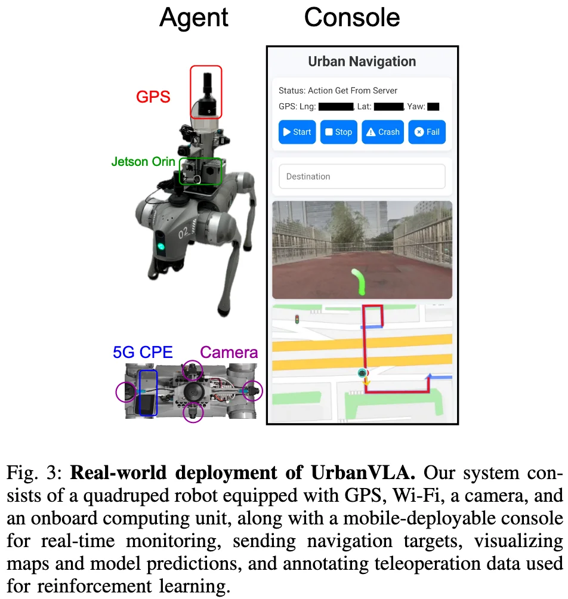

+++
date = '2026-03-23T10:40:08+08:00'
draft = false
title = 'UrbanVLA'
categories = []
tags = []
featured = false
+++

:(fas fa-award fa-fw):
:(fas fa-building fa-fw):
:(fas fa-file-pdf fa-fw):[arXiv 2510.23576](https://arxiv.org/abs/2510.23576)
:(fab fa-github fa-fw):

:(fas fa-globe fa-fw):[UrbanVLA-Web](https://pku-epic.github.io/UrbanVLA-Web/)
:(fas fa-blog fa-fw):

## TL;DR

we propose UrbanVLA, a route-conditioned VLA framework designed for scalable urban navigation.

## Motivations

- **T raTra**

## Approach

### Model

#### Base Model: NavFoM

- 通用导航基座模型 (cross-embodiment)
- vs UrbanVLA: Urban Micromobility

  <b>Base Model:</b> 
  

#### Input
- temporla multi-view images
- high-level roadbook instructions: high-level target route formulated by a sequence of 2D coordinates (waypoints) sampleed from the target route under the current egocentric frame.

#### Output
- Navigation tasks: capture the generated action token at the current time step and decode it through an MLP-based action model to obtain the navigation trajectory (waypoints under the current egocentric frame).
- VideoQA tasks: autogressively generates a set of language tokens, which are then decoded through the language model head.

#### Vision Encoder
- **pre-trained** DINOv2: 纯视觉自监督模型，细粒度图像特征
- **pre-trained** SigLIP: 图文对比学习模型，图像和文本对齐的语义信息
- concatenate in the channel dimension

#### Vision-Language Adapter
grid pooling (减少token 数量) -> two MLPs (减少 token 特征长度)

#### LLM backbone
pre-trained Qwen2

#### High-level Route Prompt Template
apply a prompt template to encode high-level roadbook instructions into text.

  

**How to Design the Prompt Template?**: Given a high-level navigation route: 
1. resample the upcoming 40m of the route trajectory at a distance of 2m -> resulting in 20 waypoints
2. convert them into the robot frame. -> a set of waypoints sampled from the high-level route provides the agent with the overall geometry and orientation of the forthcoming path.
3. -> distance and direction instructions for the next turn (for example, ‘turn right in 30 meters’) convey essential information to transition between blocks, a critical scenario for successful urban navigation.
    - when training, we apply a corner detection algorithm to segment the route into blocks and then derive block-level distance and direction cues from these segments
    - when real-world inference, this information can bu directly acquired from the API of the city navigation tool.
4. formulate the above information into an instruction template -> obtain the navigation instruction.

**Why do we design the prompt template like this?**:
- can be interpretable by VLA models.
- aligned with the data schema of the prevalent urban navigation tools (e.g., Amap). 

### Training Recipe

#### Supervised Fine-tuning (SFT)

learns essential urban navigation capabilities such as goal-reaching, collision avoidance, and social compliance.

- route-conditionednavigation task: using trajectories from the MetaUrban simulator and Sekai web navigation videos.
  - Sekai-Real（来自 YouTube 的 walking / drone videos）里的 camera trajectories，是它们自己用结构恢复/相机追踪方法从视频里提取出来的；Sekai 论文写得很明确：他们对 Sekai-Real 使用了 state-of-the-art SfM 流程来提取 camera trajectories，并在多种方案里最终选了 MegaSaM 作为基线方法来做轨迹标注与优化。
- real-world VideoQA task: to enhance real-world scene understanding.
  - LongVU：https://vision-cair.github.io/LongVU/
  - Sekai：https://lixsp11.github.io/sekai-project/

#### Reinforcement Fine-tuning (RFT)

offline reinforcement fine-tuning on a sim-real aggregated dataset.

particularly in **collision avoidance and handling ambiguous cues**, we adopt an **offline RL** approach based on Implicit Q-Learning (IQL) [27], which is well suited for offline data and mitigates out-of-distribution action issues.

- refine the model using a sim-real aggregated dataset with IQL, enhancing robustness in real-world scenarios.
-  Implicit Q-Learning (IQL): offline RL algorithm

### Data Recipe

#### VideoQA dataset**
用于训练模型对真实世界的理解能力。
- LongVU
- Sekai

#### Urban Navigation Demonstrations
**Sources**: 
- urban navigation demonstrations generated by a PPO expert in simulation
- web-scale urban travel data that capture human navigation behavior in real-world environments.

**Heuristic Trajectory Lifting (HTL)**:
- Why? -> overfitting & generalizability
    - Real-world demonstrations typically provide only the ground-truth trajector
    - Simulators offer perfect route information generated by global planners such as ORCA.
    - 
- How?
    - Savitzky-Golay filter -> **denoise web trajectories**, while ORCA-generated trajectories are used directly.
    - The self-intersecting or otherwise low-quality paths are then **removed**.
    - detect significant turning points to form coarse waypoints, and the trajectory is split into segments accordingly.
    - each segment is perturbed with gaussian positional noise -> capture the ambiguity of real-world navigation.
    - noisy segments are smoothly merged and resampled in a fixed spatial step。 -> abstracted route.

based on this design, we collected a sim-real aggregated dataset comprising 2,400 episodes (approximately 40 hours) in the MetaUrban simulator using a PPO expert, along with roughly 8 hours of real-world demonstrations via human teleoperation.

#### 

## Real-World Deploy

  

- a quadruped Unitree Go2robot
- GPS
- four cameras mounted on its front, left, right, and rear sides.
- 5G
- an onboard computing unit (Jetson Orin)
- a mobile-deployable console for real-time monitoring, sending navigation targets, visualizing maps and model predictions, and annotating teleoperation data used for reinforcement learning.
- software
    - model runs on a 4090 remote server, which communicates via Web-ADK with a Unitree Go2 robot.
    - The system operates at 2 Hz, which is sufficient for smooth and responsive navigation.
    - High-level route instructions are obtained from Amap via its Web API, while a GNSS module provides the position and orientation of the quadruped in real time.

## Experiments

8 NVIDIA H100 GPUs for approximately 12 hours.
