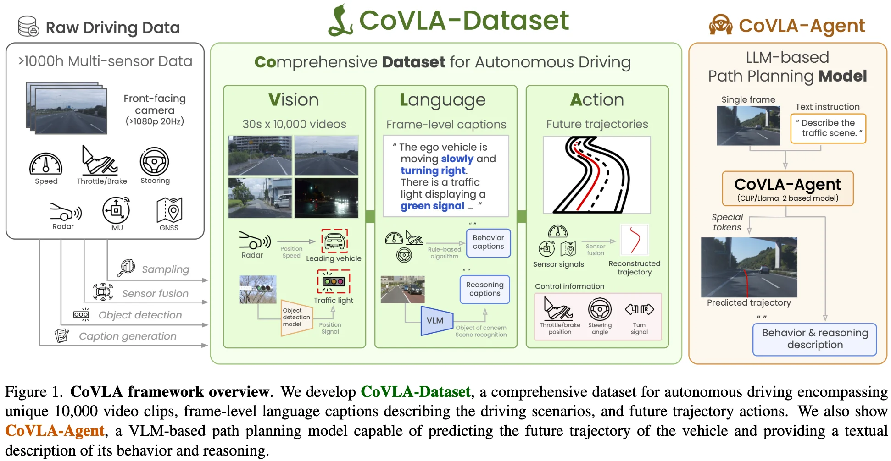

+++
date = '2026-03-30T11:31:46+08:00'
draft = false
title = 'CoVLA: Comprehensive Vision-Language-Action Dataset for Autonomous Driving'
categories = []
tags = []
featured = false
+++

:(fas fa-award fa-fw):WACV 2025, Oral
:(fas fa-building fa-fw):Turing Inc.
:(fas fa-file-pdf fa-fw):[arXiv 2408.10845](https://arxiv.org/abs/2408.10845)
:(fab fa-github fa-fw):
[turing-motors/CoVLA-Dataset](https://huggingface.co/datasets/turing-motors/CoVLA-Dataset)
:(fas fa-globe fa-fw):[covla-ad](https://turingmotors.github.io/covla-ad/)
:(fas fa-blog fa-fw):

## TL;DR

## Motivations & Innovations

## CoVLA-Dataset

### Raw Data Collection

### Data Sampling

### Auto Labeling

### Auto Captioning

### 

## Approach

### Model

### Training Recipe

### Data Recipe

## Experiments

