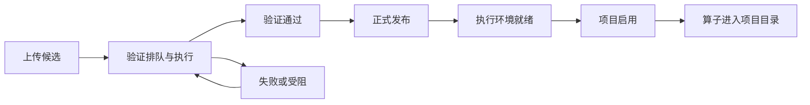

# 路由 数据与接口契约

以 `source/apps/web/src/pipelines-api.ts`、`plugin-releases-api.ts`、`deployments-api.ts`、`media-api.ts`、`platform-api.ts` 的请求为准。后台参考在 `source/apps/api/app/`。此处为复刻所需的调用关系，不把截图夹具当成生产响应。

## 1 路由和 URL 状态

| 页面 | 规范路由 | 兼容路由 |
| --- | --- | --- |
| 流水线 | `/projects/:projectId/pipelines` | `/pipelines?project_id=...` |
| 算子与插件 | `/projects/:projectId/operators` | `/operators?project_id=...` |

流水线搜索参数：`pipelineId`、`runId`、`view=builder|runs|versions|new`、`template=video|text`、`version`、`q`、`status`、`page`、`operator_id`、`operator_version`。默认进入列表，有 pipelineId 进入详情；有 runId 而无 pipelineId 时解析所属流程。

算子页搜索参数：`view=development`、`releaseId`、`pluginId`、`q`、`offset`，不带 view 时为算子库。算子库的名称/分类/模态筛选是本地 state，不写 URL。

旧路由 normalize 规则见 router.tsx：项目 ID 不接受 `*`，大部分对象 ID 长度≤80，搜索词≤200，page/version 为正安全整数，offset 为非负安全整数；operator_version 会转字符串。规范项目路由当前直接透传 search，不能假设它已经应用相同归一化。

项目选择优先路径 projectId，其次旧链接 project_id，其次用户项目 scope，最后 demo。源代码中部分内部链接仍使用兼容路由，要一并支持。

示例：

```text
/projects/demo/pipelines
/projects/demo/pipelines?view=new&template=text
/projects/demo/pipelines?pipelineId=flow-1&view=builder
/projects/demo/pipelines?pipelineId=flow-1&view=runs&version=2&runId=run-1
/projects/demo/pipelines?pipelineId=flow-1&view=versions&version=1
/projects/demo/pipelines?view=new&operator_id=documents.filter&operator_version=1.0.0
/projects/demo/operators?view=development&pluginId=example.documents&releaseId=release-1
```

## 2 核心数据模型

完整 TypeScript 类型在 `pipelines-api.ts` 和 `plugin-releases-api.ts`，不要丢弃 API 未在此摘要列出的字段。

| 对象 | 必须保留的字段及关系 |
| --- | --- |
| OperatorManifest | id/name/version/plugin_id/description/kind；input_type、input_ports、output_type；config_schema/default_config；deterministic/side_effects/cacheable/retry_safe；implementation_digest；execution_protocol/execution_scope/batch_size |
| PipelineNode | id、operator、version、config、inputs、可选 position |
| PipelineGraph | nodes 数组；inputs 中 key 为输入端口，value 为上游 node ID |
| Pipeline | id、name、description、version、graph、created_at、updated_at、versions、latest_version、latest_run |
| GraphValidation | valid、errors 字符串数组、order 拓扑节点 ID 数组 |
| PipelineRun | id、pipeline_id/name/version、status、时间、error、tasks、artifacts；取消/重试/对账标志；mode、execution_plan、operator_snapshot |
| PipelineTask | id/node_id/operator/status；input_count/output_count/duration_ms/error/artifact_id；可选 progress |
| PipelineArtifact | id/run_id/node_id/type/record_count/content_hash/metadata/records；parent_artifact_ids/cache_origin_id/created_at；has_more、可选 manifest |
| PipelineExecutionPlan | mode/version/targets/node_ids/graph；semantic_digest/plan_digest；sample 的 limit/fixed/sources；warnings/blocked |
| PluginRelease | id/project_id/plugin_id/version；wheel_filename/sha256；manifest/test_cases；status/validation_id/validation_status；runtime_digest/sdk_bundle_digest/deployment_state/active；时间 |
| PluginValidation | id/release_id/status/report/error；制品与环境摘要；创建/开始/结束时间 |
| PipelineDeployment | id/name/revision/pipeline_id/pipeline_version；trigger_kind/interval_seconds/timezone/next_trigger_at/paused/use_cache；last_error/webhook_enabled/execution_snapshot |

最小图示例（具体算子版本必须来自当前项目目录，不应硬编码为所有环境适用）：

```json
{
  "name": "文本小样本流水线",
  "description": "固定文档到过滤结果",
  "graph": {
    "nodes": [
      {
        "id": "documents",
        "operator": "documents.inline",
        "version": "1.0.0",
        "config": {"records": [{"id": "sample-1", "text": "示例文档", "metadata": {}}]},
        "inputs": {},
        "position": {"x": 0, "y": 0}
      },
      {
        "id": "filter",
        "operator": "documents.filter",
        "version": "1.0.0",
        "config": {"min_length": 1, "contains": ""},
        "inputs": {"data": "documents"},
        "position": {"x": 0, "y": 240}
      }
    ]
  }
}
```

该示例说明结构；复刻创建节点时应深拷贝服务端 `default_config`，不以示例替换完整配置。

## 3 请求约定

- `apiUrl` 使用 `VITE_API_BASE_URL`；未设置时使用相对 API URL。
- Fetch 使用 `credentials: include`。写请求带 `Content-Type: application/json` 和 `X-CSRF-Token`。
- 经 `instrumentedFetch` 传递交互追踪上下文；保留 `data-track-id`、`data-track-label` 与动作关联。
- 项目从 query `project_id` 或项目路径显式传递，不能仅依赖服务端默认项目。
- 错误正文通常是 `detail`：字符串直接展示，数组整理 loc/msg，对象使用 errors/message；非 JSON 响应仍显示 HTTP 状态。以各 API client 的实际错误处理为准。
- 列表分页响应 `{items,total,offset,limit,has_more}`。流水线 client 为滚动升级兼容旧数组响应；插件分页直接使用新结构。

## 4 流水线和算子接口

以下未在路径内包含项目的接口均追加 `?project_id=<id>`；有其他参数则使用 `&`。

| 方法与路径 | 参数或请求体 | 页面用途 |
| --- | --- | --- |
| GET `/api/operators` | project_id | 当前项目可用算子准确版本 |
| GET `/api/operator-plugins` | project_id | 预装插件及 registered |
| POST `/api/operator-plugins/register` | `{plugin_id}` | 项目启用预装插件 |
| GET `/api/pipelines` | paginated=true, offset, limit=20, q?, status? | 目录搜索分页 |
| GET `/api/pipelines/:id` | project_id | 当前定义和历史摘要 |
| GET `/api/pipelines/:id/versions/:version` | project_id | 不可变历史定义 |
| POST `/api/pipelines/validate` | `{graph}` | 服务端图和配置校验 |
| POST `/api/pipelines` | `{name,description,graph}` | 新建，201 |
| POST `/api/pipelines/:id/versions` | `{name,description,graph,expected_version}` | 保存新版本，201；冲突 409 |
| POST `/api/media/demo-pipeline` | `{urls?}` | 创建七节点视频模板 |
| GET `/api/pipeline-runs` | pipeline_id；可加 paginated、offset、limit=20、pipeline_version、status | 当前流程运行记录 |
| GET `/api/pipeline-runs/:id` | project_id | 指定运行详情和旧链接解析 |
| POST `/api/projects/:projectId/pipelines/:id/run-plan` | version + RunOptions | 小样本执行预检 |
| POST `/api/pipelines/:id/runs` | version,use_cache,idempotency_key + RunOptions | 正式或调试运行，202 |
| POST `/api/media/runs/:id/cancel` | `{}` | 取消当前运行 |
| POST `/api/media/runs/:id/retry-submission` | `{use_cache:true}`，以后台原运行规则处理 | 恢复提交 |
| POST `/api/media/runs/:id/reconcile` | `{}` | 对账不确定提交 |
| GET `/api/pipeline-artifacts/:id` | project_id | 预览、元数据和血缘 |
| GET `/api/pipeline-artifacts/:id/export` | project_id | 完整下载 |
| POST `/api/pipeline-artifacts/:id/dataset` | `{name}` | 从正式文档产物导入候选数据集 |
| GET `/api/projects/:projectId/environments` | 无 | 执行环境与池选择 |

`RunOptions` 包括 mode、targets、sample_limit、plan_digest、use_cache、environment_id、worker_pool_id。正式运行提交固定 current.version；调试必须携带预检计划摘要。服务端对同幂等键、不同内容拒绝冲突。

`retryMediaSubmission` 的函数名虽含 Media，也被流水线详情复用；不要仅按名字误删依赖。运行中心的 `/api/projects/:projectId/runs` 相关 client 也在文件中，但不是这两个页面的运行列表入口。

## 5 插件生命周期接口

均带 project_id。

| 方法与路径 | 参数或请求体 | 行为 |
| --- | --- | --- |
| GET `/api/plugin-releases/template` | project_id | 下载真实模板 Blob；失败给错误，不伪造空 zip |
| GET `/api/plugin-releases` | paginated=true,q,offset,limit=20,status?,plugin_id? | 版本目录及启用弹窗 |
| GET `/api/plugin-releases/:id` | project_id | 单个候选或正式版本 |
| GET `/api/plugin-releases/:id/validations` | project_id | 验证历史 |
| POST `/api/plugin-releases` | `{wheel_filename,wheel_base64,manifest,test_cases}` | 创建候选 |
| POST `/api/plugin-releases/:id/validations` | `{}` | 排队异步验证 |
| POST `/api/plugin-releases/:id/publish` | `{}` | 发布通过验证的固定制品 |
| POST `/api/plugin-releases/:id/activate` | `{}` | 环境 ready 后启用到项目 |



Release 状态：`candidate / validating / validated / validation_failed / published`。Validation 状态：`queued / running / passed / failed / blocked`。环境 `deployment_state` 与项目 `active` 是独立维度。服务端占用的版本身份不能由前端重复上传覆盖。

一个 PluginReleaseManifest 包含 id/name/description/version/sdk_version/operators。PluginTestCase 为 name/operator_id/config/input，以及 expected 或 expected_error `{type,match?}`。算子声明的详细 Schema、样例与 wheel 内实现一致性由服务端验证；前端只做文件/JSON/必填的初步校验。

## 6 部署接口

| 方法与路径 | 主要请求 | 行为 |
| --- | --- | --- |
| GET `/api/pipeline-deployments` | project_id,pipeline_id | 当前流程部署 |
| POST `/api/pipeline-deployments` | name,pipeline_id,pipeline_version,trigger_kind,timezone；可选 interval_seconds,first_trigger_at,environment_id,worker_pool_id；input_configs | 新不可变部署 |
| POST `/api/pipeline-deployments/:id/state` | `{paused}` | 暂停或启用 |
| POST `/api/pipeline-deployments/:id/trigger` | `{event_key}` | 幂等手动触发，返回 run_id |

后端另有 `/:id/backfill`、`/:id/triggers`、`/:id/events`，对应分区补跑、触发历史和认证数据到达事件；本次 UI 没有将它们全部做成可操作页面。

## 7 权限矩阵

| 权限 | 前端门禁 |
| --- | --- |
| pipelines:read | 访问两页、列表和详情、对账提交入口 |
| pipelines:write | 创建和编辑、校验、保存、导入、部署暂停/启用 |
| pipelines:run | 正式运行、小样本调试、重试提交、部署触发 |
| pipelines:cancel | 活动运行取消 |
| operators:develop | 上传和验证插件候选 |
| operators:publish | 正式发布插件 |
| operators:register | 启用插件、模板所需算子注册 |
| data_platform:write | 成功正式文档产物导入候选数据集 |

创建部署同时需要 write 与 run。权限以**目标项目**解析；按钮 disabled/隐藏不能替代服务端检查。申请按钮带目标项目和权限跳到权限入口。

## 8 持久化与刷新

| 数据 | 存放和生命周期 |
| --- | --- |
| 流程图、配置、名称 | React draft；保存后进入后端不可变版本 |
| 编辑撤销历史 | React state，最多 50 个先前图；保存或加载最新清空 |
| 字段无效文本 | React rawFields，按 nodeId:field 保留；不会写到后端有效图 |
| 目录条件 | URL + sessionStorage `pipeline-directory:<project>` |
| 正式提交意图 | sessionStorage `pipeline-submit:<project>:<pipeline-or-new>:<version>` |
| 调试提交意图 | sessionStorage `pipeline-debug-submit:<project>:<pipeline>:<version>` |
| 产物候选导入 | sessionStorage `pipeline-artifact-dataset:<project>:<artifact>` |
| 插件候选草稿 | localStorage `flywheel.plugin-candidate.v1:<encoded-user>:<encoded-project>` |
| 插件文件内容 | 内存 File，不在 localStorage 持久化 |

| 轮询对象 | 周期与条件 |
| --- | --- |
| 流水线目录 | 本页含活动 latest_run 时 2000ms |
| 流程运行、运行历史、单次运行 | 活动或 cancellation_pending 时 1500ms |
| 插件版本目录和详情 | validating/queued/running 时 3000ms |
| 验证历史 | release 或任一 validation 活动时 3000ms |
| 部署 | 折叠区展开挂载期间 10000ms |

TanStack Query key 必须包含项目和对象范围。保存失效目录并更新当前定义；启用插件失效目录/插件/发布/详情；运行变更更新单次运行并失效对应运行列表。代码通过 mutation lock 和 ref 同时防重复，不仅依赖按钮视觉 disabled。

## 9 复刻实现边界

如果仅交付前端，可把这些契约实现为独立 mock adapter，保留真实 API adapter 便于替换。mock 必须有 loading、error、empty、权限不足和生命周期状态，保留版本不可变、同意图重试、项目隔离和分页。不能用一个 setTimeout 把所有运行和验证都改成成功，再宣称业务已实现。

接入真实后台时需要原完整仓库及其鉴权、数据库、Worker、Dagster、容器和媒体依赖。包内后端摘录用于查明语义与限制；未包括配置秘密、数据库、已安装依赖、模型或运行制品。
