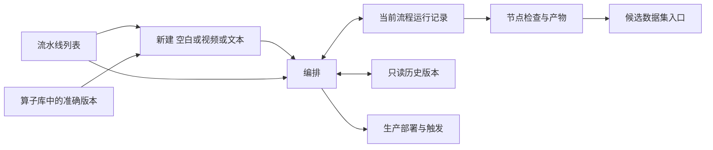

# 数据流水线与算子插件实现说明

复刻目标是当前前端行为。核心源码已原样收录在 [CORE_SOURCE.md](CORE_SOURCE.md)，完整依赖在 `source/`；[SOURCE_INDEX.md](SOURCE_INDEX.md) 提供函数入口。下文按用户操作列出实现，不把后台已有接口自动算作页面已有功能。

## 1 技术组成与共同外壳

React 19、TypeScript、Vite 6；TanStack Router 管理地址与视图，TanStack Query 管理服务端数据；Base UI 提供 Dialog、AlertDialog、Menu、Tabs、Popover；React Flow `@xyflow/react` 提供画布；Lucide 提供图标。Tailwind 4 与全局 Material 3 样式共同作用。声明版本与实际安装版本可能不同，迁移时使用随包锁文件，不自行用最新版本替代。

全局界面是浅灰底、白色主工作区、蓝色主操作。桌面左侧导航宽 232px，顶部工具行高 48px；主区域有圆角、面包屑、通知和账号菜单。小于 1024px 时全局导航改为抽屉。项目上下文和权限由 `App.tsx`、`AppNavigation.tsx`、`ProjectContext.tsx`、`auth-context.tsx` 提供。

两个页面分别有 `pipelines:read` 访问门禁；无权限显示申请入口。所有请求、缓存及对象定位带项目，切账号或项目重新挂载相关工作区。顶部通知和账号行为保留在共享外壳源码中。

## 2 流水线页面与导航

`ProjectPipelinesPage` 决定列表、新建或详情。兼容仅带 `runId` 的旧链接：先查运行，再定位所属流水线。详情中跨页运行会被拒绝展示，提示「该运行不属于当前流水线」。详情切 Tab 保存各 Tab 的运行、版本、分页和状态上下文；编排面板使用 `keepMounted`。

### 2.1 流水线列表

实现：`PipelineList`。

| 操作或区域 | 当前实现 |
| --- | --- |
| 标题 | 数据流水线；说明「管理流程定义、版本和运行。」 |
| 主操作 | 有 `pipelines:write` 时显示「新建流水线」 |
| 搜索 | 名称或说明；输入立即写入 URL `q`，重置分页，`replace: true` |
| 状态筛选 | 全部、暂无运行、待执行、运行中、已完成、失败、已取消 |
| 表格 | 流水线名称与说明、版本、最近运行、更新时间、打开操作 |
| 最近运行 | 点击状态进入这次运行；取消待确认时显示「取消中」 |
| 分页 | 服务端分页，每页 20；显示总数和当前页；请求中禁用翻页 |
| 返回目录 | 用 `sessionStorage` 恢复当前项目的搜索、状态和页码 |
| 自动刷新 | 本页有活动运行时每 2 秒刷新；结束后停止 |
| 异常与空状态 | 加载、错误与重试、首次创建、无筛选结果、后续页变空分别处理 |

列表右侧有算子与插件入口。没有编辑权限时提供申请入口。当前没有流水线删除、批量选择、收藏或列表排序控件。

### 2.2 新建与模板

实现：`NewPipeline`、`TextPipelineTemplate`。

- **空白流程**：名称输入、流程说明按钮、空画布、算子面板；先添加算子和命名才能保存。名称 UI 最大 120 字符，说明最大 2000 字符。
- **视频处理模板**：可留空使用平台示例，也可按空白字符分割输入 YouTube 链接。调用 `createDemoPipeline` 后进入已保存流程，不自动运行模型。七个节点依次为 YouTube 接入、AutoShot、关键帧、人物分割、SigLIP2、豆包视频向量、Milvus 索引。创建需要流程编辑及算子注册权限。
- **文本调试模板**：每行一条固定文档，忽略空行，ID 为 `sample-1` 等；注册 `documents.core` 后按返回的准确版本创建 `documents.inline → documents.filter`，文档带空 `metadata`。默认显示两条固定文档。创建成功进入编排。
- **从算子创建**：算子卡片带 `operator_id` 与 `operator_version` 跳入空白流程；目录加载后只添加一次该版本。未启用时显示具体错误，不换用其他版本。

### 2.3 详情头部与工具栏

头部显示完整名称、独立的修改名称按钮、最新版本徽标、项目名，以及「编排／运行记录／版本」。修改名称按钮会转到编排并打开流程信息对话框；信息修改先进入草稿，随下一版本保存。

工具栏从左到右为算子面板、参数面板、保存状态；右侧为执行环境、撤销、重做、校验、保存版本、正式运行及更多菜单。根据权限、忙碌状态、有效性和运行状态禁用或隐藏。

更多菜单包括：流程信息、复用节点缓存（默认开）、导出流程定义、导入流程定义。导出包含 `name/description/graph`，UTF-8 JSON 两空格缩进，以流程名命名。导入只在有编辑权限、非忙碌、无脏草稿时可用；最大 2,000,000 bytes，检查节点身份、版本、配置与输入结构。导入替换当前草稿、补位置、选中第一个节点、清理字段错误，并可撤销图变化。

### 2.4 编辑状态与撤销

`PipelineEditor` 分开保存服务端基线 `current`、编辑对象 `draft`、`dirty`、图历史、选中节点、字段原始文本、无效字段、校验报告、错误和提示。不要把所有数据压成一份后直接覆盖。

图历史含 `past/future`，常规编辑最多保留 50 个先前图。新增、删除、连线、配置、位置、自动布局与导入图可以撤销；一次拖拽不会为每一个鼠标移动新增历史。撤销/重做会清理字段临时文本，选中节点不存在时取消选择。名称和说明不属于独立的图历史栈。

快捷键在非输入区生效：Ctrl/⌘ Z 撤销，Ctrl/⌘ Shift Z 或 Ctrl Y 重做。按钮随历史栈和编辑权限变化。

编辑会使 `dirty=true`，清空旧校验结果与成功提示。无效 JSON 的文本也会使页面进入脏状态，且不能被最后一份有效配置静默替代。导航离开有阻止弹窗「继续编辑／放弃修改并离开」，浏览器卸载使用原生离开保护。流水线图草稿本身没有跨刷新自动恢复机制；插件文本草稿另有持久化。

### 2.5 算子面板与新增节点

按当前项目启用目录列出**每一个算子版本**，搜索名称或 ID，显示名称、kind 中文和版本。没有注册算子时给出算子页链接。

新增节点的 ID 取算子 ID 最后一段，重复时补 `_2`、`_3`；配置深拷贝 `default_config`。如果已选择一个节点，尝试连接到新节点第一个兼容输入端口；不兼容或未选上游时保持未连接并提示。具名多输入仅自动连接一个端口，其他端口需继续配置。

### 2.6 DAG 画布

实现：`PipelineCanvas.tsx` 与 `pipeline-graph.ts`。

| 部分 | 实现细节 |
| --- | --- |
| 图模型 | 只有 `nodes`，边从每个节点的 `inputs` 派生；不独立存边数组 |
| 节点卡 | kind 图标、名称、节点 ID、算子版本、输出类型、配置或检查按钮 |
| 端口 | 输入位于顶部，按具名端口均匀分布；输出位于底部，ID 固定为 `output` |
| 多输入 | `input_ports` 优先；否则 `input_type` 映射到 `data`；source 无输入 |
| 边 | `smoothstep`，端口名标签，主色 1.6px；ID 为 `source:target:port` |
| 初始视口 | 编辑画布 `{x:40,y:50,zoom:0.85}`；运行画布 fitView，padding 0.2 |
| 缩放 | 0.15 至 1.5；左下放大、缩小、适配；右下可平移缩放 MiniMap |
| 背景 | 点阵间距 18、点大小 1；使用主题边界色 |
| 移动 | 节点位置存入定义；读模式不可拖动 |
| 删除 | 选中边或节点后 Backspace/Delete；删节点同时清除其他节点引用它的输入 |
| 自动排布 | 按最大上游深度纵向分层，同层横排；横距 290，编辑纵距 240，运行默认纵距 300 |
| 点击空白 | 清除选中节点和画布错误 |
| 只读 | 禁止连线、拖动和删除，保留节点检查、平移缩放 |

连线校验拒绝：不存在节点、自连接、算子准确版本不可用、sink 有下游、source 接上游、端口不存在、未选择多输入端口、输入输出类型不完全相同、形成循环。连接同一个目标端口会替换该端口的上游，保留其他端口和配置。参数区上游下拉与拖线调用同一校验函数；不可选项显示原因。

服务端另校验 1–40 个节点、合法唯一节点 ID、有效坐标、项目启用版本、配置类型、输入端口完整且无多余项、拓扑顺序。前端不能取代这一层。

### 2.7 参数面板与 Schema 表单

参数区顺序为：有运行权限时的小样本调试、算子标题与删除、节点选择、折叠说明和类型、上游端口、配置模式切换、字段、缓存与重试说明。

| Schema 情况 | 控件 |
| --- | --- |
| boolean | checkbox |
| integer / number | number input；整数 step 1，其余 any；min/max 来自 Schema；空值阻止保存 |
| enum | select；用原 enum 值回写，保留数值等 JSON 类型 |
| string | 文本输入 |
| object / array | 多行 JSON；字段 `records` 为 15 行，其余通常 5 行 |
| nullable | 「使用空值（null）」checkbox；取消后采用默认值或对应类型空值 |
| required | 必填说明；最终验证由服务端执行 |
| 本地 `$ref` | 解析 `#/...`，支持 JSON Pointer 转义；递归及非本地引用提示 JSON 编辑 |
| `allOf` | 合并字段和 required 集合 |
| `anyOf/oneOf` | 表单选择第一个非 null 分支；完整组合配置可改用 JSON 编辑 |

字段中文名优先来自 `fieldLabels`，再使用 Schema title，最后原字段名；显示 description。字段错误按 `nodeId:field` 保存；切换节点后仍能看到无效文本。

完整 JSON 模式要求顶层对象，不能是 null 或数组。JSON 无效时切回表单会提示修正，或显式「丢弃无效文本并返回表单」。丢弃仅处理当前节点这份完整 JSON，其他节点未完成编辑继续保留。顶部错误条带「修正 节点 · 字段」定位按钮。

执行说明使用显式 `cacheable/retry_safe`，未声明时回退 `deterministic && !side_effects`；展示外部写入、有界分批、缓存和重试提示。`batch-v1` 显示 batch_size，缺省 500。

### 2.8 校验 保存 冲突

校验按钮在有节点、无字段错误、非忙碌且有编辑权限时可用。服务端返回 `{valid, errors, order}`；成功显示可执行节点数，失败列出错误。

新建调用创建 API；已有流程保存提交 `expected_version=current.version`，生成新版本。保存成功重置 dirty、图历史与原始字段文本，更新缓存及目录。没有变化时保存按钮禁用。

后台出现更新版本：干净编辑器自动加载；有草稿时显示冲突条。可「加载最新版」替换本地草稿并清空历史，也可「保留草稿」仅提升保存基线，再把整份草稿保存为新版本。不会逐字段自动合并。409 保存冲突会触发最新定义读取。

### 2.9 正式运行与执行目标

正式运行必须对应已保存版本。未保存、无效配置、发现更高版本、运行状态未确认或提交记录损坏时不能新建运行。当前版本已有 pending/queued/running/cancelling，或取消仍待确认的运行时，按钮变为「查看运行」。

执行环境是 Popover：默认本地；展开后请求可授权环境；可选择环境与 Worker Pool，切环境清空池。运行选择过滤 disabled 环境、池及 runtime，自动选择兼容资源池。提交冻结目标和缓存开关。

一次点击生成 UUID 幂等键并写入 sessionStorage；双击锁和 mutation pending 共同防重。失败后保留该键、版本、缓存和环境，显示「重试同次提交」；刷新后恢复这次意图。成功获得运行后清除意图并转运行详情。不要把网络失败自动转为另一次新运行。

### 2.10 小样本调试

实现：`PipelineDebugControls`。默认每源 20 条，范围 1–100 整数；选择已保存目标节点，先「预检调试计划」，再「运行到此节点」。目标及其依赖、固定输入 ID、语义摘要、执行计划摘要、警告由服务端计划返回。

切目标、样本数、执行资源或缓存策略会使旧计划失效；过时预检响应不会覆盖当前上下文。提交包含 `mode=debug`、targets、sample_limit、plan_digest，另有独立的 sessionStorage 幂等意图。明确的 4xx 失败清理计划和提交意图；网络/服务端不确定失败保留同次提交。

当前小样本执行范围是受支持的固定内联文档链；媒体流程虽能看到控件，预检仍由后端拒绝不支持的目标。不要把它实现成通用任意媒体调试。调试产物不能从这里导入候选数据集。

### 2.11 运行记录与节点检查

按当前流程过滤，支持版本、状态和每页 20 分页；左侧运行列表，右侧详情，窄屏上下排列。活动运行每 1.5 秒刷新，终态停止。URL 中保留选中运行和过滤条件。

详情显示流程名与运行版本、时间、ID 前 8 位、正式/调试模式、状态和错误。若有 `execution_plan`，显示计划摘要及只读运行图；选择节点联动检查区。旧运行没有计划时仍支持列表检查。

节点表为：节点 ID 与算子、状态、输入输出记录数、耗时。完成或缓存显示 `N → M 条`；未完成分别显示「输出待完成」「已提交输出」「输出未完成」。进度条只在数据有效且 total>0 时显示，支持帧/镜头/视频/记录单位，另列最近产物时间。零耗时显示 `—`，不足一秒、分钟、小时有对应格式。

检查区展示节点错误、算子和状态；有输出时读产物，无输出时解释当前状态；执行计划中上游已有产物时可查看已就绪输入。

- **取消**：pending/queued/running 且有 `pipelines:cancel`；取消请求记录后等待引擎确认，不立即当成终止。
- **重试提交**：pending、允许重试且有运行权限；恢复原运行提交。
- **对账**：`can_reconcile_submission` 或 `SUBMISSION_UNKNOWN`；读权限可用，不能用新运行替代。

### 2.12 产物与候选数据集

产物显示类型、记录数、内容指纹前 20 位、上游产物数量、缓存来源；元数据与血缘折叠，JSON 预览前 20 条，链接下载完整产物。documents 另有 ID/文本表格，超过预览范围提示下载。

上游产物按需递归展示，关闭它们的交付操作。候选数据集导入只对正式成功运行的文档产物开放，最多 1000 条，且需要 `data_platform:write`。名称默认「节点名 候选数据集」，最多 120 字符。请求失败且结果不确定时锁定原名称重试；成功显示新建/复用候选、源运行与产物、映射版本、质量结果、最多 5 条问题，并链接数据集详情。此操作不是直接发布数据集。

### 2.13 历史版本

左侧保存版本列表标记当前版本；右侧为名称、说明、只读徽标、节点与参数、完整图 JSON。「查看此版本的运行」进入按版本过滤的运行页。历史快照查询 `staleTime=Infinity`。

当前页面没有历史版本差异比较、恢复成草稿、在历史面板直接运行、节点版本升级或版本删除控件。部署表单可以选择历史流程版本，两者不要混淆。

### 2.14 生产部署与触发

详情下方折叠区「生产部署与触发」，展开才挂载内容并请求列表；展开期间每 10 秒刷新。

表格显示名称与修订号、固定流程版本、暂停/启用状态、触发方式、时区、下次触发及错误。编辑权限可暂停/启用；运行权限可手动触发未暂停部署；同次触发失败保留 event_key，成功清除并转运行。

创建表单需要编辑和运行权限：名称最多 160；固定版本；manual/interval/data；默认 Asia/Shanghai；固定间隔默认 3600 秒、最小 60、最大 31536000；可填带偏移的首次触发时间；环境、资源池；JSON 节点配置覆写。JSON 必须是「节点 ID → 配置对象」的对象。保存创建不可变部署；暂停只阻止后续触发，不取消已有运行。

数据到达 webhook 凭据由服务端配置，页面只有状态说明。分区补跑、触发历史有后端 API，但这两个页面没有完整操作视图。

## 3 算子库

实现：`OperatorsPage`、`ProjectOperatorLibrary`。页标题「算子与插件」，右侧「流水线列表」；页内两项 Tab 为「算子库」「插件开发」。开发工作区首次访问后 keepMounted，使表单状态在 Tab 切换时保留。

### 3.1 搜索 分类 模态

算子库一次读取当前项目启用的目录，**客户端过滤，没有独立分页**。搜索名称、ID、插件 ID、描述，忽略大小写。数量显示「匹配 / 全部 个算子」。

分类为全部、数据接入、解析与切分、清洗与去重、质量与筛选、模型推理与增强、数据输出、数据处理。source/sink/check 优先固定分类；其余按 ID+名称、再按描述匹配正则关键词，顺序以源码 `categorySignals` 为准，不是后端显式分类字段。

模态为全部、文本、图像、音频、视频、通用，按 input_type/output_type 和描述推断，可多选标签归属。筛选某具体模态时也包含通用算子。当前推断未遍历具名 `input_ports`，复刻时不要误称具有完整契约模态推断。

无结果提示调整条件并提供清除；未启用时提示启用插件及权限申请；失败显示错误和重试。

### 3.2 算子卡片

按 `id@version` 渲染：图标、类别、版本、名称、描述、输入→输出类型；展开「参数与执行契约」显示算子 ID/版本、插件、副作用/确定性概述以及 config_schema JSON。卡片的简要缓存文案只依据 side_effects/deterministic；编排参数面板另使用显式 cacheable/retry_safe。

「用于新流水线」带准确算子 ID 与版本进入当前项目新流程。没有算子独立详情路由，也不提供编辑 Python、在线构建、卸载或算子删除。

### 3.3 项目启用弹窗

「启用插件」打开对话框，说明现有流程快照不变。进入时才读取预装插件与已发布版本。没有注册权限仍可查看，但动作禁用并显示申请。

已发布部分服务端按插件 ID/版本搜索，每页 20；每卡显示名字、版本、执行环境状态、说明、插件 ID、包含算子。展开预览可用能力；已启用后可直接将准确算子用于新流程。

只有 `published`、`deployment_state=ready`、未 active 且有注册权限时能启用；「查看验证记录」跳到对应开发详情并关弹窗。预装插件部分显示名称、registered 状态、版本与算子；未注册可启用。同插件同版本若出现在当前已发布列表会从预装列表去重。

启用使用共享锁避免重复动作，完成后失效更新目录、插件、发布列表与详情缓存。

## 4 插件开发

### 4.1 版本目录

顶部「插件版本」与说明、下载开发模板、新建插件版本；存在草稿时新建按钮文案改为继续编辑草稿，并提示发现未提交草稿。创建和验证需要 `operators:develop`。

两列布局：左侧按 `plugin_id` 分组的版本列表，右侧选择详情。顶部全部插件/精确插件身份切换；支持显式提交搜索和分页，URL 保存 q、offset、pluginId、releaseId。所选详情不在本页时继续保留详情并提示。活动验证每 3 秒轮询列表。

区分首次空目录、搜索无匹配、加载中、错误、未选择版本；首次空目录提供模板/上传入口，不展示空分页。列表错误和详情错误分别可重试。

### 4.2 新建候选工作区

实现：`PluginCandidateForm`。这是**全屏对话工作区**，固定标题、内部滚动表单、步骤锚点和粘性提交区域，不是普通小弹窗。

三段依次为：准备文件，检查声明，检查测试。文件包括 wheel、manifest.json、test_cases.json；可导入后修改文本。声明字段为 ID、名称、版本、SDK 版本（默认 `1`）、说明；声明及样例先显示数量和前 8 个名称，高级 JSON 编辑默认折叠。

| 限制 | 前端实现 |
| --- | --- |
| wheel | 需选择 `.whl`，最多 8 MiB |
| 导入 JSON 文件 | 每个最多 1 MiB |
| manifest | 包含 operators 数组；读入 identity；正式提交要求 ID/名称/版本非空 |
| operators 与 test_cases | 必须是非空合法 JSON 数组；服务端继续检查实际契约 |
| 请求体 | wheel Base64 与 JSON 总共最多 12 MiB |
| 忙碌 | 文件读取或上传中禁用表单与关闭，提交锁防双击 |

上传是 JSON 请求，不是 multipart。成功创建候选后关闭表单、清草稿、选中新增 release 与 plugin；不会自动验证、发布或启用。

### 4.3 草稿保护

localStorage key 为 `flywheel.plugin-candidate.v1:<encoded-user>:<encoded-project>`。保存 identity、operators 文本、cases 文本、wheel 文件名，不保存 wheel 内容。关闭后同一挂载组件可保留 File 对象，离开/刷新重挂载后必须重选文件，并明确提示恢复文件名。

关闭或 Escape 遇到脏草稿，显示 AlertDialog：「放弃草稿／继续编辑／保留并关闭」，初始焦点在继续编辑。存储不可用显示错误；有已选 wheel、忙碌或存储失败且有修改时使用 beforeunload。按账号与项目隔离草稿，清除必须由显式放弃或成功上传触发。

### 4.4 版本详情与门禁

显示名称/版本、插件 ID、说明、状态；生命周期五步是候选制品、验证通过、正式发布、环境就绪、项目启用。不是只按单个字符串画一条成功进度条，每一步分别取实际字段。

| 情况 | 主提示及操作 |
| --- | --- |
| 候选未验证 | 运行验证；发布和启用禁用 |
| queued/running/validating | 等待 Worker 或结果；自动更新，禁用重复验证 |
| validation_failed | 看失败项并修正；环境恢复后可重验，改内容需新版本 |
| validated 且 validation_status=passed | 可正式发布；未发布不能启用 |
| published 且环境未 ready | 联系管理员准备环境；可刷新环境状态 |
| published 且 ready | 有权限可启用到项目 |
| active | 已可编排，按钮为项目已启用，提供流水线入口 |

验证、发布、启用共享动作锁；状态只有成功请求后刷新得到，不预先假定成功。发布权限为 `operators:publish`，启用为 `operators:register`；缺少权限有申请链接。

详情可展开所含算子、manifest 与测试样例。底部显示 wheel 文件名、创建/发布时间、环境状态、wheel SHA-256、runtime digest、SDK digest。

### 4.5 验证记录

实现：`PluginValidationReport` 与 `ValidationBody`。当前验证优先按 `release.validation_id` 匹配，找不到用列表首条；其他验证折叠成历史。验证中每 3 秒读取 release 与 validations，另有手动刷新。

报告先显示检查总数、通过、失败、未知数量；只有布尔 `true/false` 才能归为通过/失败，缺失或字符串结果显示「结果未提供」。逐项列名称、状态、算子 ID、消息、输出数量；常见英文消息翻译为中文。

失败项按 **样例名与 operator_id 同时匹配**，可展开预期与实际左右对照；缺失数据给出原因。原始报告 JSON 与验证日志分别折叠。没有 report 时 queued/running 显示等待说明；错误独立展示。

当前没有在详情上直接编辑已提交候选、自动生成修订候选、插件退役、停用项目版本或删除发布记录的按钮。

## 5 视觉与自适应规格

**完整复制 CSS 顺序比重写近似样式更可靠**：`App.css → fonts.css / shared UI → pipelines.css → plugins.css`，部分规则在文件后半覆盖旧定义，不能只取前面的尺寸。

| 项目 | 当前基线 |
| --- | --- |
| 主色 | `#0b57d0`，主色容器 `#d3e3fd` |
| 页面表面 | 白色；低层容器 `#f8f9fa`，搜索底 `#e8eaed` |
| 正文与次级文字 | `#202124`、`#5b5f63` |
| 错误 | `#ba1a1a`，错误底 `#ffdad6` |
| 边界 | outline `#80868b`，outline-variant `#dadce0` |
| 字体 | Google Sans Flex、Roboto、PingFang SC、Microsoft YaHei、Noto Sans SC 等回退；代码 Google Sans Code |
| 圆角 token | 4、8、12、16、28、9999px；按钮和搜索为胶囊 |
| 标题 | 页面/详情通常 24px / 32px / 400；窄屏详情可切 title-large |
| 按钮 | 外层触控区至少 48×48；内部容器沿 Material token；不能只按看见的填色高度实现 |
| 搜索栏 | 56px 最小高度，16/24 字体，24px 图标，左右 16px |
| 编辑列宽 | 算子 13rem，中间 minmax(0,1fr)，参数 20rem |
| 编辑宽度判断 | ResizeObserver 测实际工作区；小于 1120px 优先参数并收起算子，小于 720px 两侧改抽屉 |
| 编辑画布高度 | `max(25rem, 100dvh - 16rem)`；窄屏有 `max(24rem, 100dvh - 17rem)` 覆盖 |
| 插件开发列 | 左 `minmax(15rem,21rem)`，右余量；1000px 以下缩左列，700px 以下上下排列 |
| 上传工作区 | 100dvh，全宽；内容居中最大参考 68rem；内部滚动、步骤与提交区 sticky |

面板、Dialog、Menu 均保留键盘焦点、aria-label、aria-expanded、aria-controls、role alert/status；关闭窄屏面板恢复触发按钮焦点。动画尊重 prefers-reduced-motion。界面文案和状态必须共同保留，不能只用颜色表意。

## 6 容易误判为已实现的部分

| 现有事实 | 复刻边界 |
| --- | --- |
| 后端返回 waiting_reason、display_status、attempt 等 | 本页 RunDetail 主要消费 status、cancellation_pending、错误、计划、任务与产物；没有完整独立重试次数/调度详情面板 |
| 验证报告有日志 | 是插件验证日志；运行详情没有通用实时运行日志控制台 |
| 后端有补跑和触发历史接口 | 部署页面没有对应完整操作 UI |
| 有多输入及分支 | 不等于多输出端口，也不表示节点并行执行 |
| 版本列表可看历史 | 没有比较、恢复或直接运行历史版本的页面动作 |
| API 支持图定义 | 没有可见的节点重命名、节点版本升级、画布水平布局切换、面板拖宽或连线重接专用入口 |
| 候选上传成功 | 后续验证、发布、环境就绪、项目启用各自独立 |
| 文本草稿可恢复 | 指插件上传文本；流水线脏图不自动持久化 |

原代码还保留少量兼容行为：项目路由的 validateSearch 直接透传，旧 `/pipelines` 与 `/operators` 路由才执行完整参数归一化；草稿导航阻止条件里有对旧 `/pipelines` 路径的判断。若重构时调整这类行为，应作为明确差异记录，而不是声称完全一致。
