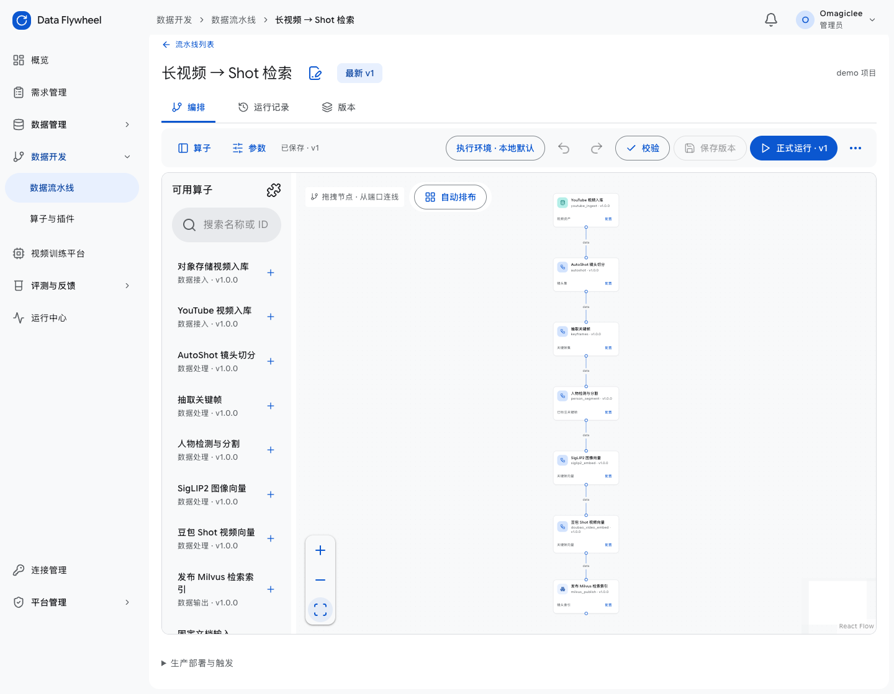
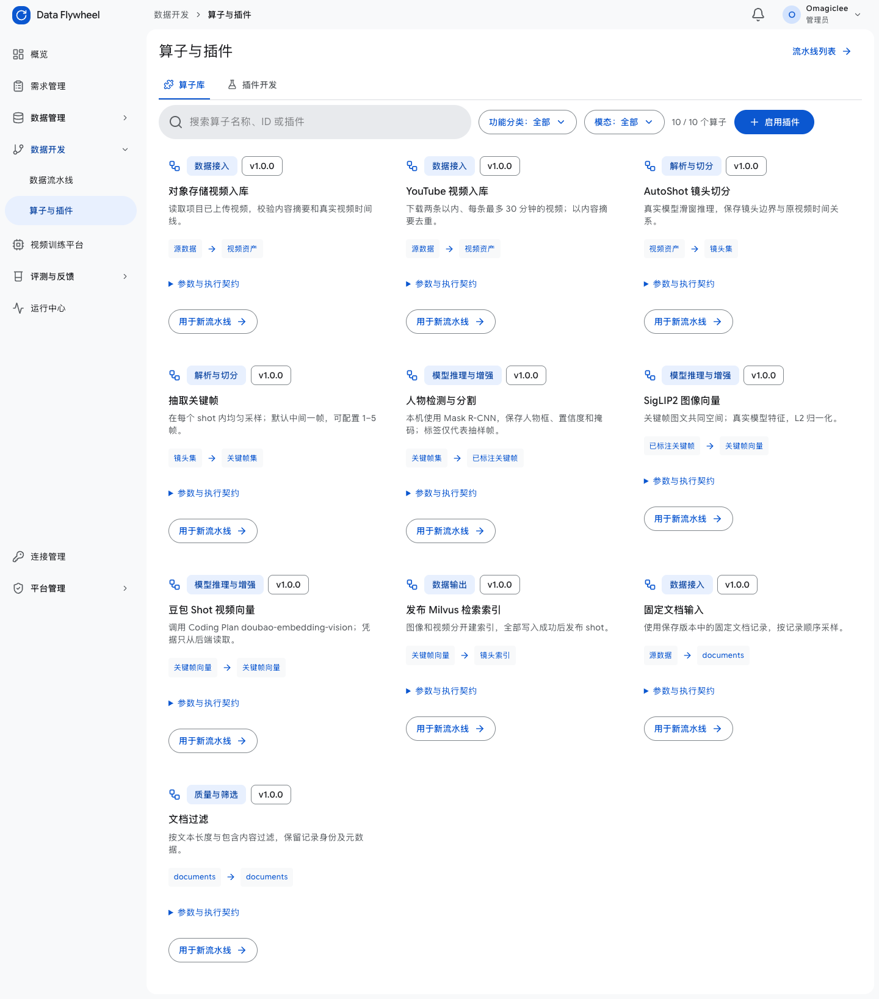
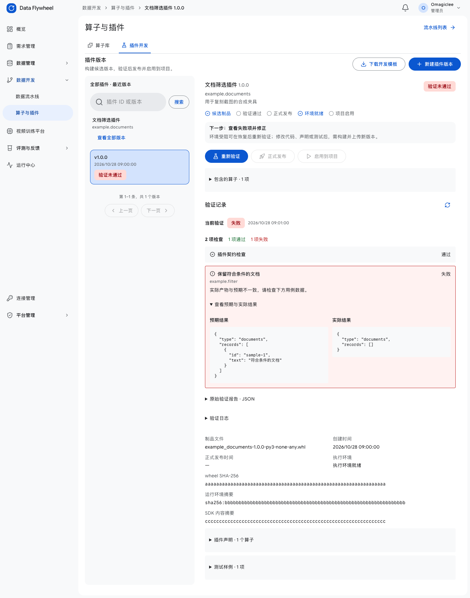

# 页面截图索引

截图来自现有 React 组件。桌面 1440×1000，部分为整页长图；手机 390×844。含 fixture 的场景使用合成 API 响应，只作为条件状态与视觉参考。

| 截图 | 场景 |
| --- | --- |
| [01-pipeline-directory.png](screenshots/01-pipeline-directory.png) | 真实临时 API 数据；无生产运行 |
| [02-pipeline-new.png](screenshots/02-pipeline-new.png) | 空白流程 |
| [03-video-template.png](screenshots/03-video-template.png) | 视频模板输入 |
| [04-text-template.png](screenshots/04-text-template.png) | 文本模板输入 |
| [05-video-builder.png](screenshots/05-video-builder.png) | 真实七节点视频定义，未执行模型 |
| [06-node-parameters.png](screenshots/06-node-parameters.png) | 节点参数与小样本调试控件 |
| [07-node-json.png](screenshots/07-node-json.png) | 完整配置 JSON 编辑 |
| [08-editor-menu.png](screenshots/08-editor-menu.png) | 导入导出与缓存开关 |
| [09-version.png](screenshots/09-version.png) | 历史只读定义 |
| [10-deployment.png](screenshots/10-deployment.png) | 部署修订表单，未创建触发器 |
| [11-operator-library.png](screenshots/11-operator-library.png) | 真实预装算子库 |
| [12-plugin-enable.png](screenshots/12-plugin-enable.png) | 项目插件启用对话框 |
| [13-plugin-development-empty.png](screenshots/13-plugin-development-empty.png) | 插件开发空状态 |
| [14-plugin-upload.png](screenshots/14-plugin-upload.png) | 真实上传表单，未上传 wheel |
| [15-plugin-validation-fixture.png](screenshots/15-plugin-validation-fixture.png) | 合成失败报告，仅展示真实组件的条件状态 |
| [16-plugin-published-fixture.png](screenshots/16-plugin-published-fixture.png) | 合成已发布并启用状态；不表示真实发布 |
| [17-run-artifact-fixture.png](screenshots/17-run-artifact-fixture.png) | 合成运行与文档产物，展示检查和候选交付；未执行正式运行 |
| [18-mobile-parameters.png](screenshots/18-mobile-parameters.png) | 390px 窄屏参数抽屉 |

## 视频流程编排

## 项目算子库

## 插件验证失败状态 使用合成响应

